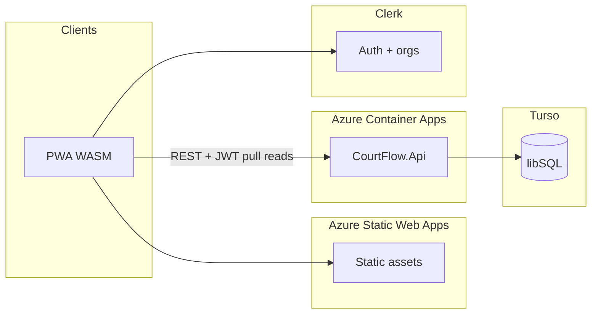

# CourtFlow — Azure stack, deployment, and CI/CD

> **Canonical copy in this repository.** Covers architecture, Turso migration, legacy DB cleanup, Azure provisioning, GitHub Actions templates, and go-live checklist. Keep in sync with the Cursor plan `azure_swa_hardening` (or treat this file as source of truth and refresh Cursor from it).

## Load pattern (drives design)

- **Season:** Most usage is **September through March**, **weekends only** (not a 24/7 or summer spike).
- **Concurrency:** Only **a couple of tournaments** at a time, not a nation-wide event with massive parallel writes.
- **Data freshness:** **No realtime** for now—**refresh** the UI and let the app **read from the API (and DB)** again. No Azure SignalR, no WebSocket hub in scope.

**Implication:** A **simpler, cheaper** stack: **pull-based reads** + **scale-to-zero API** is a strong match. You avoid SignalR **cost, limits, and integration** entirely. The main risks left are **cold start** (first request after idle) and **enough** rate limiting on public reads—not fan-out to thousands of websockets.

---

## Committed stack (locked)

| Layer | Choice | Notes |
|--------|--------|--------|
| **UI** | **Azure Static Web Apps** + Blazor **WASM** **PWA** | Free tier where it fits; Standard if you outgrow limits. |
| **API** | **Azure Container Apps** (containerized [`CourtFlow.Api`](../src/CourtFlow.Api/CourtFlow.Api.csproj)) | **Scale to zero** + **capped max replicas** + **budgets**. |
| **Data** | **Turso** (libSQL) | SQLite-compatible libSQL/EF model; read-heavy **refresh** model. |
| **Auth** | **Clerk** | Org-aware; API validates **JWTs**; map to `OrganizationId` / roles in your DB. |
| **Realtime** | **None** (v1) | Refresh or optional **HTTP** poll only. |

**Optional fallback (only if Turso blocks a hard deadline):** a short-lived SQLite/local fallback can unblock delivery; keep Turso as the deployment target.

---

## Target architecture (refresh-only)

You are optimizing for **low baseline cost** (roughly off-season to **near-zero** compute) and **acceptable** performance on **weekend tournament** load in a small number of regions, accepting **migration effort** (e.g. Turso) in exchange for predictable small bills.

| Layer | Choice | Cost intent |
|--------|--------|-------------|
| **UI** | Blazor **WASM** as **PWA** on **Azure Static Web Apps** (free tier where possible) | Static hosting; UI work on clients |
| **API** | **ASP.NET Core** (repo is **.NET 10**) on **Azure Container Apps** consumption, **scale to zero** | Pay when weekends hit; still cap **max replicas** |
| **Data** | **Turso** (libSQL) | Flat free/low; huge read headroom for **refresh** traffic |
| **Auth** | **Clerk** (orgs) | Free MAU band; API validates JWTs |
| **Realtime** | **None (v1)** — user **refresh** / re-navigate; optional later **auto-refresh** in UI (timer) is still just HTTP, not SignalR | $0; no message/connection services |



**Codebase fact:** there is **no SignalR** in the repo—**deferring** realtime **does not** remove an existing feature; it avoids adding one.

---

## 1. Frontend: WASM + PWA on SWA

Same technical drivers as before: [`CourtFlow.Web/Program.cs`](../src/CourtFlow.Web/Program.cs) is **Blazor Server** today; SWA requires **WASM** (or static-only) for the cost model you want.

- Add/adjust WASM project referencing [`CourtFlow.Web.Shared`](../src/CourtFlow.Web.Shared/CourtFlow.Web.Shared.csproj) (`SupportedPlatform` browser is already set).
- **PWA:** manifest, icons, service worker; avoid aggressive caching of API JSON unless you have explicit invalidation.
- **Refresh UX:** A simple **“Refresh”** or **auto-poll** every *N* seconds (configurable) on public boards is enough for v1; still plain **GET** requests, no websockets.
- **SWA:** `staticwebapp.config.json` (security headers, routes), CI deploy of published WASM `wwwroot`.
- Remove Blazor Server–only pieces (e.g. [`ReconnectModal.razor`](../src/CourtFlow.Web/Components/Layout/ReconnectModal.razor) circuit UI).

---

## 2. Auth: Clerk (replaces most of the current browser/cookie design)

Current stack: cookie auth on web + [`BearerTokenHandler`](../src/CourtFlow.Web/Authentication/BearerTokenHandler.cs) reading `access_token` from **server** `HttpContext` claims after [`AuthEndpoints`](../src/CourtFlow.Web/Authentication/AuthEndpoints.cs) calls your API **password** sign-in ([`AuthController`](../src/CourtFlow.Api/Controllers/AuthController.cs) + [`IdentityService`](../src/CourtFlow.Infrastructure/Identity/IdentityService.cs)).

**With Clerk:**

- WASM signs in via **Clerk**; API trusts **Clerk JWTs** (issuer, audience, JWKS rotation).
- **Map** Clerk org / membership → `OrganizationId` and roles; mapping table in Turso as needed.
- **Rate limiting:** still on **anonymous** [`PublicEventsController`](../src/CourtFlow.Api/Controllers/PublicEventsController.cs) and **Clerk webhooks**; **ACA** (CPU) can still spike if abused, even without SignalR.

---

## 3. Database: Turso + EF Core (cost-first, your accepted tradeoffs)

You accept **single-writer** semantics and migration work. For **weekend, few tournaments**, read-heavy refresh traffic fits Turso’s **read-optimized** story.

- **Provider:** Follow Turso **.NET / libSQL** + EF Core guidance; confirm remote + optional **embedded replica** only if you want lower read latency on busy weekends.
- **Migrations:** Keep migrations aligned to the SQLite/libSQL-compatible model and validate against Turso development/staging before production cutover.
- **Concurrency:** A **couple of tournaments** lowers write overlap risk; still avoid **one hot row** for every score change if you see lock waits in tests.
- **Identity:** If Clerk owns users, you may **slim** local Identity to service accounts or mapping only.

### 3.1 Legacy database cleanup (after Turso is working)

Do this **on a dedicated branch/PR** once the libSQL provider and migrations are **green** in CI and you have run against a real Turso database (at least dev + staging). Keep legacy migration history only if needed for audit.

**Summary table (areas):**

| Area | What to clean up |
|--------|------------------|
| **EF / packages** | Keep only Turso/libSQL and SQLite-compatible EF packages in [`DependencyInjection`](../src/CourtFlow.Infrastructure/DependencyInjection.cs). |
| **Migrations** | Keep a single active SQLite/libSQL migration lineage; archive legacy migration history only if needed for compliance/audit. |
| **Local Docker** | [`deploy/docker-compose.dev.yml`](../deploy/docker-compose.dev.yml) should stay DB-agnostic (or use local SQLite only). |
| **Config** | `ConnectionStrings:Default` or `Turso:*` config should point at Turso (or local SQLite fallback for offline work). |
| **CI/CD** | Keep workflows DB-service-agnostic; use Turso branch DB or SQLite in-memory for tests that require persistence. |
| **Cloud** | Remove any no-longer-used managed relational instances/resources from billing scope. |
| **Tooling** | Keep `dotnet-ef`; retire one-off SQL scripts tied to old providers or rewrite for SQLite compatibility. |
| **Observability** | Dashboards/alerts should target Turso + ACA metrics only. |

**Detailed step order (execution):**

| Step | Action |
|------|--------|
| 1. **Code** | Use Turso/libSQL + SQLite-compatible EF wiring per [Turso / libSQL documentation for .NET](https://docs.turso.tech/sdk/csharp/quickstart). Update [`CourtFlow.Infrastructure`](../src/CourtFlow.Infrastructure/DependencyInjection.cs). |
| 2. **Migrations** | Keep migrations targeted to the active libSQL-compatible model. |
| 3. **Local dev** | Keep `docker-compose.dev.yml` DB-free and use `ConnectionStrings__Default` or `Turso:*` for local/dev data access. |
| 4. **Secrets** | Keep only active Turso/libSQL secrets in user secrets, `.env`, and GitHub environments. |
| 5. **CI** | Keep workflows free of legacy DB service containers; use Turso test DB or SQLite in-memory where needed. |
| 6. **Azure** | Decommission any no-longer-used managed database infrastructure and related network rules. |
| 7. **Repo search** | Search for legacy provider keywords and remove outdated guidance. |
| 8. **Data** | Run one-time ETL from any legacy store to Turso and verify row counts/relationships before final decommission. |

**Order:** get **Turso + migrations** working in **at least** one non-production environment first, then decommission legacy DB infrastructure, then finish docs/config cleanup.

**Data:** If you have **irreplaceable** data in a legacy relational store, run a one-time **ETL** (or export from staging) into Turso **before** turning off the old instance.

---

## 4. API hosting: Azure Container Apps

- Containerize [`CourtFlow.Api`](../src/CourtFlow.Api/CourtFlow.Api.csproj); **min replicas = 0** (acceptable cold start on first Saturday request—tune to **min 1** only if UX requires); **max replicas** cap, CPU/memory limits.
- **Weekend traffic:** KEDA/HTTP scale rules can stay simple; you are not sizing for 24/7 always-on.
- **CORS:** to SWA + custom domains; remove [`DangerousAcceptAnyServerCertificateValidator`](../src/CourtFlow.Web/Program.cs) in production.
- **Pricing:** Treat free-grant and per-use numbers as **directional**; **budgets + alerts** on the subscription or RG.

**Optional:** If cold starts on the **first** request of a weekend are painful, a **scheduled min replica = 1** on Sat/Sun only (automation) is a middle ground—add only if needed.

---

## 5. Abuse and cost protections (still required)

Without SignalR, attack surface is **ACA (CPU)**, **Turso/API rate limits**, and **SWA bandwidth**—not websocket messages.

- **`AddRateLimiter`:** public list/detail/schedule gets (refresh storms look like many GETs from few gyms—still need **per-IP** throttles to block scrapers).
- **Cost Management:** budgets + action groups; **low off-season** spend should be mostly DB + any always-on min replica if you add it.
- **Optional Front Door / WAF** in front of ACA for scripted abuse.
- **App Insights:** sampling.

---

## 6. Suggested implementation order (revised)

1. **Turso + EF** on a branch until core flows and migrations pass; in the **same** PR series, apply **legacy DB cleanup** (packages, compose, old migrations) once the new path is proven—see **§3** and **§3.1**.
2. **WASM + SWA + PWA** shell, then **Clerk** end-to-end.
3. **ACA** productionization (image, secrets, scale rules, alerts) and **§7–10** (provision + CI/CD + checklist).
4. **Hardening pass:** rate limits, max replicas, budgets, optional WAF.
5. **(Deferred)** Realtime (SignalR or other) only if product demands live updates without refresh.

---

# Part B: Deployment and CI/CD (Azure, GitHub, Turso, Clerk)

## 7. Provisioning: Azure, Turso, and Clerk

This section is what to **set up in portals** (not the repo) so the workflows in **§8–10** can deploy. The app may still be on **Blazor Server**; finish the **WASM** project before you rely on the **SWA** workflow (§10.4).

### 7.1 Azure: resource group and naming

1. Create a **resource group** (example: `courtflow-rg`, e.g. `West US 2`).
2. Name examples (yours can differ):
   - ACR: `courtflowacr`
   - Container App: `courtflow-api`
   - Container Apps **environment**: `courtflow-env`
   - Static Web App: `courtflow-web`

### 7.2 Azure: ACR and Container App (API image)

1. **Azure Container Registry** (Basic to start is fine). Admin user optional; GitHub **OIDC** can use `az acr login` with the right service principal or managed identity.
2. **Container Apps** environment in the same resource group/region.
3. **Container App** for the API:
   - **Ingress:** HTTP, **external** (or internal + Front Door later), target port **8080** (see **§10.1** `deploy/Dockerfile.api`).
   - **Image:** `courtflow-api:<tag>` in your ACR.
   - **Scale:** `min replicas` 0 (or 1 if you reject cold start); `max replicas` a **ceiling** (e.g. 3–5).
4. **Environment / secrets in the app** (not in GitHub):
   - `ConnectionStrings__Default` = Turso / libSQL connection (API only, never the browser).
   - `Cors__Origins__0` = SWA URL, e.g. `https://<name>.azurestaticapps.net` (+ custom domain if any).
   - `Jwt` + **Clerk** (issuer, audience) per your app config.
5. (Optional) **Key Vault** references in production.

**Migrations (Turso/EF):** run in release (GitHub job with Turso secret), a one-off ACA `Job`, or at startup (your choice; avoid destructive startup in production).

### 7.3 Azure: Static Web App (front end)

1. Create a **Static Web App**; build preset **Custom** if you deploy pre-built **WASM** from GitHub.
2. No **Azure Function** in SWA is **required** for this architecture—the API is on **Container Apps** with a public URL.
3. CORS: configured on the **API**; allow the SWA origin(s) (see §7.2).
4. (Optional) Custom domain on SWA + DNS.

### 7.4 Turso

1. Account + **libSQL** database.
2. R/W token for the API (on ACA, not the WASM client). Separate creds for CI if migrations run in pipeline.
3. Map the connection to `ConnectionStrings__Default` (or `Turso:*`) in ACA (see [DependencyInjection](../src/CourtFlow.Infrastructure/DependencyInjection.cs)). **Do not** commit the token to git.

**Legacy DB cleanup** after cutover: **§3.1** (and detailed steps in the second table there).

### 7.5 Clerk

1. Clerk app (separate **dev** / **prod** recommended).
2. Redirects / allowed origins: SWA URL(s) and local `https://localhost:*`.
3. Map **Clerk org** → `OrganizationId` in Turso.
4. API: JWT validation with Clerk’s **issuer** and **JWKS**; no secret keys in the WASM static bundle (only public keys/IDs where appropriate on the client).
5. Configure Clerk session token claims to include `org_id` and `org_role` (or equivalent names mapped by the API claims transformer).
6. Password sign-in fallback is removed; the legacy `/api/v1/auth/sign-in` endpoint is intentionally `410 Gone`.

### 7.6 Optional hardening (cost / abuse)

- **Budget + alert** on the resource group.
- **WAF** (e.g. Front Door) in front of the public API.
- **Application Insights** on the API with **sampling**.

---

## 8. GitHub: CI/CD and secrets

### 8.1 Workflows to add in the repository

| Purpose | File |
|--------|------|
| PR + main: build + test | [`.github/workflows/ci.yml`](../.github/workflows/ci.yml) (add from §10.2) |
| Deploy API: image → ACR → Container App | [`.github/workflows/deploy-api.yml`](../.github/workflows/deploy-api.yml) (add from §10.3) |
| Deploy PWA to SWA | [`.github/workflows/deploy-swa.yml`](../.github/workflows/deploy-swa.yml) (add from §10.4; only after **WASM** project exists) |

### 8.2 GitHub secrets

| Name | Use |
|------|-----|
| `AZURE_CLIENT_ID` | OIDC app registration (federated credential) |
| `AZURE_TENANT_ID` | Entra tenant |
| `AZURE_SUBSCRIPTION_ID` | Subscription |
| `AZURE_ACR_NAME` | e.g. `courtflowacr` (short name) |
| `AZURE_RESOURCE_GROUP` | e.g. `courtflow-rg` |
| `AZURE_CONTAINER_APP` | e.g. `courtflow-api` |
| `AZURE_STATIC_WEB_APPS_API_TOKEN` | SWA → *Manage deployment token* (sensitive) |

**OIDC:** app registration, federated credential (GitHub → this repo/branch or environment). Rights: e.g. **AcrPush** (or ACR `push`) and ability to `az containerapp update` on the app. Prefer **OIDC** over long‑lived `AZURE_CREDENTIALS` JSON.

**Optional:** GitHub **Environment** `production` with approvers to gate deploys.

---

## 9. After deploy: CORS, Clerk, and ops

- **CORS** on the API must list the **exact** SWA origins (and custom domain).
- **Rotate** `AZURE_STATIC_WEB_APPS_API_TOKEN` if it leaks; store only in **secrets**.

---

## 10. CI/CD: Dockerfile and workflow YAML (templates)

> Add these as **real files** in the repo. Adjust branch names, paths, and `WASM_CSPROJ` when the Blazor **WASM** project exists.

### 10.1 `deploy/Dockerfile.api` (context: **repository root**)

```dockerfile
FROM mcr.microsoft.com/dotnet/aspnet:10.0 AS base
WORKDIR /app
EXPOSE 8080
ENV ASPNETCORE_URLS=http://0.0.0.0:8080
FROM mcr.microsoft.com/dotnet/sdk:10.0 AS build
ARG BUILD_CONFIGURATION=Release
WORKDIR /src
COPY . .
RUN dotnet restore src/CourtFlow.Api/CourtFlow.Api.csproj
RUN dotnet publish "src/CourtFlow.Api/CourtFlow.Api.csproj" -c "$BUILD_CONFIGURATION" -o /app/publish /p:UseAppHost=false
FROM base AS final
WORKDIR /app
COPY --from=build /app/publish .
ENTRYPOINT ["dotnet", "CourtFlow.Api.dll"]
```

### 10.2 `.github/workflows/ci.yml` (build + test)

```yaml
name: CI
on:
  push:
    branches: [ main ]
  pull_request:
    branches: [ main ]
concurrency:
  group: ci-${{ github.ref }}
  cancel-in-progress: true
jobs:
  build:
    runs-on: ubuntu-latest
    steps:
      - uses: actions/checkout@v4
      - name: Setup .NET
        uses: actions/setup-dotnet@v4
        with:
          dotnet-version: '10.0.x'
      - name: Restore, build, test
        run: |
          dotnet restore
          dotnet build --no-restore -c Release
          dotnet test --no-build -c Release --logger "trx;LogFileName=testresults.trx"
      - name: Publish API (artifact sanity, no deploy)
        run: dotnet publish src/CourtFlow.Api/CourtFlow.Api.csproj -c Release -o /tmp/courtflow-api-out
```

### 10.3 `.github/workflows/deploy-api.yml` (ACR + Container App)

Uses **OIDC**; runner must have `docker` + rights to ACR/ACA.

```yaml
name: Deploy API
on:
  push:
    branches: [ main ]
    paths:
      - 'src/**'
      - 'deploy/**'
      - '.github/workflows/deploy-api.yml'
  workflow_dispatch: {}
permissions:
  id-token: write
  contents: read
env:
  AZURE_RESOURCE_GROUP: ${{ secrets.AZURE_RESOURCE_GROUP }}
  AZURE_ACR_NAME: ${{ secrets.AZURE_ACR_NAME }}
  AZURE_CONTAINER_APP: ${{ secrets.AZURE_CONTAINER_APP }}
  IMAGE_NAME: courtflow-api
jobs:
  deploy:
    runs-on: ubuntu-latest
    steps:
      - uses: actions/checkout@v4
      - name: Azure login
        uses: azure/login@v2
        with:
          client-id: ${{ secrets.AZURE_CLIENT_ID }}
          tenant-id: ${{ secrets.AZURE_TENANT_ID }}
          subscription-id: ${{ secrets.AZURE_SUBSCRIPTION_ID }}
      - name: Log in to ACR
        run: az acr login --name ${{ env.AZURE_ACR_NAME }}
      - name: Set image ref
        run: echo "IMAGE=${{ env.AZURE_ACR_NAME }}.azurecr.io/${{ env.IMAGE_NAME }}:${{ github.sha }}" >> $GITHUB_ENV
      - name: Build and push image
        run: |
          set -e
          docker build -f deploy/Dockerfile.api -t $IMAGE .
          docker push $IMAGE
      - name: Deploy to Container App
        run: |
          az containerapp update \
            --name ${{ env.AZURE_CONTAINER_APP }} \
            --resource-group ${{ env.AZURE_RESOURCE_GROUP }} \
            --image $IMAGE
```

> Alternatives: **ACR** cloud build: `az acr build -r $ACR -f deploy/Dockerfile.api .` (no local Docker on the same runner shape for build step).

Add a **`.dockerignore`** at the repository root to exclude `**/bin`, `**/obj`, `.vs`, `**/logs` (see **todos** in the plan frontmatter: `cicd-assets`).

### 10.4 `.github/workflows/deploy-swa.yml` (WASM to Static Web Apps)

Use **`workflow_dispatch` only** until a **WASM** `.csproj` exists. Then enable `push` and fix `WASM_CSPROJ`. If the deploy action rejects `app_location`, try `app_location: ${{ env.PUBLISH_DIR }}` with `output_location: wwwroot` (see the [action README](https://github.com/Azure/static-web-apps-deploy)).

```yaml
name: Deploy PWA
on:
  workflow_dispatch: {}
# After WASM:
#  push:
#    branches: [ main ]
#    paths: [ 'src/CourtFlow.Web.Client/**', '.github/workflows/deploy-swa.yml' ]
permissions:
  id-token: write
  contents: read
  pull-requests: write
env:
  WASM_CSPROJ: src/CourtFlow.Web.Client/CourtFlow.Web.Client.csproj
  PUBLISH_DIR: ${{ github.workspace }}/pwa
jobs:
  build_and_deploy:
    runs-on: ubuntu-latest
    name: Build and deploy SWA
    steps:
      - uses: actions/checkout@v4
      - name: Setup .NET
        uses: actions/setup-dotnet@v4
        with:
          dotnet-version: '10.0.x'
      - name: Publish Blazor WebAssembly
        run: |
          set -e
          dotnet publish "${{ env.WASM_CSPROJ }}" -c Release -o "${{ env.PUBLISH_DIR }}"
      - name: Azure Static Web Apps
        id: builddeploy
        uses: Azure/static-web-apps-deploy@v1
        with:
          azure_static_web_apps_api_token: ${{ secrets.AZURE_STATIC_WEB_APPS_API_TOKEN }}
          repo_token: ${{ secrets.GITHUB_TOKEN }}
          app_location: ${{ env.PUBLISH_DIR }}/wwwroot
          api_location: ''
          output_location: ''
          skip_app_build: true
        env:
          SKIP_ENV_VALIDATION: 1
```

### 10.5 `staticwebapp.config.json` (in WASM `wwwroot` when you add it)

Configure routes, headers, and **navigation fallback** for the SPA. Omit `platform.apiRuntime` unless you add a Node API in SWA (this stack does not require it). Follow [Microsoft’s Blazor + SWA](https://learn.microsoft.com/en-us/azure/static-web-apps/deploy-blazor) guidance for `navigationFallback`.

---

## 11. Go-live checklist

- [ ] Resource group + ACR + Container Apps **environment** + **Container app** (port **8080**)
- [ ] **Static web app** + `AZURE_STATIC_WEB_APPS_API_TOKEN` in GitHub
- [ ] **OIDC** (or SP) for GitHub with rights to ACR and Container App
- [ ] All secrets from **§8.2**
- [ ] **Turso** in ACA env; CI for migrations (if you migrate in pipeline)
- [ ] **Clerk** (URLs, API JWT/JWKS, org mapping in Turso)
- [ ] **CORS** on API = SWA URL(s) only
- [ ] `deploy/Dockerfile.api` + **§10.2–10.4** YAML files + **`.dockerignore`**
- [ ] **WASM** project path correct in **10.4** before enabling SWA on `push`
- [ ] **Budgets**; **max replicas** on ACA; **rate limits** on public API
- [ ] **Legacy DB → Turso** per **§3.1** (code, compose, cloud resources, secrets, data)

---

## Risk note (concise)

- **Clerk ↔ tenant mapping** remains the main product/auth design task.
- **Cold start** on ACA after long idle: acceptable for you; if not, raise **min replicas** on weekend windows only.
- **Single-writer** SQLite: lower risk with **few** concurrent tournaments; still test concurrent writes to **one** match/row.
- **No SignalR** simplifies ops and cost; reintroduce only on **product** need, not infrastructure default.

**Escape hatch only:** if **Turso** blocks a critical deadline, temporarily use local SQLite while keeping Turso as the target database. Committed direction remains **SWA + ACA + Turso + Clerk**.
