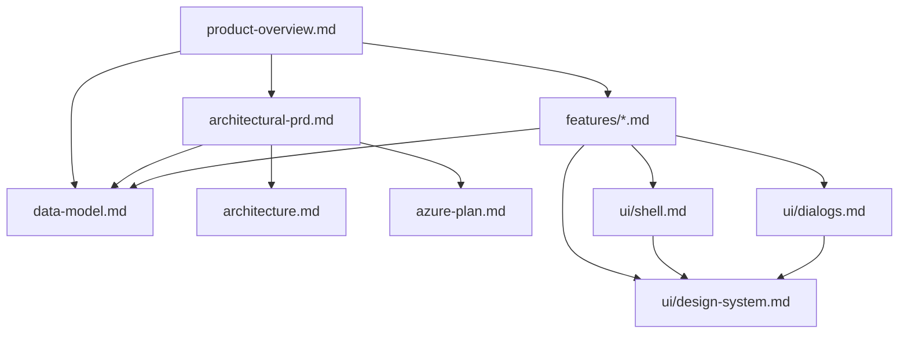

# CourtFlow Docs

This is the canonical home for everything about CourtFlow that isn't code. The goal is that any contributor — engineer, designer, operator, or product reviewer — can rebuild the app's intent, architecture, schema, and UI from these docs alone.

**Start here:** [`product-overview.md`](product-overview.md) — what CourtFlow is, who it's for, and what V1 includes.

---

## Product

| Doc | Use it for |
| --- | --- |
| [`product-overview.md`](product-overview.md) | Mission, problems we're solving, audiences, in/out scope, NFRs, success metrics. **Read first.** |
| [`happy-path.md`](happy-path.md) | End-to-end walkthrough from CSV to a built tournament. Read after `product-overview.md` to see how the features fit together. |

## Architecture

| Doc | Use it for |
| --- | --- |
| [`architecture.md`](architecture.md) | Quick layered solution + patterns reference (Clean Architecture, DDD, CQRS, multi-tenancy). |
| [`architectural-prd.md`](architectural-prd.md) | Long-form architectural PRD: technology stack, DDD conventions, runtime behaviors, deployment summary. |
| [`adr/`](adr/) | Architecture Decision Records — one short page per non-obvious, hard-to-reverse decision. Current: [`0001 Match identity vs assignment`](adr/0001-match-identity-vs-assignment.md), [`0002 Styling strategy (no SASS)`](adr/0002-styling-strategy.md), [`0003 Status lifecycle per aggregate`](adr/0003-status-lifecycle-per-aggregate.md), [`0004 Reflow preview contract`](adr/0004-reflow-preview-contract.md), [`0005 Stage materialization and bracket resolution`](adr/0005-stage-materialization-and-bracket-resolution.md), [`0006 Read models: tiebreaker, delay, public & division readiness`](adr/0006-read-models-tiebreaker-delay-public-division-readiness.md), [`0007 Engine seams and testing`](adr/0007-engine-seams-and-testing.md). |

## Data

| Doc | Use it for |
| --- | --- |
| [`data-model.md`](data-model.md) | Canonical schema reference: aggregates, bounded contexts, every table and field, status lifecycles, domain events, audit/concurrency rules. |

## Deployment

| Doc | Use it for |
| --- | --- |
| [`azure-plan.md`](azure-plan.md) | Committed Azure stack (Static Web Apps + Container Apps + Turso + Clerk), CI/CD workflow templates, go-live checklist. |
| [`local-development.md`](local-development.md) | How to run the app locally (Aspire AppHost), what the dashboard env vars in `launchSettings.json` do, and how to point the WASM client at the right API for each scenario. |

## UI cross-cutting

| Doc | Use it for |
| --- | --- |
| [`ui/design-system.md`](ui/design-system.md) | Color palette, typography, iconography, density, theming, snackbar/loading/empty/form/table patterns, accessibility. |
| [`ui/shell.md`](ui/shell.md) | Information architecture (route tables), layouts, drawer + nav menu, header tournament selector, auth flow chrome. |
| [`ui/dialogs.md`](ui/dialogs.md) | Catalog of every modal dialog with fields, validation, and save behavior. |

## Per-feature PRDs

Each tab in the admin app has its own UI-focused PRD. Public surfaces have theirs too. They link back to the cross-cutting docs above for shared concerns.

| Feature | Doc |
| --- | --- |
| Sign-in / sign-out / authorization redirects | [`features/auth.md`](features/auth.md) |
| Public events landing | [`features/public-landing.md`](features/public-landing.md) |
| Public event detail (Teams / Schedule / Brackets / Standings tabs + my-team filter) | [`features/public-event.md`](features/public-event.md) |
| Tournaments list + tournament editor + clone | [`features/tournaments.md`](features/tournaments.md) |
| Divisions table | [`features/divisions.md`](features/divisions.md) |
| Division detail (stages, pools, brackets, rankings, work rotation) | [`features/division-detail.md`](features/division-detail.md) |
| Teams table + filters | [`features/teams.md`](features/teams.md) |
| CSV imports | [`features/imports.md`](features/imports.md) |
| Schedule grid + conflicts + per-match move/score/start | [`features/schedule.md`](features/schedule.md) |
| Brackets viewer + generation | [`features/brackets.md`](features/brackets.md) |
| Flat matches list + scoring + start | [`features/matches.md`](features/matches.md) |
| Pool standings | [`features/standings.md`](features/standings.md) |
| Repair Job history + mid-tournament corrections | [`features/repairs.md`](features/repairs.md) |
| Court status & delay dashboard (Cards + Grid layouts, TV mode, match clock, reflow preview) | [`features/court-status.md`](features/court-status.md) |
| Work team rotation (cross-cutting affordances) | [`features/work-teams.md`](features/work-teams.md) |
| Print outputs (pool sheets, score sheets, brackets, court runs) | [`features/print-outputs.md`](features/print-outputs.md) |

## Samples

| File | Purpose |
| --- | --- |
| [`sample-imports/predefined-pools-sample.csv`](sample-imports/predefined-pools-sample.csv) | Reference CSV for the predefined-pools import format. |
| [`sample-imports/ranked-teams-snake-sample.csv`](sample-imports/ranked-teams-snake-sample.csv) | Reference CSV for the ranked-teams (snake) import format. |

---

## How the docs relate

## Conventions

- **Filenames** are lowercase kebab-case.
- **Per-feature PRDs** are UI-only. Anything about schema, API contract, or domain rules belongs in `data-model.md` (or the architectural PRD) and is linked from the feature.
- **`data-model.md` is the canonical schema source of truth.** When the model changes, the doc is updated first.
- **Don't duplicate.** Cross-link instead. If you find yourself restating something from another doc, link to it.
