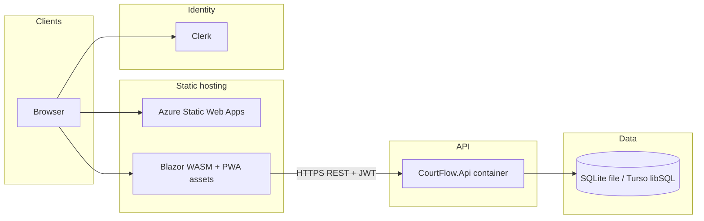

# CourtFlow — Architectural Product Requirements Document

This document describes **how CourtFlow is built and operated**: technologies, layering, deployment topology, and the reasoning behind each choice. It complements the product overview at [`product-overview.md`](product-overview.md), the canonical schema at [`data-model.md`](data-model.md), and the deployment deep dive in [`azure-plan.md`](azure-plan.md).

---

## 1. Purpose and audience

| Audience | Use this document to |
|----------|----------------------|
| Engineers | Onboard quickly, place new code in the right layer, and respect cross-cutting concerns (tenancy, auth, DB compatibility). |
| Operators | Understand what runs where, how secrets flow, and what "good" scaling and cost posture looks like. |
| Product / architecture reviewers | Trace tradeoffs (cost vs. realtime, SQLite semantics vs. managed SQL, Clerk vs. legacy Identity flows). |

---

## 2. Architectural goals

These goals drive technology selection and hosting decisions:

1. **Low baseline cost** — Seasonal weekend usage (volleyball tournaments) favors scale-to-zero compute, static UI hosting, and a database tier that does not require always-on relational servers for early phases.
2. **Simple freshness model (V1)** — No dedicated realtime channel (no SignalR/WebSockets in scope). Clients **pull** state via HTTP; optional polling or manual refresh is acceptable.
3. **Clear boundaries** — REST API for machine and UI consumption; UI talks only to the API over HTTP, not directly to the database.
4. **Future client reuse** — Shared UI in a **Razor Class Library** so Blazor WebAssembly today can align with future hosts (for example MAUI Blazor Hybrid or additional web shells) without duplicating screens.
5. **Multi-tenant correctness** — Organization-scoped data and authorization policies enforced server-side, not only in the UI.
6. **Operability** — Structured logging, rate limiting for abusive traffic, infrastructure-as-code for repeatable environments, and CI that validates builds, tests, and Terraform.

---

## 3. System context

At a high level, authenticated admins use a Blazor-based web client. The client obtains tokens from **Clerk** and calls **CourtFlow.Api**. The API persists data via **EF Core** to either **local SQLite** or **Turso (libSQL)**. Deployment targets **Azure Static Web Apps** for static/WASM assets and **Azure Container Apps** for the API container.

---

## 4. Solution layout and layering

The .NET solution follows **clean architecture** conventions: dependencies point inward toward the domain; infrastructure and hosts sit at the outer edge.

| Project | Responsibility |
|---------|----------------|
| `CourtFlow.Domain` | Entities, value objects, enums, domain events. No infrastructure references. |
| `CourtFlow.Application` | Application services orchestrated as **CQRS** commands/queries via **MediatR**; **FluentValidation** validators; DTOs and abstractions (`IAppDbContext`, engine interfaces). |
| `CourtFlow.Infrastructure` | **EF Core** `DbContext`, migrations, multi-tenancy (`ITenantContext`), Clerk/JWT-adjacent helpers, and domain engines (scheduling, brackets, standings, court status). **Target:** no ASP.NET Identity store — Clerk is the IdP; see fresh-start plan Phase 1. |
| `CourtFlow.Api` | ASP.NET Core **Web API** host: controllers, JWT authentication configuration, **Swagger/OpenAPI**, **CORS**, **rate limiting**, **Serilog**, startup wiring. |
| `CourtFlow.ApiClient` | Typed **HttpClient**-based API surface consumed by Blazor (endpoint classes + shared JSON options). Keeps HTTP paths and serialization consistent across hosts. |
| `CourtFlow.Web.Shared` | **Razor Class Library**: reusable components, theming, shared client-side services; references `CourtFlow.ApiClient`. Marked with browser supported platform for WASM. |
| `CourtFlow.Web` | **Blazor Web App** host: **interactive WebAssembly** render mode, MudBlazor, registers HTTP client to API (dev-only relaxed TLS validation). |
| `CourtFlow.Web.Client` | **Blazor WebAssembly** project: Clerk-oriented auth (`JwtAuthenticationStateProvider`, token store, `BearerTokenHandler`), PWA **service worker** registration. |
| `CourtFlow.Application.Tests` | **xUnit** tests with **EF Core InMemory** where persistence is needed. |

**Rationale:** Separating Domain/Application from Infrastructure keeps tournament rules testable and swap-friendly (for example changing DB provider or auth mapping) without rewriting UI or API routing.

### 4.1 Domain-Driven Design conventions

The Domain layer is organized around **aggregates** that own their invariants and transaction boundaries. The canonical aggregate list is in [`data-model.md`](data-model.md#aggregates-and-bounded-contexts).

**Aggregate roots (V1 + target):** `Organization`, `User`, `Venue`, `Tournament`, `TournamentTeam`, `Division`, **`Stage`**, `Pool`, `Bracket`, `Match`, `ScheduleVersion`, `RepairJob`, `ImportJob`. Each:

- Carries an **optimistic concurrency token** so concurrent admin edits surface as visible conflicts rather than last-write-wins.
- Encapsulates child entities (e.g. `Match` owns `MatchSet`, `MatchParticipantSource`, `MatchOfficialAssignment`, `MatchResultReport`; `ScheduleVersion` owns `MatchAssignment`).
- References other aggregates by id only. Cross-aggregate consistency is enforced by application services or domain services, never by spanning a single transaction across two roots.

**Value objects** are used for things without identity: scoring lines, address blocks, time-of-day windows, IANA time zone wrappers. They are immutable and compared by value.

**Domain events** are raised from aggregate roots and dispatched after persistence. The named events in [`data-model.md`](data-model.md#domain-events-and-integration-hooks) (`TournamentCreated`, `DivisionSeedingFinalized`, `PoolsGenerated`, `SchedulePublished`, `MatchResultReported`, `TournamentTeamWithdrawn`, `RemainingMatchesReassigned`, etc.) are first-class types in `CourtFlow.Domain`.

**Status lifecycles** (Tournament, Division, Stage, TournamentTeam, Match, ScheduleVersion, RepairJob) are encoded as enums in `Domain` with allowed transitions guarded inside the aggregate, not in controllers or UI. Pattern: [`adr/0003-status-lifecycle-per-aggregate.md`](adr/0003-status-lifecycle-per-aggregate.md). Named read models for cross-cutting projections: [`adr/0006-read-models-tiebreaker-delay-public-division-readiness.md`](adr/0006-read-models-tiebreaker-delay-public-division-readiness.md).

**Repositories** are deliberately not introduced as per-entity abstractions. The Application layer accesses persistence through `IAppDbContext` (a thin EF Core abstraction) plus query-side helpers. This keeps the seam small while still allowing in-memory tests.

Deep **Application modules** (ReflowPreview, StageMaterialization, read models) and engine-interface policy are summarized in [`architecture.md`](architecture.md#deep-modules-named-application-seams) and ADRs [`adr/0004-reflow-preview-contract.md`](adr/0004-reflow-preview-contract.md) through [`adr/0007-engine-seams-and-testing.md`](adr/0007-engine-seams-and-testing.md).

---

## 5. Technology stack (inventory and rationale)

### 5.1 Platform and language

| Technology | Version (repo intent) | Role | Rationale |
|------------|----------------------|------|-----------|
| **.NET / C#** | **10.0** (`net10.0`) | Primary runtime and language | Single stack for API, web client, and shared libraries; strong tooling for EF Core and ASP.NET Core. |

### 5.2 Backend application frameworks

| Technology | Role | Rationale |
|------------|------|-----------|
| **ASP.NET Core** | Web API pipeline | Mature middleware model for auth, CORS, rate limiting, and structured errors (`ProblemDetails`). |
| **Controllers + Minimal APIs pattern** | HTTP mapping | Controllers provide conventional REST grouping and Swagger integration. |
| **MediatR** | CQRS dispatch | Handlers stay small and testable; controllers delegate to a single pipeline (validation, logging hooks can be extended via behaviors later). |
| **FluentValidation** (+ ASP.NET Core integration in API) | Input validation | Declarative rules aligned with DTOs; integrated with the API host auto-validation. |

### 5.3 Data access and storage

| Technology | Role | Rationale |
|------------|------|-----------|
| **EF Core** | ORM and migrations | Strong LINQ model, migrations, and alignment with ASP.NET Core Identity stores. |
| **SQLite** (`Microsoft.EntityFrameworkCore.Sqlite`) | Local / single-file DB | Zero external dependencies for developer machines and simple deployments. |
| **Turso / libSQL** (`BMDRM.LibSql.Core`, `UseLibSql`) | Hosted SQLite-compatible service | Matches **read-heavy, refresh-based** usage and cost goals documented in [`azure-plan.md`](azure-plan.md); remote connection string resolves via `ConnectionStrings:Default` or `Turso:Url` + optional token composition in `DependencyInjection.cs`. |
| **EFCore.NamingConventions** | Snake_case mapping | Consistent PostgreSQL/SQLite-friendly column naming across environments. |

**Important semantic note:** SQLite and libSQL favor **single-writer** patterns. For CourtFlow's expected concurrency (few overlapping tournaments), this is acceptable; hot-row contention remains an operational risk to monitor if score updates concentrate on narrow keys.

### 5.4 Identity and security

| Technology | Role | Rationale |
|------------|------|-----------|
| **Clerk** | External IdP (orgs, sessions, JWT issuance for SPA/WASM) | Reduces custom auth UI burden; org-aware identity aligns with multi-tenant product goals. |
| **JWT Bearer authentication** (`Microsoft.AspNetCore.Authentication.JwtBearer`) | API trust model | Stateless verification against Clerk issuer configuration; scales naturally with container replicas. |
| **ASP.NET Core Identity** (`IdentityCore`, EF stores) | Local user store / roles (legacy path and scaffolding) | Supports existing domain tables and seed flows; legacy password sign-in is disabled (`410` on old sign-in endpoint) while Clerk is the interactive path. |
| **`IClaimsTransformation` (ClerkClaimsTransformation)** | Normalize claims | Maps external tokens into roles and tenant claims (`org_id`) expected by policies. |
| **Authorization policies** | `RequireAdmin`, `RequireOrg` | Central enforcement for admin-only V1 and organization-scoped operations. |
| **CORS** | Browser access control | Explicit allowed origins (Terraform can inject `Cors__Origins__*` into Container Apps). |
| **Rate limiting** (`AddRateLimiter`) | Abuse and cost protection | Separate policies (for example `public-read`) throttle anonymous-style read storms documented in [`azure-plan.md`](azure-plan.md). |

**Auth direction:** Clerk-first with JWT validation. Legacy Identity password sign-in is intentionally `410 Gone`. See [`product-overview.md`](product-overview.md) for product-level auth scope.

### 5.5 API documentation and integration

| Technology | Role | Rationale |
|------------|------|-----------|
| **Swashbuckle / Swagger UI** | OpenAPI generation | Accelerates partner integrations and manual QA; JWT security scheme documented for bearer tokens. |
| **System.Text.Json** (`JsonStringEnumConverter`) | Serialization | Stable enum wire format between API and `CourtFlow.ApiClient`. |

### 5.6 Frontend

| Technology | Role | Rationale |
|------------|------|-----------|
| **Blazor Web App + WebAssembly** | UI delivery | WASM runs on SWA-friendly static hosting; `CourtFlow.Web` uses interactive WebAssembly render mode and pulls in Client + Shared assemblies. |
| **MudBlazor** | Component library | Consistent Material-style UX with less bespoke CSS for admin-heavy screens. |
| **`CourtFlow.Web.Shared` RCL** | Shared UI | Enables reuse across WASM today and alternative hosts later (product PRD calls out MAUI / public views). |
| **PWA (`service-worker.js`)** | Offline shell / installability | Aligns with Azure Static Web Apps + mobile-friendly tournament floor usage (within constraints of still needing network for API unless explicitly cached). |

UI conventions (design system, shell, dialogs, per-feature specs) live in [`ui/`](ui/) and [`features/`](features/).

### 5.7 Observability

| Technology | Role | Rationale |
|------------|------|-----------|
| **Serilog** (`Serilog.AspNetCore`, console + rolling file sinks) | Structured logs | Request logging and configurable sinks; file rolling useful on local and container file systems where mounted. |
| **Azure Log Analytics** (via Terraform modules) | Centralized logs for ACA | Supports querying API diagnostics in cloud deployments without bespoke agents if wired through Container Apps environment. |

### 5.8 Infrastructure and delivery

| Technology | Role | Rationale |
|------------|------|-----------|
| **Docker** (`deploy/Dockerfile.api`) | API container image | Multi-stage build on `mcr.microsoft.com/dotnet/sdk:10.0` → `aspnet:10.0`, exposes **8080** for Container Apps ingress. |
| **Terraform** (`infra/terraform`) | IaC | Modules for resource group, Log Analytics, ACR, Container Apps environment + API app, Static Web App, budget alerts; separates **dev** and **prod** env folders. |
| **GitHub Actions** | CI/CD | `ci.yml`: restore, build, test, publish API artifact sanity, Terraform fmt/validate for bootstrap/dev/prod; additional workflows deploy API and SWA per repository automation. |

### 5.9 Testing

| Technology | Role | Rationale |
|------------|------|-----------|
| **xUnit** | Test runner | Common .NET default; integrates with `dotnet test` in CI. |
| **coverlet.collector** | Coverage | Hook for coverage reports in pipelines or IDE. |
| **EF Core InMemory** | Lightweight persistence tests | Fast feedback for application-layer tests without SQLite files. |

---

## 6. Key runtime behaviors

### 6.1 API startup (development vs. production)

- **Development:** Swagger/Swagger UI enabled; EF migrations applied automatically; demo seed runs after migrate.
- **Production expectations:** Clerk enabled and configured (startup throws if misconfigured outside Development); HTTPS redirection, CORS, authentication/authorization, rate limiting, and global exception handling participate in the pipeline.

### 6.2 Database provider selection

Infrastructure registers `AppDbContext` with either **libSQL** or **SQLite** based on connection string shape (`libsql://`, `https://`, or token query patterns). This keeps one EF model while supporting local files and Turso-hosted URLs.

### 6.3 Multi-tenancy

`ITenantContext` (HTTP-scoped) binds the current organization from the request context so queries and commands enforce tenant boundaries at the application/infrastructure edge.

### 6.4 Client configuration on WASM

`CourtFlow.Web.Client` merges `wwwroot/appsettings.json` into configuration because default WASM configuration can be empty on static hosts—avoiding synchronous stream pitfalls documented in code comments.

---

## 7. Deployment architecture (target)

The **committed cloud shape** is documented in [`azure-plan.md`](azure-plan.md). Summary:

| Layer | Azure service | Notes |
|-------|---------------|-------|
| UI | **Azure Static Web Apps** | Hosts published WASM static assets; free tier where adequate. |
| API | **Azure Container Apps** | Container from ACR; **min replicas** may be 0 for cost (cold start tradeoff). |
| Registry | **Azure Container Registry** | Stores API images; Terraform uses Basic SKU in examples. |
| Telemetry | **Log Analytics** | Wired to Container Apps environment module. |
| Governance | **Budget alerts** | Terraform module alerts on forecast/spend thresholds. |

Secrets such as `ConnectionStrings__Default` are injected as Container App secrets rather than baked into images.

---

## 8. Non-functional requirements (architecture-backed)

| NFR | How the architecture addresses it |
|-----|-------------------------------------|
| **Cost efficiency** | Scale-to-zero API, static WASM hosting, Turso/libSQL positioning (see Azure plan load assumptions). |
| **Security** | Clerk JWT validation, admin/org policies, CORS restrictions, rate limits on sensitive/public surfaces. |
| **Maintainability** | Layered solution; MediatR handlers; shared API client; Terraform modules per concern. |
| **Portability** | SQLite-compatible schema path; single EF model; containerized API. |
| **Extensibility** | RCL for UI reuse; engines behind interfaces in Application/Infrastructure. |

---

## 9. Deferred / future architecture (explicit non-scope)

Items intentionally deferred or reserved for later phases:

- **Realtime updates** (SignalR or similar) — Product accepts refresh/polling for V1; avoids websocket infra cost and complexity.
- **Blazor Server as primary production mode** — Current hybrid uses WASM interactivity; Azure SWA cost model favors WASM/static assets per Azure plan.
- **Alternate clients** — MAUI Blazor Hybrid and public-facing sites are product roadmap consumers of the same API + RCL.

---

## 10. Traceability

| Topic | Document |
|-------|----------|
| Product intent, personas, scope, NFRs, success metrics | [`product-overview.md`](product-overview.md) |
| Canonical schema and aggregates | [`data-model.md`](data-model.md) |
| Per-feature UI specifications | [`features/`](features/) |
| Cross-cutting UI: design system, shell, dialogs | [`ui/`](ui/) |
| Quick architecture reference | [`architecture.md`](architecture.md) |
| Azure services, Clerk/Turso rollout, CI snippets, checklists | [`azure-plan.md`](azure-plan.md) |
| Local run and configuration keys | [`../README.md`](../README.md) |

---

## 11. Revision discipline

When making architectural changes:

1. Update **this file** if technology choices or topology change meaningfully.
2. Update [`azure-plan.md`](azure-plan.md) if cloud services, secrets, or CI/CD assumptions shift.
3. Update [`data-model.md`](data-model.md) when aggregate shape or invariants change.
4. Reconcile [`product-overview.md`](product-overview.md) when auth or tenancy stories diverge from implementation.

---

*End of Architectural PRD.*
