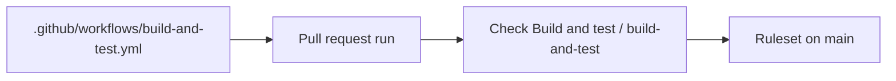

# Build and test before merge plan

Follows the spec in [spec.md](spec.md). This slice adds one GitHub Actions workflow and one repository ruleset on `main`. It does not change a file under `src/`. It does not change [src/global.json](../../src/global.json), [src/Directory.Build.props](../../src/Directory.Build.props), [src/Directory.Packages.props](../../src/Directory.Packages.props), or [src/CourtFlow.slnx](../../src/CourtFlow.slnx). It does not edit [tools/logo/](../../tools/logo/).



## Order

1. Add the workflow file below. Do not add a second workflow, a path filter, a `push` trigger, or `pull_request_target`.
2. From a machine with the .NET 10 SDK and a container runtime, run `dotnet test src/CourtFlow.slnx`. The existing suite passes before the workflow is pushed. If that machine has no container runtime, the API tests cannot pass there. Do not edit `src/` to skip them. The pull request run is then the first full run.
3. Push the workflow on a pull request into `main`. Read the check name from that run. It is `Build and test / build-and-test`. If GitHub reports any other name, stop. Do not rename the job to chase it, and do not create the ruleset against a guessed name.
4. A red run that is a missing .NET 10 SDK or a Docker daemon the tests cannot use is fixed in the workflow only, then pushed again. A red run that is a failed test, a warning, or a restore failure which also fails under the local command in step 2 is a broken tree. Stop. Do not edit `src/` to make it green.
5. When that check is green, create the ruleset below. Read it back. A 403 on create or on read-back stops the slice. The workflow file alone does not finish it. Do not merge while the check is missing or red, or while the ruleset read-back differs from this plan.

## Files

No file under `src/` is added or changed. These stay as they are:

- [src/global.json](../../src/global.json) — still selects `Microsoft.Testing.Platform` and still has no SDK pin. The committed file is not given an `sdk` version.
- [src/Directory.Build.props](../../src/Directory.Build.props) — `TreatWarningsAsErrors` stays `true`. That is why a warning fails the workflow command.
- [src/Directory.Packages.props](../../src/Directory.Packages.props) — no package version changes.
- [src/CourtFlow.slnx](../../src/CourtFlow.slnx) — still the only solution the job tests. It already contains `CourtFlow.Domain.Tests`, `CourtFlow.Application.Tests`, `CourtFlow.Api.Tests`, `CourtFlow.Web.Tests`, and `CourtFlow.AppHost.Tests`. Do not add a test project.
- [src/CourtFlow.Api.Tests/ApiFactory.cs](../../src/CourtFlow.Api.Tests/ApiFactory.cs) — keeps `postgres:16-alpine`. The workflow does not replace it with a service container.
- [src/CourtFlow.AppHost.Tests/AppHostModelTests.cs](../../src/CourtFlow.AppHost.Tests/AppHostModelTests.cs) — keeps setting `COURTFLOW_SKIP_VOLUME_ADOPTION`. The workflow does not set that variable.

- [.github/workflows/build-and-test.yml](../../.github/workflows/build-and-test.yml) — new, outside `src/`. This is the only workflow. Its text is the workflow section below.

The ruleset is not a file. It is created on `mdfelchlin/CourtFlow` through `POST /repos/mdfelchlin/CourtFlow/rulesets`.

## Workflow

`actions/checkout@v7` and `actions/setup-dotnet@v6` are the action tags. Do not float either to `@main`. Do not set `cache: true` on setup-dotnet. `dotnet-version` is `10.0.x` and `dotnet-quality` is `ga`, so the 10.0 band does not install a preview. `src/global.json` does not pin an SDK, and the dotnet host otherwise selects the newest SDK on the runner, including one that was already installed. After setup-dotnet, the job writes a runner-only `global.json` at the repository root with that step's `dotnet-version` and `test.runner` set to `Microsoft.Testing.Platform`. That file is not committed. `dotnet --version` must be that same version, a `10.0` GA build, before the test command. If `dotnet-quality: ga` is rejected by the action, fix the workflow so the installed SDK is still the latest GA `10.0` patch. Do not install `latest` across majors.

The test step's working directory is the repository root. Its `run` is exactly `dotnet test src/CourtFlow.slnx`. No configuration, no filter, no `--no-build`, no `--no-restore`, no second test command. No Postgres service. No AppHost. No secret, no `env` block, and no GitHub environment. Permissions stay `contents: read` on the workflow. The job does not widen them.

`ubuntu-latest` supplies Docker. Do not install another daemon, and do not run the tests inside a container. Do not set Testcontainers variables ahead of a failure. If the green-run attempt fails because the daemon is unreachable or Ryuk cannot start, fix that in this workflow and record the reason in the commit. That fix still does not edit `src/`.

`dotnet` reads `global.json` from the working directory upward. It does not read [src/global.json](../../src/global.json) when the command runs from the repository root, so the committed `test.runner` does not select Microsoft.Testing.Platform there. SDK 10.0.402 then builds the test projects with the VSTest target, which Microsoft.Testing.Platform.MSBuild 2 rejects. The job writes a runner-only `global.json` at the repository root with the installed SDK version and `test.runner` set to `Microsoft.Testing.Platform`. That file is not committed. [src/global.json](../../src/global.json) stays as it is.

```yaml
name: Build and test

on:
  pull_request:
    branches:
      - main

permissions:
  contents: read

concurrency:
  group: build-and-test-${{ github.event.pull_request.number }}
  cancel-in-progress: true

jobs:
  build-and-test:
    name: build-and-test
    runs-on: ubuntu-latest
    timeout-minutes: 30
    steps:
      - name: Checkout
        uses: actions/checkout@v7

      - name: Install .NET 10 SDK
        id: dotnet
        uses: actions/setup-dotnet@v6
        with:
          dotnet-version: 10.0.x
          dotnet-quality: ga

      - name: Use that SDK
        run: |
          version="${{ steps.dotnet.outputs.dotnet-version }}"
          jq -n --arg version "$version" '{sdk:{version:$version},test:{runner:"Microsoft.Testing.Platform"}}' > global.json
          jq -e '.test.runner == "Microsoft.Testing.Platform"' src/global.json >/dev/null
          test "$(dotnet --version)" = "$version"

      - name: Test
        id: test
        run: |
          set +e
          dotnet test src/CourtFlow.slnx > "$RUNNER_TEMP/test-output.txt"
          code=$?
          cat "$RUNNER_TEMP/test-output.txt"
          exit "$code"

      - name: Summarize tests
        if: always()
        env:
          TEST_OUTCOME: ${{ steps.test.outcome }}
        run: python3 .github/scripts/summarize-tests.py "$RUNNER_TEMP/test-output.txt"
```

[.github/scripts/summarize-tests.py](../../.github/scripts/summarize-tests.py) reads that captured log. It writes the totals and, when tests fail, each failed test's name and message to `$GITHUB_STEP_SUMMARY`. The test command stays `dotnet test src/CourtFlow.slnx`. The summary step runs even when the test step fails, and it does not change the job's exit.

Omit `types` on `pull_request`, so the default events run for draft and ready pull requests. Omit `paths` and `paths-ignore`. The concurrency group is the pull request number, so a new commit cancels the in-progress run for the older commit. A cancelled run is not a success. There is one job, so the suite is not split.

## Ruleset

Before creating one, `GET /repos/mdfelchlin/CourtFlow/rulesets` and `GET /repos/mdfelchlin/CourtFlow/branches/main/protection`. A 404 on classic protection means there is none. If classic protection is already enabled, or a ruleset already targets `main`, stop and tell the developer what it requires. Do not delete it, and do not add a second ruleset beside it.

Otherwise `POST /repos/mdfelchlin/CourtFlow/rulesets` with this body. `bypass_actors` is empty, so admins are not exempt. `strict_required_status_checks_policy` is false, so the branch does not have to be current with `main`. `required_approving_review_count` is 0, and the other review flags are false. All three merge methods stay allowed. The check context is exactly `Build and test / build-and-test`. Leave `integration_id` unset. If the API rejects the body for that, set `integration_id` to `15368` (the GitHub Actions app on github.com) and stop if that is also rejected.

```json
{
  "name": "Build and test before merge",
  "target": "branch",
  "enforcement": "active",
  "bypass_actors": [],
  "conditions": {
    "ref_name": {
      "include": ["refs/heads/main"],
      "exclude": []
    }
  },
  "rules": [
    {
      "type": "pull_request",
      "parameters": {
        "allowed_merge_methods": ["merge", "squash", "rebase"],
        "dismiss_stale_reviews_on_push": false,
        "require_code_owner_review": false,
        "require_last_push_approval": false,
        "required_approving_review_count": 0,
        "required_review_thread_resolution": false
      }
    },
    {
      "type": "required_status_checks",
      "parameters": {
        "do_not_enforce_on_create": false,
        "strict_required_status_checks_policy": false,
        "required_status_checks": [
          { "context": "Build and test / build-and-test" }
        ]
      }
    }
  ]
}
```

Read the created ruleset back with `GET /repos/mdfelchlin/CourtFlow/rulesets/{id}`. Enforcement is `active`. The bypass list is empty. The include is `refs/heads/main`. The two rule types are the only rules. The status check context matches, and strict mode is false.

## Tests

No new test file. The spec leaves the product tree unchanged, so this slice does not add a test that reads the workflow or the ruleset.

The existing suite is the regression, run as `dotnet test src/CourtFlow.slnx` locally when a container runtime is available, and as that same command in the workflow. It already covers director-facing behavior, the API, and startup. In particular:

- [src/CourtFlow.Web.Tests/PackageRulesTests.cs](../../src/CourtFlow.Web.Tests/PackageRulesTests.cs) fails if package versions or `net10.0` were edited.
- [src/CourtFlow.Web.Tests/EngineeringPracticesTests.cs](../../src/CourtFlow.Web.Tests/EngineeringPracticesTests.cs) fails if the shared build settings were edited.
- [src/CourtFlow.AppHost.Tests/AppHostModelTests.cs](../../src/CourtFlow.AppHost.Tests/AppHostModelTests.cs) `HostStartsTheApiBlazorAppPostgresAndMailpit` fails if the startup ports move.

`git diff -- src` is empty on the implementation commit. That is the check that `src/global.json` was not committed with an SDK pin and that no product file was edited to make the pipeline green.

## No test

- The workflow trigger, the missing path filter, and the absence of `pull_request_target`. The file in this plan is the check. No test reads it.
- The job name, `ubuntu-latest`, the 30-minute timeout, `contents: read`, and the empty secret list. No test reads them. A hung job hitting the timeout is not staged.
- Cancelling the older run when a pull request gets a new commit. Concurrency is in the workflow file. No test opens two runs.
- A pull request into `main` showing `Build and test / build-and-test`, and a failing test turning that check red. The implementation run shows the green check. This slice does not break a test to force a red check. A missing or red check blocks the merge only once the ruleset exists, which has no test.
- The ruleset: pull requests required, that check required, bypass list empty so repository admins are not exempt, direct push refused, branch not required to be current with `main`. The read-back in the ruleset section is the check. Pushing to `main` to watch it be refused is not a test.
- Required reviews, signed commits, a linear history, and a merge queue staying off. The read-back shows those rules were not added.
- Draft pull requests running, and a docs-only pull request running the full suite. No test opens those pull requests.
- `tools/logo/` not being built, and `dotnet format` not being its own step. The workflow has one test command.
- The runner-only root `global.json`. The committed [src/global.json](../../src/global.json) has no SDK pin, which the empty `src` diff checks. `dotnet test` from the repository root does not read that committed file.
- API tests still pulling `postgres:16-alpine`. No test asserts that image tag. [src/CourtFlow.Api.Tests/ApiFactory.cs](../../src/CourtFlow.Api.Tests/ApiFactory.cs) is unchanged, and the existing API tests are what start the container.
