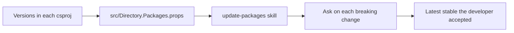

# Current packages plan

Follows the spec in [spec.md](spec.md). This slice moves NuGet versions for the product tree into [src/Directory.Packages.props](../../src/Directory.Packages.props), brings those packages to the latest stable version, and adds the rule and the skill named in the intent. It does not add a library, change `TargetFramework`, or edit [tools/logo/](../../tools/logo/). The central file stays under `src/`. Do not add `Directory.Packages.props` at the repo root.

`CourtFlow.Domain` and `CourtFlow.Application` reference no packages. Leave those two project files unchanged.

## Order

1. Add the central file with the versions already in the project files. Remove `Version` from each `PackageReference` under `src/` in the same change, so a build never sees central management and a project version together.
2. Add the package-layout tests, then restore, build, and run the existing tests. This proves the move itself, before any version changes.
3. Add the always-on rule and the update skill.
4. Run the skill once. It updates [src/Directory.Packages.props](../../src/Directory.Packages.props). On each breaking change it asks how to proceed and waits. Then build and run the tests again.

## Files

- [src/Directory.Packages.props](../../src/Directory.Packages.props) — new. `ManagePackageVersionsCentrally` is true. One `PackageVersion` per id, exact stable versions, no ranges and no floating versions. Do not set `CentralPackageFloatingVersionsEnabled` or `CentralPackageTransitivePinningEnabled`.
- These project files lose the `Version` attribute and keep every other attribute on the reference:
  - [src/CourtFlow.Api/CourtFlow.Api.csproj](../../src/CourtFlow.Api/CourtFlow.Api.csproj)
  - [src/CourtFlow.Api.Tests/CourtFlow.Api.Tests.csproj](../../src/CourtFlow.Api.Tests/CourtFlow.Api.Tests.csproj)
  - [src/CourtFlow.Infrastructure/CourtFlow.Infrastructure.csproj](../../src/CourtFlow.Infrastructure/CourtFlow.Infrastructure.csproj) — `Microsoft.EntityFrameworkCore.Design` keeps `IncludeAssets` `runtime; build; native; contentfiles; analyzers; buildtransitive` and `PrivateAssets` `all`.
  - [src/CourtFlow.Web/CourtFlow.Web.csproj](../../src/CourtFlow.Web/CourtFlow.Web.csproj) — `Microsoft.AspNetCore.Components.WebAssembly.DevServer` keeps `PrivateAssets="all"`.
  - [src/CourtFlow.Web.Tests/CourtFlow.Web.Tests.csproj](../../src/CourtFlow.Web.Tests/CourtFlow.Web.Tests.csproj)
  - [src/CourtFlow.Domain.Tests/CourtFlow.Domain.Tests.csproj](../../src/CourtFlow.Domain.Tests/CourtFlow.Domain.Tests.csproj)
  - [src/CourtFlow.Application.Tests/CourtFlow.Application.Tests.csproj](../../src/CourtFlow.Application.Tests/CourtFlow.Application.Tests.csproj)
  - [src/CourtFlow.AppHost/CourtFlow.AppHost.csproj](../../src/CourtFlow.AppHost/CourtFlow.AppHost.csproj)
  - [src/CourtFlow.AppHost.Tests/CourtFlow.AppHost.Tests.csproj](../../src/CourtFlow.AppHost.Tests/CourtFlow.AppHost.Tests.csproj)
- [src/CourtFlow.Web.Tests/PackageRulesTests.cs](../../src/CourtFlow.Web.Tests/PackageRulesTests.cs) — new. The web test project already walks up to [src/CourtFlow.slnx](../../src/CourtFlow.slnx). A new test project would be another package consumer.
- [.cursor/rules/current-packages.mdc](../../.cursor/rules/current-packages.mdc) — new, outside `src/`. `alwaysApply: true`.
- [.cursor/skills/update-packages/SKILL.md](../../.cursor/skills/update-packages/SKILL.md) — new, outside `src/`.

Leave [src/CourtFlow.Domain/CourtFlow.Domain.csproj](../../src/CourtFlow.Domain/CourtFlow.Domain.csproj), [src/CourtFlow.Application/CourtFlow.Application.csproj](../../src/CourtFlow.Application/CourtFlow.Application.csproj), and [src/CourtFlow.slnx](../../src/CourtFlow.slnx) unchanged. Every project stays on `net10.0`.

The first central file copies these versions, one entry each. Shared ids already agree, so nothing stops for a clash. The skill run may replace a version with a newer stable one. It must not add or drop an id.

| Package | Version to move |
| --- | --- |
| Aspire.Hosting.AppHost | 13.6.1 |
| Aspire.Hosting.PostgreSQL | 13.6.1 |
| Aspire.Hosting.Testing | 13.6.1 |
| bunit | 2.11.3 |
| CommunityToolkit.Aspire.Hosting.MailPit | 13.6.0 |
| coverlet.MTP | 10.1.0 |
| Microsoft.AspNetCore.Components.Authorization | 10.0.12 |
| Microsoft.AspNetCore.Components.WebAssembly | 10.0.12 |
| Microsoft.AspNetCore.Components.WebAssembly.DevServer | 10.0.12 |
| Microsoft.AspNetCore.DataProtection.EntityFrameworkCore | 10.0.12 |
| Microsoft.AspNetCore.Mvc.Testing | 10.0.12 |
| Microsoft.EntityFrameworkCore | 10.0.12 |
| Microsoft.EntityFrameworkCore.Design | 10.0.12 |
| Microsoft.EntityFrameworkCore.Relational | 10.0.12 |
| Microsoft.NET.Test.Sdk | 18.10.1 |
| MudBlazor | 9.11.0 |
| Npgsql.EntityFrameworkCore.PostgreSQL | 10.0.3 |
| Testcontainers.PostgreSql | 4.16.0 |
| xunit.runner.visualstudio | 4.0.1 |
| xunit.v3 | 4.0.2 |

`Sdk Name="Aspire.AppHost.Sdk"` on the app host is not a `PackageReference`. Its `Version` stays in that project file and stays equal to `Aspire.Hosting.AppHost`. When the skill moves that package, it sets the SDK attribute to the same version in the same edit.

## Rule

The rule text tells an agent:

- Add a NuGet package only when the user specifically instructed this task to add that package. Otherwise stop and ask. Do not pick a library.
- Write the latest stable version only in `src/Directory.Packages.props`. A package id already declared keeps one version, moved to that latest stable.
- Refuse a prerelease.
- Leave `Version` off every `PackageReference` under `src/`.
- Updating MudBlazor, Entity Framework Core, Npgsql, Aspire, or the test packages is allowed. Replacing one of them with a different product is not.
- When the latest stable has a known vulnerability, stop and let the developer decide. Do not swap the package, pin an older version, or add a suppression instead.
- A deprecation notice is not a reason to replace a library.
- A full bring-up of packages already declared is the `update-packages` skill.

## Skill run

The skill reads `src/Directory.Packages.props` and the projects under `src/`. Latest stable is the highest nuget.org version that NuGet does not mark prerelease. `dotnet list src/CourtFlow.slnx package --outdated` shows which declared packages are behind. `dotnet list src/CourtFlow.slnx package --vulnerable --include-transitive` is the advisory list. Every severity counts. Direct and transitive packages both count.

A higher major version is a breaking change. So is a latest stable that does not support `net10.0`. The skill asks about one such package at a time, names the package, the declared version, and the latest stable, and waits. It does not apply that update, skip it, or open a pull request before the answer. It then does what the developer said for that package. A skip is not stored. The next run asks again.

A same-major update is applied without asking. If that update fails the build or the existing tests, the skill stops, treats it as a breaking change, and asks how to proceed. It does not rewrite product behavior unless the developer says to.

When the latest stable, or a transitive package still present after direct packages are current, has an advisory, the skill names the package, whether it is direct or transitive, and the advisory, then waits. It does not downgrade, add a package, turn on transitive pinning, or add `NoWarn` unless the developer chooses that.

The skill does not add a package id, does not edit `tools/logo/` or `TargetFramework`, and does not take a prerelease. When nothing is behind, it says so and still reports advisories.

After the run, the product tree builds and the existing tests pass, except where the developer accepted an update and said how to proceed.

## Tests

New facts in [src/CourtFlow.Web.Tests/PackageRulesTests.cs](../../src/CourtFlow.Web.Tests/PackageRulesTests.cs). They walk from the test assembly to `CourtFlow.slnx`, then read `src/` and the repo root. They ignore `bin` and `obj`.

- `ManagePackageVersionsCentrally` is true in `src/Directory.Packages.props`, and that file is the only `Directory.Packages.props` at `src/` or the repo root.
- Each `PackageVersion` is an exact stable version: digits and dots only.
- Every `PackageReference` under `src/` has no `Version`. The ids are exactly the twenty in the table above, each declared once.
- `CourtFlow.Domain` and `CourtFlow.Application` have no `PackageReference`.
- The Design reference still has its `IncludeAssets` and `PrivateAssets`. The DevServer reference still has `PrivateAssets="all"`.
- Every project under `src/` targets `net10.0`.
- The app host SDK version equals the `Aspire.Hosting.AppHost` package version.
- No project or the central file sets `NoWarn` for `NU1901`, `NU1902`, `NU1903`, or `NU1904`. If the developer, when asked, chooses a suppression, change this fact to that package only.
- A temporary project with its own central file and a `PackageReference` that sets `Version` fails `dotnet build` with `NU1008`. The temp project is outside the repo. This proves a project version fails the build. It does not restore a package.

Existing tests are not edited and must pass after the move and again after the skill run. [src/CourtFlow.AppHost.Tests/AppHostModelTests.cs](../../src/CourtFlow.AppHost.Tests/AppHostModelTests.cs) `Host_starts_the_api_blazor_app_postgres_and_mailpit` is the check that startup still includes the API, the Blazor app, Postgres, and Mailpit on the same ports.

## No test

- An agent in a later chat obeys the rule. The test checks that the rule file is always on and contains the limits. Cursor applying it is not a test.
- The skill waits for an answer, and a later run asks again about a package the developer skipped. That is a conversation during the skill run.
- Declared versions stay the latest stable after this slice. A test that stored today's latest would fail when nuget.org publishes again. `dotnet list package --outdated` during the skill run is the check.
- Zero advisories. The developer may keep a vulnerable latest. The skill run's vulnerability report is the check that each remaining advisory was handed over.
- [tools/logo/package.json](../../tools/logo/package.json). It is not a NuGet project, and this slice does not edit it.
- A director-facing behavior change beyond the existing domain, application, API, web, and app host tests.
- A deprecation notice. The rule forbids treating one as a reason to replace a library. No package is deprecated in a test.
