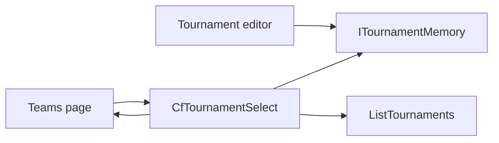

# Current tournament plan

Follows the spec in [spec.md](spec.md). [poc/](../../poc/) stays untouched. This slice changes only the Blazor app. The API, the domain, and Postgres stay as they are. The browser memory in [src/CourtFlow.Web/Services/ITournamentMemory.cs](../../src/CourtFlow.Web/Services/ITournamentMemory.cs) stays the one current tournament; the dropdown does not add a second store.

The new control loads the tournament list, resolves that memory, and renders a **Tournament** label immediately to the left of a dropdown. Teams places it in the page header and deletes the select that sits under the title. Choosing a tournament still reloads that page's teams.

## Order

1. Add `CfTournamentSelect` and point Teams at it. Remove the under-title picker and the page's own list and memory reads.
2. Let the header actions wrap, so the label and dropdown stay one unit under the title on a narrow screen.
3. Update the Teams tests that still look for `CfSelect<TournamentResponse>` and the old prompt.
4. Assert the list, the editor, the not-found page, and the app bar do not render the dropdown.
5. Leave every project outside the Blazor app and its tests unchanged.

## Files

- [src/CourtFlow.Web/Components/CfTournamentSelect.razor](../../src/CourtFlow.Web/Components/CfTournamentSelect.razor) — new. On first render it calls `ListTournamentsAsync` and `ReadAsync`. Until that list returns, it renders nothing. Then it shows a `MudStack` row, centered, that does not wrap: a `<label for>` reading **Tournament**, then a dense outlined `MudSelect` of `TournamentResponse`. The select is not full width, `Clearable` is false, and the placeholder is **Select tournament**. Options use the tournament name, in the list the API returned, with no extra sort. A remembered id that is still in the list becomes the value and is reported to the page. A missing id is forgotten, and the prompt stays. A director's choice calls `RememberAsync` and then the page callback. The control exposes `Items` and `Value` the way `CfSelect` does, so tests can read them. No `style` attribute and no class other than a MudBlazor spacing utility.
- [src/CourtFlow.Web/Pages/Teams.razor](../../src/CourtFlow.Web/Pages/Teams.razor) — the header actions are Import CSV, Add, then `CfTournamentSelect`, and only when the list has at least one tournament are the two buttons rendered. The select under the title is removed. `TournamentPrompt` is removed. The page no longer injects `ITournamentMemory` or calls `ListTournamentsAsync`. It still shows the progress bar until the control reports the list, then keeps today's branches: no tournaments, nothing selected, loading teams, no divisions, no teams, and the table. `LoadAsync` still resets the division filter and the search when the tournament changes.
- [src/CourtFlow.Web/Components/CfPageHeader.razor](../../src/CourtFlow.Web/Components/CfPageHeader.razor) — the actions row gets `Wrap="Wrap.Wrap"`. The title row already wraps. The tournament control's own row does not, so the label stays on the left of the dropdown when the actions wrap.
- [src/CourtFlow.Web.Tests/FakeApi.cs](../../src/CourtFlow.Web.Tests/FakeApi.cs) — an optional gate on `ListTournamentsAsync`, matching `ListTeamsGate`, so a test can observe the loading state.
- [src/CourtFlow.Web.Tests/TeamsPageTests.cs](../../src/CourtFlow.Web.Tests/TeamsPageTests.cs) — the assertions below. Find `CfTournamentSelect` instead of `CfSelect<TournamentResponse>`. Division filters stay on `CfSelect<DivisionResponse>`.
- [src/CourtFlow.Web.Tests/LayoutTests.cs](../../src/CourtFlow.Web.Tests/LayoutTests.cs) — `No_sign_in_chrome_or_tournament_selector` also asserts the layout contains no `CfTournamentSelect`.
- [src/CourtFlow.Web.Tests/TournamentPageTests.cs](../../src/CourtFlow.Web.Tests/TournamentPageTests.cs) — the tournament list, both editor routes, and `NotFound` contain no `CfTournamentSelect`. `Opening_an_existing_tournament_remembers_it` stays as it is.

Do not change [src/CourtFlow.Api](../../src/CourtFlow.Api), [src/CourtFlow.Domain](../../src/CourtFlow.Domain), [src/CourtFlow.Infrastructure](../../src/CourtFlow.Infrastructure), [src/CourtFlow.Web/Layout/MainLayout.razor](../../src/CourtFlow.Web/Layout/MainLayout.razor), or [src/CourtFlow.Web/Services/ITournamentMemory.cs](../../src/CourtFlow.Web/Services/ITournamentMemory.cs). The editor keeps calling `RememberAsync` when an existing tournament opens. Saving a new tournament still navigates to that editor, which remembers it.

## Tests

Teams, in [src/CourtFlow.Web.Tests/TeamsPageTests.cs](../../src/CourtFlow.Web.Tests/TeamsPageTests.cs):

- While `ListTournamentsAsync` is gated, the progress bar is shown and `CfTournamentSelect` is absent.
- The header order is Import CSV, Add, then a label **Tournament** whose `for` matches the select. The label is the select's previous sibling. The old under-title prompt "Select a tournament" is absent.
- The control's items follow the API list order. Two tournaments with the same name both appear.
- The select's `Clearable` is false.
- With nothing remembered, the placeholder is **Select tournament**, the page shows "Select a tournament to see its teams.", and Add and Import CSV are disabled.
- With no tournaments, the dropdown still shows **Select tournament**, the page shows "No tournaments yet. Create one on the Tournaments page." with a link to `/`, and Add is absent.
- A remembered tournament that still exists is selected and its teams load.
- A remembered id that is gone leaves nothing selected, forgets once, and disables Add and Import CSV.
- Choosing a tournament remembers it, loads that tournament's teams, and resets the filter and search. `Changing_the_tournament_resets_the_filter_and_search` stays, pointed at `CfTournamentSelect`.

Absence, in the layout and tournament page tests:

- `MainLayout` renders no `CfTournamentSelect` and still has no "Select tournament" text.
- The tournament list, `/tournaments/new`, `/tournaments/{id}`, and `NotFound` render no `CfTournamentSelect`.
- Opening an existing tournament still sets `ITournamentMemory`. Together with the remembered-on-load Teams test, that is the check that Teams then opens on the tournament the editor opened.

## No test

- A 360 px viewport and sideways scrolling. bUnit does not lay out a viewport. The wrap flags are the implementation of that rule.
- Opening the popup with the keyboard and moving through options. Tests set the select value the way the current Teams tests do.
- Clicking an option in the open popup.
- A second page using the dropdown. Only Teams adopts it in this slice.
- A new API or database test. The list endpoint and the stored tournaments do not change.

## Proof of concept left behind

The proof of concept put `HeaderTournamentSelect` in the app bar, hid it on `/tournaments` routes, and selected the most recent tournament when nothing was stored. This slice does none of those. It also remounted the routed page from the layout when the selection changed, and stored the id in `localStorage` under `courtflow.selectedTournamentId`. This slice keeps the existing `ITournamentMemory` and reloads the Teams data in place.
