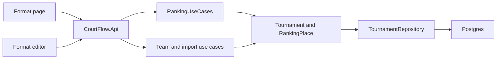

# Division ranking plan

Follows the spec in [spec.md](spec.md) and the domain-driven design constraint in [../product/intent.md](../product/intent.md).

A ranking is part of the **Tournament**, beside its divisions and entries. A division is ranked only when it has `RankingPlace` rows. Not ranked stores nothing, so the last team leaving a ranked division returns it to not ranked with no extra flag. Adding, moving, and removing an entry update that ranking in the same operation, and one `SaveChangesAsync` writes both. The application layer loads the tournament, lists or saves the ranking, and orders an unranked division by name. The API and the Blazor app stay outside the domain. On-screen words live in `RankingWording` so the Format page and the editor cannot drift. [poc/](../../poc/) stays untouched.

Saving a ranking that is already stored updates the existing places in place. Inserting a fresh set on every save would collide with the unique entry index while the old rows were still present. Reordering can also give two places the same rank for a moment inside one save. The unique rank constraint is therefore deferrable, so Postgres checks it at the end of the statement. The unique entry constraint stays immediate.

## Order

1. Domain: `RankingPlace`, ranking methods on `Tournament`, shared wording, and domain tests.
2. Persistence: EF mapping, the organization filter, unique indexes, a migration after [src/CourtFlow.Infrastructure/Migrations/20261013161542_AddSignInAndAccess.cs](../../src/CourtFlow.Infrastructure/Migrations/20261013161542_AddSignInAndAccess.cs), rankings included with a tournament, and the test reset.
3. Application: contracts and `RankingUseCases`. Entry changes already go through `Tournament`, so add, move, delete, and import pick up the ranking rules without a second write.
4. API: format and ranking endpoints, editor-only save, and API tests against Postgres.
5. Web: client, contracts, and fake; the Format link; the Format page and editor; the reorder helper; the leave dialog; and bUnit tests.

## Files

### Domain

- **New** [src/CourtFlow.Domain/RankingPlace.cs](../../src/CourtFlow.Domain/RankingPlace.cs). One saved place: `Id`, `OrganizationId`, `TournamentId`, `DivisionId`, `EntryId`, `Rank`, and `IsNew`. The constructor is internal to the tournament. `SetRank` changes the position, `Accept` clears `IsNew`, and `MoveTo` changes the division, the rank, and the new flag together.
- **New** [src/CourtFlow.Domain/RankingWording.cs](../../src/CourtFlow.Domain/RankingWording.cs). The Format and editor copy, including status, team count, the rejected-rank snackbar, the move announcement, and the Edit and View labels. "Add teams first." uses a period, matching the intent and the empty state. The snackbar is "Enter a rank from 1 to {n}," with the trailing comma from the spec.
- [src/CourtFlow.Domain/Tournament.cs](../../src/CourtFlow.Domain/Tournament.cs) gains a private ranking list and:
  - `IsRanked`, `NewTeamCount`, and `RankingOf`.
  - `SaveRanking` rejects a set that is not exactly the division's entry ids, once each, with "The teams in this division changed. Review the ranking and save again." and writes nothing. The first save inserts places. A later save updates those rows and clears `IsNew`. An empty save of an empty division is allowed and stays unranked.
  - `EnterTeam` appends the new entry at the bottom, marked new, only when the division is already ranked.
  - `MoveEntry` relocates the place only when the division changes. A move into an unranked division removes the place and closes the gap. A move between two ranked divisions takes the bottom of the target and is marked new. A same-division move leaves the ranking alone.
  - `RemoveEntry` removes the place first and closes the gap. The last place leaving unranks the division.
  - `RemoveDivision` clears any leftover ranking before the division goes. A division with teams is still rejected first.
  - An archived tournament still rejects the save with "This tournament is archived. Restore it to make changes."

### Persistence

- [src/CourtFlow.Infrastructure/CourtFlowDbContext.cs](../../src/CourtFlow.Infrastructure/CourtFlowDbContext.cs). Table `ranking_places`, filtered to the current organization, with a backing field on the tournament.
  - The tournament cascades to its places.
  - The place-to-division key uses client cascade, as entries do.
  - The place-to-entry key cascades, so removing an entry cannot leave a place behind at the database.
  - A unique index on `EntryId` is immediate: an entry appears in at most one ranking.
  - A unique constraint on `(DivisionId, Rank)` is `DEFERRABLE INITIALLY DEFERRED`. The model snapshot still records it as a unique index of that name. Postgres creates the index for the constraint, and the next migration diffs the model, not that SQL.
- **New** migration `AddRankings` and an updated model snapshot under [src/CourtFlow.Infrastructure/Migrations/](../../src/CourtFlow.Infrastructure/Migrations/).
- [src/CourtFlow.Infrastructure/TournamentRepository.cs](../../src/CourtFlow.Infrastructure/TournamentRepository.cs). The children loaded with a tournament include rankings.
- [src/CourtFlow.Api.Tests/ApiFactory.cs](../../src/CourtFlow.Api.Tests/ApiFactory.cs). Reset deletes `ranking_places` before `tournament_teams`.

### Application

- [src/CourtFlow.Application/Contracts.cs](../../src/CourtFlow.Application/Contracts.cs) gains `FormatDivisionDetails`, `RankingTeamDetails`, `DivisionRankingDetails`, and `SaveRanking`.
- **New** [src/CourtFlow.Application/Rankings/RankingUseCases.cs](../../src/CourtFlow.Application/Rankings/RankingUseCases.cs).
  - **List.** Divisions in `Division.OrderForList` order: name ignoring case, then Female before Male. Each row carries the team count, whether it is ranked, the new-team count, and the status words.
  - **Get and save.** A missing division returns null. An unranked division's teams are ordered by team name ignoring case, then club name ignoring case, and are not stored. A ranked division is returned in saved rank order, with club and team names. Save calls `Tournament.SaveRanking` and saves once.
- [src/CourtFlow.Application/Access/SignInUseCases.cs](../../src/CourtFlow.Application/Access/SignInUseCases.cs). A member may return to an address under `/format` after signing in.

### API

- **New** [src/CourtFlow.Api/RankingEndpoints.cs](../../src/CourtFlow.Api/RankingEndpoints.cs), mapped from the member group in [src/CourtFlow.Api/Program.cs](../../src/CourtFlow.Api/Program.cs), which also registers `RankingUseCases`.

  | Method and path | Who | Purpose |
  | --- | --- | --- |
  | `GET /api/tournaments/{tournamentId}/format` | Any member | Division rows for the Format page |
  | `GET /api/divisions/{divisionId}/ranking` | Any member | One division's ranking, or name order when it is not ranked |
  | `PUT /api/divisions/{divisionId}/ranking` | Editor | Body `{ entryIds }`. Save, or `400` with the domain message |

  A tournament or division the caller cannot see is `404`. A viewer write is `403`. `TournamentEndpoints.RejectRules` turns a domain rejection into `400` with `{ error }`.

### Web

- [src/CourtFlow.Web/Services/ApiContracts.cs](../../src/CourtFlow.Web/Services/ApiContracts.cs), [ICourtFlowApi.cs](../../src/CourtFlow.Web/Services/ICourtFlowApi.cs), and [CourtFlowApi.cs](../../src/CourtFlow.Web/Services/CourtFlowApi.cs) get the matching records and the three calls.
- [src/CourtFlow.Web/Layout/NavMenu.razor](../../src/CourtFlow.Web/Layout/NavMenu.razor). Format, with the `AccountTree` icon, sits after Teams and is active on `/format` and below it.
- **New** [src/CourtFlow.Web/Pages/Format.razor](../../src/CourtFlow.Web/Pages/Format.razor) at `/format`. Title "Format · CourtFlow". The shared tournament dropdown sits on the title line. Empty, loading, no-division, and archived states use the spec copy. The table columns are Division, Teams, Ranking, and Actions. Edit opens `/format/{id}/ranking`. A division with no teams has the button disabled and the tooltip "Add teams first." Viewers and archived tournaments get View with the visibility icon. Rows use MudBlazor grid columns so a narrow screen wraps without a new stylesheet.
- **New** [src/CourtFlow.Web/Pages/FormatEditor.razor](../../src/CourtFlow.Web/Pages/FormatEditor.razor) at `/format/{divisionId}` and `/format/{divisionId}/{step}`.
  - Unknown step or a missing division shows "This division was not found." and a link to `/format`.
  - The header is the division label, with "Back to format", and the tournament name under it. Opening the editor remembers that tournament.
  - The stepper links Ranking, Pools, and Brackets. Pools and Brackets are info alerts only.
  - Ranking shows the status, Randomize, Discard, and Save. Owners and editors on an unpublished or published tournament can reorder. Viewers and archived tournaments see plain ranks, no handles, and no buttons, and they do not see the name-order alert.
  - A drag and a typed rank both call `RankingOrder.Move`. MudBlazor's drop index counts the dragged row as still in the list, so a move downward lands one index earlier.
  - An invalid rank shows the warning snackbar and remounts the list so the field shows the current rank again.
  - Randomize shuffles on the client. Discard reloads from the API and asks nothing. Save is enabled when the order differs, the division is not ranked, or a loaded team is new. Discard is enabled only when the order differs.
  - A save rejected with the teams-changed message keeps the director's order, drops teams that left, and appends teams that joined, marked new. The reloaded ranking becomes the baseline, so the merge stays unsaved.
  - Leaving inside the app with a different order opens "Discard ranking changes?" through `NavigationLock`. Discard continues. Keep editing stays. Leaving the app uses the browser prompt, because `ConfirmExternalNavigation` follows that same unsaved check.
- **New** [src/CourtFlow.Web/RankingOrder.cs](../../src/CourtFlow.Web/RankingOrder.cs). `Move` treats the destination as the final index. `Shuffle` is a Fisher-Yates over `IRankingRandom`. It retries when the result is the current order, then swaps the first two so a broken source still changes the list. One team is left as it is. `SystemRankingRandom` uses `Random.Shared` and is registered in [src/CourtFlow.Web/Program.cs](../../src/CourtFlow.Web/Program.cs).
- [src/CourtFlow.Web/Services/Confirmations.cs](../../src/CourtFlow.Web/Services/Confirmations.cs) gains a cancel-text argument so the leave dialog can say "Keep editing."
- [src/CourtFlow.Web.Tests/FakeApi.cs](../../src/CourtFlow.Web.Tests/FakeApi.cs) stores rankings, can reject a save, and records the last order sent.

## Tests

Domain tests in **new** [src/CourtFlow.Domain.Tests/RankingRulesTests.cs](../../src/CourtFlow.Domain.Tests/RankingRulesTests.cs):

- A save that omits, repeats, or adds an entry is rejected, and the stored places stay as they were. A matching save ranks 1 to N and clears new.
- Adding and moving in append at the bottom as new. Removing and moving out close the gap. Ranks stay 1 to N.
- Saving clears the new count. The last team leaving unranks the division. A team added after that stores nothing.
- Entry changes on a division that is not ranked store nothing.
- A team that leaves and returns is new again, at the bottom.
- A same-division move, a team rename, and a division rename or gender change leave the ranking alone.
- An archived tournament cannot save a ranking.
- Several teams entered together land at the bottom in that order.

API tests in **new** [src/CourtFlow.Api.Tests/RankingApiTests.cs](../../src/CourtFlow.Api.Tests/RankingApiTests.cs):

- The Format list is in division order and reports "0 teams.", "1 team.", "Not ranked", "Ranked", "Ranked, 1 new team at the bottom.", and "Add teams first."
- An unranked division reads back in name order. Saving that order ranks it, and a later read returns the saved order with new cleared.
- Add, move, delete, and a CSV import update the ranking in the same change. Several import rows append in file order.
- Renaming a team or a division leaves the ranking alone.
- A save with a missing, extra, or repeated entry is rejected and writes nothing.
- An archived save is rejected. A viewer gets `403` on save and `404` after the tournament is archived. Another organization's division is `404` on read and save. Deleting a tournament removes its places.
- Inserting a repeated entry or a repeated rank through SQL fails with a unique violation.

API changes to existing tests:

- [src/CourtFlow.Api.Tests/AccessPolicyApiTests.cs](../../src/CourtFlow.Api.Tests/AccessPolicyApiTests.cs): a signed-out caller is challenged on the format and ranking routes, and a viewer may read them and may not save.
- [src/CourtFlow.Api.Tests/SignInTests.cs](../../src/CourtFlow.Api.Tests/SignInTests.cs): a return address under `/format` is kept for a member.

Web tests in **new** [src/CourtFlow.Web.Tests/FormatPageTests.cs](../../src/CourtFlow.Web.Tests/FormatPageTests.cs):

- No tournaments shows the Teams message and a link to `/tournaments`. Nothing selected shows "Select a tournament to see its divisions." Loading shows the bar and hides the table. No divisions links to the tournament editor.
- Rows follow division order. Counts and status use the singular and plural words. An empty division's button is disabled with "Add teams first."
- An archived tournament shows the archived note and View buttons.
- Edit opens `/format/{id}/ranking`.

Web tests in **new** [src/CourtFlow.Web.Tests/FormatEditorTests.cs](../../src/CourtFlow.Web.Tests/FormatEditorTests.cs):

- The three step addresses, Back, the stepper, and the two placeholders. A missing division says it was not found. Opening the editor remembers the tournament. No teams shows "Add teams first." and hides the list and the buttons.
- A typed rank and `MoveEntryTo` land on the same order, and the live region announces the move. An out-of-range rank is rejected, nothing moves, and the field shows the current rank.
- Randomize follows the injected source and changes the order. It is disabled for one team.
- Save is enabled on an unchanged never-ranked division and ranks it. Discard is enabled only after the order changes, and it reloads the saved order.
- Leaving a clean ranking asks nothing. Leaving a dirty ranking asks, Keep editing stays, and Discard continues and restores the loaded order.
- A rejected save keeps the director's order, drops the team that left, and appends the new team marked "New."
- A viewer and an archived tournament are read-only: no handles, no fields, no buttons, and no name-order alert.

Web tests in **new** [src/CourtFlow.Web.Tests/RankingOrderTests.cs](../../src/CourtFlow.Web.Tests/RankingOrderTests.cs):

- `Move` takes a row out and inserts it at the destination index.
- `Shuffle` uses the random source. A source that would keep the current order swaps the first two instead.

Web changes to existing tests:

- [LayoutTests.cs](../../src/CourtFlow.Web.Tests/LayoutTests.cs): the drawer lists Format after Teams, and Format is active on `/format` and under it.
- [NavMenuTests.cs](../../src/CourtFlow.Web.Tests/NavMenuTests.cs): the Format link is present for a member.
- [StylingRulesTests.cs](../../src/CourtFlow.Web.Tests/StylingRulesTests.cs) needs no change. It already covers the new `.razor` files.

## No test

- **Phone-width stacking.** Rows use MudBlazor's grid columns. No visual test runs at 360 px.
- **Dragging by touch, or with a pointer.** The editor test calls `MoveEntryTo`, which is the same method the drop handler calls. It does not press MudBlazor's drag handle, and it does not run on a phone.
- **The drop-index adjustment.** MudBlazor counts the dragged row as still in the list. The one-index correction for a downward move is not driven by a drop event.
- **Leaving the app.** The browser prompt on reload or close is enabled from the same unsaved check. Its wording belongs to the browser, and bUnit does not close a tab.
- **Simultaneous saves.** Two people saving different orders for the same teams are not simulated. The last save wins.
- **Screen reader delivery.** The live region text is asserted. A reader announcing it is not.

## Proof of concept left behind

[poc/docs/features/division-detail.md](../../poc/docs/features/division-detail.md) had these, and this slice does not carry them forward:

- A ranking panel pinned beside every step, with a saved source and a manual-override flag.
- A fixed random seed so a later step could repeat the same shuffle.
- Locking the ranking once play began.
- Writing a ranking from a `Rank` or `SeedHint` column on import.
