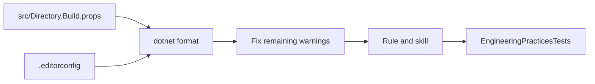

# Engineering practices plan

Follows the spec in [spec.md](spec.md). This slice adds shared build checks for the product tree, brings the hand-written code under `src/` up to them, and updates the rule and skill already named in the intent. It does not change `TargetFramework`, [src/Directory.Packages.props](../../src/Directory.Packages.props), [src/global.json](../../src/global.json), [src/CourtFlow.slnx](../../src/CourtFlow.slnx), or [tools/logo/](../../tools/logo/). It does not edit [src/CourtFlow.Infrastructure/Migrations/](../../src/CourtFlow.Infrastructure/Migrations/).

## Order

1. Add the root `.editorconfig` from the .NET SDK template, then the Migrations `generated_code` section. Generate this before any format, so the formatter skips that folder.
2. Add [src/Directory.Build.props](../../src/Directory.Build.props) with warnings as errors. Leave every project file's `Nullable` and `ImplicitUsings` at `enable`. Do not copy the analysis properties into a project file.
3. Run `dotnet format src/CourtFlow.slnx`. If that diff touches `src/CourtFlow.Infrastructure/Migrations/`, restore that folder before continuing.
4. Build. Fix remaining warnings in hand-written files. Resolve the `CS0618` suppression in the AppHost test. If compiler warnings remain only inside Migrations, add the Infrastructure `NoWarn` described below. Do not add any other suppression.
5. Update the rule and the skill so their text matches this plan.
6. Add the engineering-practices tests, then `dotnet build src/CourtFlow.slnx` and `dotnet test src/CourtFlow.slnx`.

## Files

- [src/Directory.Build.props](../../src/Directory.Build.props) — new. Sets `AnalysisLevel` to `latest`, `AnalysisMode` to `Recommended`, `TreatWarningsAsErrors` to `true`, `EnforceCodeStyleInBuild` to `true`, `Nullable` to `enable`, and `ImplicitUsings` to `enable`. Does not set `NoWarn`. Does not set `AnalysisMode` to `All`.
- [.editorconfig](../../.editorconfig) — new, at the repository root, outside `src/`. Generate it with `dotnet new editorconfig`. Do not change a severity the template left as suggestion or silent. Append one section for `src/CourtFlow.Infrastructure/Migrations/**` with `generated_code = true`.
- These project files stay free of `AnalysisLevel`, `AnalysisMode`, `TreatWarningsAsErrors`, and `EnforceCodeStyleInBuild`. They keep `Nullable` and `ImplicitUsings` at `enable`:
  - [src/CourtFlow.Api/CourtFlow.Api.csproj](../../src/CourtFlow.Api/CourtFlow.Api.csproj)
  - [src/CourtFlow.Api.Tests/CourtFlow.Api.Tests.csproj](../../src/CourtFlow.Api.Tests/CourtFlow.Api.Tests.csproj)
  - [src/CourtFlow.Application/CourtFlow.Application.csproj](../../src/CourtFlow.Application/CourtFlow.Application.csproj)
  - [src/CourtFlow.Application.Tests/CourtFlow.Application.Tests.csproj](../../src/CourtFlow.Application.Tests/CourtFlow.Application.Tests.csproj)
  - [src/CourtFlow.AppHost/CourtFlow.AppHost.csproj](../../src/CourtFlow.AppHost/CourtFlow.AppHost.csproj)
  - [src/CourtFlow.AppHost.Tests/CourtFlow.AppHost.Tests.csproj](../../src/CourtFlow.AppHost.Tests/CourtFlow.AppHost.Tests.csproj)
  - [src/CourtFlow.Domain/CourtFlow.Domain.csproj](../../src/CourtFlow.Domain/CourtFlow.Domain.csproj)
  - [src/CourtFlow.Domain.Tests/CourtFlow.Domain.Tests.csproj](../../src/CourtFlow.Domain.Tests/CourtFlow.Domain.Tests.csproj)
  - [src/CourtFlow.Web/CourtFlow.Web.csproj](../../src/CourtFlow.Web/CourtFlow.Web.csproj)
  - [src/CourtFlow.Web.Tests/CourtFlow.Web.Tests.csproj](../../src/CourtFlow.Web.Tests/CourtFlow.Web.Tests.csproj)
- [src/CourtFlow.Infrastructure/CourtFlow.Infrastructure.csproj](../../src/CourtFlow.Infrastructure/CourtFlow.Infrastructure.csproj) — same, unless step 4 still reports a compiler warning whose path is only under Migrations. Then this file, and no other, sets `NoWarn` to those codes, with an XML comment that names the Migrations folder. `Microsoft.EntityFrameworkCore.Design` keeps its `IncludeAssets` and `PrivateAssets`.
- [src/CourtFlow.AppHost.Tests/AppHostModelTests.cs](../../src/CourtFlow.AppHost.Tests/AppHostModelTests.cs) — the `CS0618` pragma around `GetEnvironmentVariableValuesAsync` goes, by calling the replacement named in that obsolete diagnostic, still for `DistributedApplicationOperation.Publish`. `Host_starts_the_api_blazor_app_postgres_and_mailpit` still asserts ports `5009`, `7011`, `5186`, and `7211`, `IsProxied` false, and the environment names `Email__Smtp`, `WorkOS__ApiKey`, and `Resend__ApiKey`. If the replacement would drop one of those assertions, keep the call and put a `//` reason on the same line as `#pragma warning disable CS0618`.
- Hand-written files under `src/` that `dotnet format` or a remaining warning fix must change. Do not list them ahead of the build. A fix that would change director-facing behavior, an API contract, or an accepted spec stops for the developer. Do not move a type into another project.
- [src/CourtFlow.Web.Tests/EngineeringPracticesTests.cs](../../src/CourtFlow.Web.Tests/EngineeringPracticesTests.cs) — new. The web test project already walks up to [src/CourtFlow.slnx](../../src/CourtFlow.slnx). A new test project would be another package consumer.
- [.cursor/rules/engineering-practices.mdc](../../.cursor/rules/engineering-practices.mdc) — already present, outside `src/`. Replace its text with the rule section below. `alwaysApply: true`.
- [.cursor/skills/verify-engineering-practices/SKILL.md](../../.cursor/skills/verify-engineering-practices/SKILL.md) — already present, outside `src/`. Replace its text with the skill section below.

Leave the thirteen files in [src/CourtFlow.Infrastructure/Migrations/](../../src/CourtFlow.Infrastructure/Migrations/) unchanged, including `#nullable disable` and `#pragma warning disable 612, 618`. Every project stays on `net10.0`.

## Rule

The rule text tells an agent:

- Write product code under `src/` to current Microsoft guidance for .NET, ASP.NET Core, Blazor, Entity Framework Core, Aspire, and xUnit.
- Styling stays typed C# and MudBlazor parameters. Do not add `*.razor.css`. Hand-written CSS is only the loading screen and the unhandled-error bar in `wwwroot/css/app.css`.
- Do not add a service-defaults project. The API stays on `5009` and `7011`, the Blazor app on `5186` and `7211`, and Postgres on `5432`.
- The session stays in the `HttpOnly` cookie `courtflow-session`. Page code does not read a WorkOS token. Who is signed in still comes from `GET /api/me`.
- A calendar date a director sees uses `MM/dd/yyyy`. The API keeps `yyyy-MM-dd`.
- When Microsoft guidance would change director-facing behavior, an API contract, or an accepted intent, keep the accepted behavior.
- `src/Directory.Build.props` holds `AnalysisLevel` `latest`, `AnalysisMode` `Recommended`, `TreatWarningsAsErrors` `true`, and `EnforceCodeStyleInBuild` `true`. Leave info-level suggestions off.
- Generated migration files stay generated. A suppression needs a reason beside it. Do not add one to make the build pass.
- Google OR-Tools, hosted Postgres, and `tools/logo/` are outside this rule. Package versions belong to the current-packages rule.
- Checking a branch is the `verify-engineering-practices` skill.

## Skill

The skill reads `.cursor/rules/engineering-practices.mdc`. It diffs the current branch against the repository's default branch and includes uncommitted changes under `src/`. It leaves files the branch does not touch, except a warning its own edit caused, which it fixes and reports.

It edits a violation when the edit is structure, project settings, or checks. `dotnet format src/CourtFlow.slnx` applies the style rules the build enforces. It does not change director-facing behavior, an API contract, or behavior an accepted spec specifies. When the only fix would, it does not edit, and it tells the developer the file, the diagnostic, and why it stopped. It does not move a type from one project to another.

It restores a branch change that adds `*.razor.css`, a service-defaults project, a WorkOS token page code can read, or a director-facing calendar date that does not use `MM/dd/yyyy`. It keeps the shared build settings, and it does not set `AnalysisMode` to `All` or raise suggestion rules to warning. It does not hand-edit `src/CourtFlow.Infrastructure/Migrations/`. It does not add a suppression to make the build pass. It does not edit `tools/logo/`, add Google OR-Tools or hosted Postgres, or change package versions. Package versions are the `update-packages` skill.

The report names each file it changed and what about it changed. When the branch already follows the rule, it says so and lists no edits.

This slice's own bring-up is steps 3 and 4, not a later call of the skill. Later calls stay branch-scoped.

## Tests

New facts in [src/CourtFlow.Web.Tests/EngineeringPracticesTests.cs](../../src/CourtFlow.Web.Tests/EngineeringPracticesTests.cs). They walk from the test assembly to `CourtFlow.slnx`, then read `src/` and the repo root. They ignore `bin`, `obj`, and `node_modules`.

- `src/Directory.Build.props` is the only file under `src/` or the repo root that sets `AnalysisLevel`, `AnalysisMode`, `TreatWarningsAsErrors`, or `EnforceCodeStyleInBuild`. The values are `latest`, `Recommended`, `true`, and `true`. The same file sets `Nullable` to `enable` and `ImplicitUsings` to `enable`.
- No project file under `src/` sets those four analysis properties. None sets `Nullable` or `ImplicitUsings` to `disable`.
- No project file sets `NoWarn`, except `CourtFlow.Infrastructure` when its `NoWarn` has an XML comment that names Migrations.
- The root `.editorconfig` contains `root = true` and a Migrations section with `generated_code = true`.
- Every `#pragma warning disable` under `src/`, outside `src/CourtFlow.Infrastructure/Migrations/`, has `//` on the same line. The scan includes `.cs` and `.razor`.
- `.cursor/rules/engineering-practices.mdc` contains `alwaysApply: true`, `*.razor.css`, `service-defaults`, `courtflow-session`, `MM/dd/yyyy`, `Recommended`, and `verify-engineering-practices`.
- `.cursor/skills/verify-engineering-practices/SKILL.md` contains `default branch`, `uncommitted`, `dotnet format`, `src/CourtFlow.slnx`, `does not move a type`, `Migrations`, `tools/logo/`, and `update-packages`. It tells the agent to report each changed file, and to stop without editing when the fix would change accepted behavior.

Existing tests are not rewritten for new behavior and must pass. [src/CourtFlow.AppHost.Tests/AppHostModelTests.cs](../../src/CourtFlow.AppHost.Tests/AppHostModelTests.cs) `Host_starts_the_api_blazor_app_postgres_and_mailpit` is the check that startup ports and proxying stay. [src/CourtFlow.Web.Tests/PackageRulesTests.cs](../../src/CourtFlow.Web.Tests/PackageRulesTests.cs) is the check that package versions were not edited.

`git diff -- src/CourtFlow.Infrastructure/Migrations` is empty at the end. That is the check the generated files were not edited.

## No test

- An agent in a later chat obeys the rule. The test checks that the rule file is always on and contains the limits. Cursor applying it is not a test.
- A later skill run diffs a branch, edits, reports, restores a broken accepted difference, and stops when a fix would change behavior. The test checks that the skill text says so. Running that conversation is not a test.
- Suggestion and silent severities in the SDK editorconfig template stay as generated. The implementer appends only the Migrations section. A snapshot of the whole template would fail on the next SDK. The build succeeding with `AnalysisMode` `Recommended` is the check that info and suggestion diagnostics do not fail it.
- A root continuous-integration workflow. This slice does not add one.
- [tools/logo/package.json](../../tools/logo/package.json). This slice does not edit it.
- A director-facing behavior change beyond the existing domain, application, API, web, and app host tests.
- Storing a sign-in token where page code can read it. This slice does not add that.
