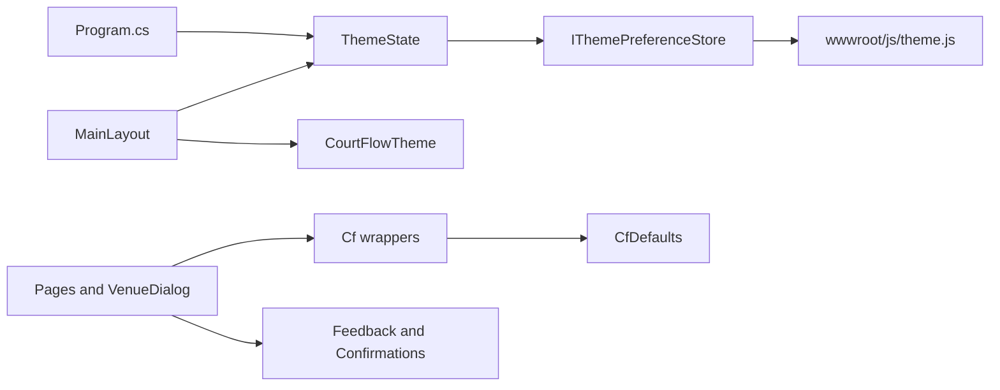

# Look and feel plan

Follows the spec in [spec.md](spec.md) and the accepted intent in [intent.md](intent.md).

All changes are in [src/CourtFlow.Web](../../src/CourtFlow.Web) and [src/CourtFlow.Web.Tests](../../src/CourtFlow.Web.Tests). The domain, application, infrastructure, and API projects do not change. [poc/](../../poc/) stays untouched. The proof of concept's `CourtFlow.png` is copied, not moved.

Typed values live in a new `Theming/` folder. Pages and dialogs reach MudBlazor through `Cf*` wrappers in `Components/` and through two small services for snackbars and confirmations. The only JavaScript is one script that reads and writes the theme cookie and reports the operating system setting. The only hand-written CSS is the loading screen and the error bar.

## Order

1. **Clean up the template.**
   - Delete `wwwroot/lib/bootstrap` and `Layout/MainLayout.razor.css`.
   - Cut `wwwroot/css/app.css` down to the loading screen and `#blazor-error-ui`. Remove the Bootstrap, form-validation, `code`, and `.blazor-error-boundary` rules. The app has no `ErrorBoundary`, so nothing renders that last class.
   - In `index.html`, swap the Roboto link for Inter.
2. **Add brand assets.** Copy `poc/src/CourtFlow.Web/wwwroot/CourtFlow.png` to `wwwroot/CourtFlow.png`, keying its solid teal background to transparent. Replace `favicon.png` and `icon-192.png` with versions made from the original logo, keeping the solid background. This is a one-time image step with any image tool.
3. **Build the typed theme and theme mode.** Add the `Theming/` files. Add `wwwroot/js/theme.js` and load it in `index.html` before the Blazor script. Register the services in `Program.cs` and resolve the mode before `RunAsync`.
4. **Add the stylistic guard tests** (`StylingRulesTests`, `ThemeContrastTests`). Adding them early keeps every later step honest.
5. **Build the layout.** Rewrite `MainLayout`, add `NavMenu`, and bring `NotFound` inside the frame.
6. **Add wrappers and feedback services.** Add the `Cf*` components, `CfDefaults`, `Feedback`, and `Confirmations`.
7. **Move the screens onto the wrappers.**
   - Rewrite `TournamentList`, `TournamentEditor`, and `VenueDialog`.
   - `VenueDialog` becomes a real `MudDialog`.
   - Inline confirmations and error alerts are removed.
8. **Update the tests.** Update `TournamentPageTests` and `FakeApi`, then add the layout, theme, and wrapper tests.

## Files

### Theme and mode

- `src/CourtFlow.Web/Theming/CourtFlowTheme.cs`
  - One static `MudTheme` with both palettes, the typography, and `LayoutProperties.DefaultBorderRadius = "10px"`, using every value in the spec's brand tables.
  - The light palette also sets `WarningContrastText` to dark text.
  - It holds `FontFamily` once and reuses it for default, `H4`, `H6`, and button typography.
  - It holds the logo path (`CourtFlow.png`) and the logo size (44).
  - This is the only C# file allowed to contain hex colors or font names.
- `src/CourtFlow.Web/Theming/ThemeMode.cs` — `enum ThemeMode { Light, Dark }`.
- `src/CourtFlow.Web/Theming/ThemeState.cs` — a singleton.
  - `ThemeMode Mode`, `bool IsDarkMode`, and `event Action? Changed`.
  - `InitializeAsync()` reads the store once.
  - `ToggleAsync()` flips the mode in memory, raises `Changed`, then writes the store. It catches `JSException`, so a refused cookie still leaves the new mode for the visit.
  - A static, pure `Resolve(string? cookieValue, bool systemPrefersDark)` returns the mode: `light` or `dark` from the cookie, ignoring case, and otherwise the system setting.
  - It is a singleton rather than scoped so `Program.cs` can initialize the same instance the layout reads.
- `src/CourtFlow.Web/Theming/IThemePreferenceStore.cs` — `Task<ThemePreference> ReadAsync()`, returning the cookie value and whether the system prefers dark, plus `Task WriteAsync(ThemeMode mode)`.
- `src/CourtFlow.Web/Theming/JsThemePreferenceStore.cs` — the `IJSRuntime` implementation, calling `courtflowTheme.read` and `courtflowTheme.write`.
- `src/CourtFlow.Web/wwwroot/js/theme.js` — defines `window.courtflowTheme`.
  - `read()` returns `{ cookie, systemPrefersDark }`. The cookie comes from `document.cookie`. `systemPrefersDark` comes from `matchMedia('(prefers-color-scheme: dark)')`.
  - `write(mode)` sets `courtflow-theme=<mode>; path=/; max-age=31536000; SameSite=Lax`.
  - It does not touch the page's look, so the loading screen stays light.
- `src/CourtFlow.Web/Theming/CfDefaults.cs` — typed component defaults the wrappers read: outlined variant, dense margin, small button size, the app bar elevation, and the content `MaxWidth.ExtraExtraLarge`. Pages never repeat these values.
- `src/CourtFlow.Web/Program.cs`
  - Register `ThemeState` (singleton), `IThemePreferenceStore`, `Feedback`, and `Confirmations`.
  - Replace `await builder.Build().RunAsync()` with: build the host, `await host.Services.GetRequiredService<ThemeState>().InitializeAsync()`, then `await host.RunAsync()`.
  - This is the documented pattern for calling JS before the first render, so the frame's first paint already uses the resolved mode.

### Frame

- `src/CourtFlow.Web/Layout/MainLayout.razor`
  - `MudThemeProvider Theme="CourtFlowTheme.Theme" IsDarkMode="ThemeState.IsDarkMode"`, plus the popover, dialog, and snackbar providers.
  - The app bar has the menu button (`aria-label="Toggle navigation"`), the logo `MudImage` with an empty alt, and the "CourtFlow" text inside one link to `/`, then a spacer, then the theme toggle.
  - The toggle's icon and label come from `ThemeState.IsDarkMode`.
  - `MudDrawer Variant="DrawerVariant.Mini" OpenMiniOnHover="true" ClipMode="DrawerClipMode.Always"`.
  - `MudMainContent` wraps a `MudContainer MaxWidth="CfDefaults.ContentMaxWidth"`.
  - It subscribes to `ThemeState.Changed` and unsubscribes on dispose.
  - **Check during implementation:** does a mini drawer in MudBlazor 8.13 overlay the content when expanded below the small breakpoint? If it doesn't, switch to `DrawerVariant.Responsive` below that breakpoint using `MudBreakpointProvider`. Tell the product owner, because the intent names the mini variant.
- `src/CourtFlow.Web/Layout/NavMenu.razor` — a `MudNavMenu` with one `CfNavLink`: Tournaments, `EmojiEvents`, `Href="/"`, active prefixes `/` exact and `/tournaments`.
- `src/CourtFlow.Web/Pages/NotFound.razor` — adds `@layout MainLayout`, so it renders in the frame however the router hosts the not-found page. It uses `CfPageHeader` with the title "Page not found", the `SearchOff` icon, and a link to `/`.
- `src/CourtFlow.Web/App.razor` — unchanged. `FocusOnNavigate Selector="h1"` starts working once pages render `h1`.
- `src/CourtFlow.Web/wwwroot/index.html`
  - Load the Inter font. Keep `favicon.png`. Load `js/theme.js`.
  - Keep the loading markup.
  - Remove the reference to `CourtFlow.Web.styles.css`, because no scoped CSS remains. If the build still emits the bundle, leave the link.
- `src/CourtFlow.Web/wwwroot/css/app.css`
  - Keep the loading circle and the loading text. The track uses the light primary color at low stroke opacity, the arc uses the light primary color, the page background is the light background, and the text uses light text primary.
  - Keep `#blazor-error-ui` with its current layout.
  - Every hex value in the file must be one of those three light palette values.

### Wrappers

All in `src/CourtFlow.Web/Components/`. Each wrapper passes through `Label`, `Required`, `Disabled`, the value, and a `ValueChanged` callback. It passes extra attributes to the MudBlazor control, so `data-testid` keeps working.

- `CfField.razor` — the shared shell for form fields.
  - It renders the label above the control as a `MudText` holding a `<label for=…>`, with an asterisk when `Required`.
  - The control gets a generated id through MudBlazor's `InputId` when 8.13 exposes it, and `aria-labelledby` otherwise.
  - Required controls set `Required="true"` so screen readers hear it.
- `CfTextField.razor` — `MudTextField<string>` inside `CfField`, taking `Lines` for description.
- `CfNumericField.razor` — generic `CfNumericField<T>` over `MudNumericField<T>`, passing `Min` and `Max`.
- `CfDateField.razor` — binds `DateOnly?`, converting to and from `MudDatePicker`'s `DateTime?`.
  - It sets `Editable="true"` and `DateFormat="yyyy-MM-dd"`, so keyboard users and tests can type a date.
  - It shows the calendar icon.
- `CfSelect.razor` — generic `CfSelect<T>` over `MudSelect<T>`, taking `Items` and a `Func<T, string> ToLabel`, with a `Placeholder` shown when nothing is selected. The time zone select uses `UsTimeZones.All`.
- `CfAddButton.razor` — a small, filled, primary `MudButton` with the `Add` icon and the text "Add". It takes `AriaLabel` and `OnClick`.
- `CfIconButton.razor` — a small `MudIconButton` inside a `MudTooltip`, taking `Icon`, `Label` (used as both tooltip text and `aria-label`), `Color`, and `OnClick`.
- `CfSaveButton.razor` — a filled, primary `MudButton` with the `Save` icon, taking `Text` and `OnSave` (`Func<Task>`). It sets itself disabled while `OnSave` runs.
- `CfPageHeader.razor` — a `MudText Typo="Typo.h4" HtmlTag="h1"` with an optional `BackHref` (which renders a `CfIconButton` with the `ArrowBack` icon and the label "Back to tournaments"), plus an `Actions` slot on the right.
- `CfNavLink.razor` — wraps `MudNavLink`. It listens to `NavigationManager.LocationChanged` and adds MudBlazor's own `active` class when the path matches any active prefix. `MudNavLink` alone cannot mark `/` active on `/tournaments/{id}`.

### Feedback

- `src/CourtFlow.Web/Services/Feedback.cs` — wraps `ISnackbar`.
  - `Saved()` and `Deleted()` show success messages.
  - `Rejected(string message)` shows a warning.
  - `Failed(string message)` shows an error.
  - `Task<bool> RunAsync(Func<Task> action, Action onSuccess)` catches `DomainRuleException` as rejected and `HttpRequestException` as failed. It returns whether the action succeeded, so a dialog knows whether to close.
- `src/CourtFlow.Web/Services/Confirmations.cs` — `Task<bool> ConfirmDeleteAsync(string itemName, string consequence)`.
  - It uses `IDialogService.ShowMessageBoxAsync` with the title "Delete {itemName}?", the consequence as the body, and the buttons "Delete" and "Cancel".
  - It sets `CloseOnEscapeKey` and `BackdropClick` to true.
  - It returns `true` only for Delete.

### Screens

- `src/CourtFlow.Web/Pages/TournamentList.razor`
  - `CfPageHeader` titled "Tournaments", with `CfAddButton AriaLabel="Add tournament"` in its actions slot.
  - A progress bar while loading.
  - An info alert "No tournaments yet. Use Add to create one." when the list is empty.
  - Otherwise a `MudTable Dense Hover Breakpoint="Breakpoint.Sm"`, with `DataLabel` on each cell so rows stack on phones.
  - Duration is shown as "{n} min". Edit and Delete are `CfIconButton`s labeled "Edit {name}" and "Delete {name}".
  - Delete goes through `Confirmations` with the consequence "Its venues and courts are also deleted.", then `Feedback.Deleted()`.
  - `MudTable` is used directly. It is the only table so far, and a wrapper waits for a second one.
- `src/CourtFlow.Web/Pages/TournamentEditor.razor`
  - A `loading` flag. The progress bar shows until the tournament and the list have loaded. The form renders only after that.
  - Start and end dates become `DateOnly?` fields, replacing today's `startText` and `endText`.
  - Fields use `CfTextField`, `CfDateField` (inside `MudGrid`, with `xs="12" sm="6"` items), `CfSelect`, and `CfNumericField`.
  - The long-span and duplicate-name warnings stay inline as `MudAlert Severity.Warning`.
  - Save uses `CfSaveButton` and `Feedback.RunAsync`. Today's inline error alert and `error` field are removed.
  - The Venues card has a header with `CfAddButton AriaLabel="Add venue"`, and an info alert "No venues yet. Use Add to create one." when empty.
  - Each venue shows its name, its address, and its court count with the `SportsVolleyball` icon, plus `CfIconButton` Edit and Delete.
  - Add and Edit open `VenueDialog` through `IDialogService.ShowAsync`. When the dialog returns saved, the venue list reloads.
  - Delete confirms with "Its courts are also deleted."
  - The not-found state keeps "This tournament was not found." and adds a link to `/`.
- `src/CourtFlow.Web/Components/VenueDialog.razor`
  - Becomes a `MudDialog` with a cascading `IMudDialogInstance`.
  - Its parameters are `TournamentId` and `Existing`. It calls `ICourtFlowApi` itself, so it can stay open on a rejected save or a failed call.
  - Fields use `CfTextField` and `CfNumericField`.
  - The actions are a text "Cancel" on the left and `CfSaveButton` on the right.
  - On success it shows `Feedback.Saved()` and closes with a result.

## Tests

All in [src/CourtFlow.Web.Tests](../../src/CourtFlow.Web.Tests), using bUnit with MudBlazor services. Tests that open dialogs render a `MudDialogProvider` in the same context first. Snackbar assertions read `ISnackbar.ShownSnackbars`.

**`FakeApi.cs`**
- Implement `CreateVenueAsync` and `UpdateVenueAsync`, and count the calls.
- Add a `FailWith` property. When set, the next call throws `HttpRequestException` with that message.

**`ThemeStateTests.cs`** (pure, with a fake store)
- `Resolve`:
  - The cookie `dark` gives dark, whatever the system says.
  - The cookie `light` gives light, whatever the system says.
  - No cookie follows the system, light or dark.
  - An invalid cookie value such as `blue` follows the system.
  - Case is ignored.
- `InitializeAsync` reads the store once and does not write.
- `ToggleAsync` flips the mode, raises `Changed`, and writes the new mode.
- A store write that throws `JSException` still leaves the new mode.

**`LayoutTests.cs`**
- Renders a link to `/` containing the logo and "CourtFlow".
- Renders a menu button labeled "Toggle navigation".
- The drawer has exactly one link, Tournaments.
- The theme toggle reads "Switch to dark theme" in light mode and "Switch to light theme" in dark mode. Clicking it flips the label and records one write on the fake store.
- Renders no sign-in, sign-out, user name, or tournament selector text.
- The Tournaments link is active at `/`, at `/tournaments/new`, and at `/tournaments/{id}`.

**`WrapperTests.cs`**
- `CfTextField`, `CfNumericField`, `CfDateField`, and `CfSelect`:
  - The label renders before the input as a `<label>` tied to the input.
  - `Required` adds the asterisk and the input's required marking.
  - No floating MudBlazor label renders.
- `CfNumericField` passes `Min` and `Max` through.
- `CfDateField` binds `DateOnly?` both ways, and typing `2026-09-01` sets September 1.
- `CfSelect` shows its placeholder when empty, and lists labels from `ToLabel`.
- `CfSaveButton` is disabled while its task is pending. Two clicks call `OnSave` once.
- `CfIconButton` renders its label as `aria-label` and as tooltip text.
- `CfPageHeader` renders exactly one `h1`.

**`TournamentPageTests.cs`**, updated
- The existing behavior tests keep their meaning:
  - The five list fields.
  - Create and edit share one editor.
  - Venues wait until details are saved.
  - Create moves to the new tournament and edit stays.
  - Unknown ids show not found.
  - Only the seven zones are offered.
  - Both warnings show and saves still run.
  - A tournament doesn't warn about its own name.
  - September 1 through 5 doesn't warn.
- `Fill` types dates into the `CfDateField` inputs. It sets the time zone through the `CfSelect` component's `ValueChanged`, instead of opening the popover.
- New or changed tests:
  - The empty list and the empty venue list show the new info copy.
  - The list shows duration as "60 min".
  - The list and the editor each render one `h1`.
  - The editor shows a progress bar and no form until its load finishes. The test uses a `FakeApi` gate that holds `GetTournamentAsync`.
  - Deleting a tournament opens a modal titled "Delete City Cup?" that mentions venues and courts:
    - Cancel calls nothing.
    - Delete calls delete once and shows "Deleted".
  - Deleting a venue behaves the same way, and its body mentions courts.
  - Saving details shows "Saved".
  - A rejected save, such as a blank name, shows the rule message as a warning, and no error alert is rendered inline.
  - With `FailWith` set, a save shows the failure as an error and the page keeps its values.
  - Add venue opens a modal titled "Add venue":
    - Saving calls create, closes the dialog, reloads the list, and shows "Saved".
    - Cancel calls nothing.
    - A blank name keeps the dialog open with a warning.
    - `FailWith` keeps it open with an error.
  - Edit venue opens "Edit venue", prefilled, and saving calls update.
  - The not-found state and the `NotFound` page both link back to `/`.

**`StylingRulesTests.cs`** — reads the `CourtFlow.Web` source tree, found by walking up from the test assembly to `CourtFlow.slnx`.
- No `*.razor.css` file exists.
- No `wwwroot/lib/bootstrap` folder exists.
- No `.razor` file has a `style=` attribute or a hex color.
- Every literal `Class="…"` value in a `.razor` file is only MudBlazor spacing utilities, such as `pa-4`, `mt-3`, or `px-2`.
- No `.cs` file except `Theming/CourtFlowTheme.cs` contains a hex color or the string `Inter`.
- Every hex value in `wwwroot/css/app.css` equals the light background, light primary, or light text primary in `CourtFlowTheme`.

**`ThemeContrastTests.cs`** — computes WCAG contrast from the `MudColor` palette values, in both modes. Each of these pairs must reach at least 4.5:1:
- Text primary on background and on surface.
- Text secondary on background and on surface.
- App bar text on the app bar background.
- Each of primary, secondary, success, info, warning, and error against its contrast text.
- Drawer text on the drawer background in dark mode.

The test settles whether the dark palette needs its own status colors, as the spec's "unless contrast fails" requires.

## No test

These spec items have no automated test. bUnit does not lay out or paint pages. Check them once in a browser at 360 px and at desktop width before calling the slice done.

- No page scrolls sideways at 360 px. Table rows stack below the small breakpoint. Start and end date stack.
- The drawer expands on hover. On a phone-width screen the expanded drawer covers the content.
- The loading screen is light even when the saved mode is dark. The frame appears in the resolved mode with no light-to-dark switch after load.
- A browser that refuses cookies still toggles for the visit. `ThemeStateTests` covers the logic, but not a real browser's refusal.
- Operating system theme changes while the app is open are ignored. This is behavior by omission, since nothing subscribes to changes.
- Dialogs trap focus, and focus returns to the opening button. Escape and a backdrop click close confirmations without deleting. MudBlazor owns this behavior. The tests cover only the result of Cancel.
- Keyboard reach across the menu button, toggle, drawer link, toolbar buttons, fields, and dialog buttons.
- Focus moves to the `h1` after navigation. The tests prove each page has one `h1`. `FocusOnNavigate` does the focusing.
- The favicon, the app icon, and the logo look right in both modes.
- Inter actually loads from Google Fonts.

## Proof of concept left behind

The proof of concept's [design system](../../poc/docs/ui/design-system.md) and [shell](../../poc/docs/ui/shell.md) also had these. This slice does not carry them forward:
- The `--cf-*` CSS token layer, its TV-mode and print overrides, and [ADR 0002](../../poc/docs/adr/0002-styling-strategy.md). Typed C# replaces them.
- The `cf-select--*`, `cf-field--*`, and `cf-form-details*` CSS classes. Wrappers and MudBlazor layout components replace them.
- Server-side reading of the theme cookie through `IHttpContextAccessor`. This app has no server rendering. JS reads the cookie before the first render instead.
- The public layout, the auth chrome (user name, Login, Logout), the header tournament selector, and the tournament-context remount.
- Drawer links for divisions, teams, imports, schedule, brackets, matches, standings, repairs, and court status.
- `MudDataGrid`, the autocomplete and time wrappers, `CfDateTimeRow`, and division color derivation.
- Google Places on the venue address.

Where the proof of concept differs from the spec, the spec wins:
- The tournament list stays at `/`.
- The add button is `CfAddButton`, not `CfToolbarAddButton`.
- The theme follows the operating system when there is no cookie, instead of always starting light.
- The loading screen stays light.
