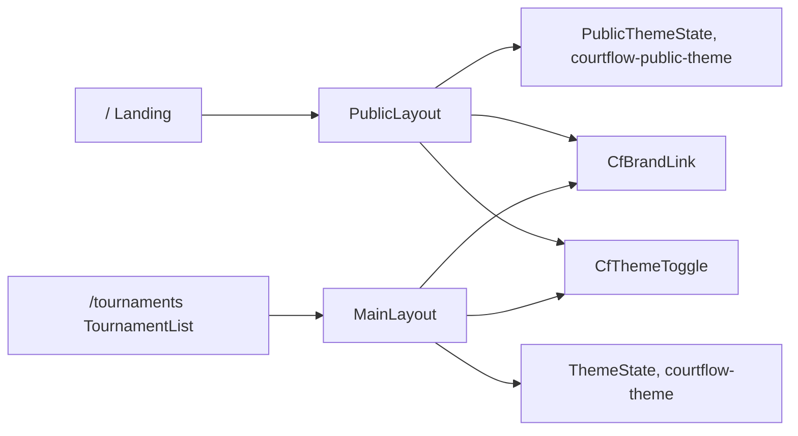

# Public landing page plan

Follows the spec in [spec.md](spec.md). This slice changes only the Blazor app and its tests. The API, the domain, and Postgres stay as they are.

The landing page takes `/` in a new public frame. The tournament list moves to `/tournaments`, and every director link that pointed at the old root follows it. The public frame gets its own light or dark choice in its own cookie, so the two frames can differ.

## Order

1. **Two theme choices.** Make the theme cookie name a parameter, and register a second theme state for the public frame. `Program.cs` initializes both before the first render.
2. **Shared app bar parts.** Extract `CfBrandLink` and `CfThemeToggle` from `MainLayout`, so both frames use the same logo, name, toggle icons, and labels.
3. **Move the tournament list** to `/tournaments` and repoint every director link.
4. **Add `PublicLayout` and `Landing`.**
5. **Update the existing tests, then add the new ones.**

## Files

**Theme**

- [src/CourtFlow.Web/wwwroot/js/theme.js](../../src/CourtFlow.Web/wwwroot/js/theme.js) — `read(cookieName)` and `write(cookieName, mode)` take the cookie name instead of hard-coding `courtflow-theme`. The cookie attributes stay the same: `path=/`, one year, `SameSite=Lax`.
- [src/CourtFlow.Web/Theming/JsThemePreferenceStore.cs](../../src/CourtFlow.Web/Theming/JsThemePreferenceStore.cs) — the constructor takes `(IJSRuntime js, string cookieName)` and passes the name to both calls.
- `src/CourtFlow.Web/Theming/ThemeCookies.cs` — new. `Director = "courtflow-theme"` and `Public = "courtflow-public-theme"`.
- [src/CourtFlow.Web/Theming/ThemeState.cs](../../src/CourtFlow.Web/Theming/ThemeState.cs) — no longer `sealed`. The logic does not change. Its summary says it is the director's choice.
- `src/CourtFlow.Web/Theming/PublicThemeState.cs` — new. `public sealed class PublicThemeState(IThemePreferenceStore store) : ThemeState(store)`. It gives the public choice its own DI type and reuses `Resolve`, `InitializeAsync`, and `ToggleAsync`.
- [src/CourtFlow.Web/Program.cs](../../src/CourtFlow.Web/Program.cs) — the single `IThemePreferenceStore` registration becomes two factory registrations. `ThemeState` uses a `JsThemePreferenceStore` built with `ThemeCookies.Director`; `PublicThemeState` uses one built with `ThemeCookies.Public`. Both states are awaited with `InitializeAsync()` before `RunAsync`.
- [src/CourtFlow.Web/Theming/CourtFlowTheme.cs](../../src/CourtFlow.Web/Theming/CourtFlowTheme.cs) — adds `H3` typography with the font stack and weight 600, matching H4 and H6.
- [src/CourtFlow.Web/Theming/CfDefaults.cs](../../src/CourtFlow.Web/Theming/CfDefaults.cs) — adds:
  - `PublicContentMaxWidth = MaxWidth.Large`.
  - `SecondaryTextClass = "mud-text-secondary"`, which is MudBlazor's own class for the palette's secondary text color.
  - `BrandNameStyle = "white-space:nowrap;overflow:hidden;text-overflow:ellipsis;min-width:0"`. This is the one hand-written CSS exception the spec requires the plan to name. MudBlazor 8.13 has no typed truncation for `MudText` and no ellipsis utility class. It follows the `DropZoneInputStyle` precedent, and its doc comment says why.

**Shared components**

- `src/CourtFlow.Web/Components/CfBrandLink.razor` — new. Takes an `Href` parameter. Renders `MudLink` with `Color.Inherit`, no underline, and `data-testid="brand-link"`. Inside are the logo `MudImage` (empty alt, `CourtFlowTheme.LogoSize`) and "CourtFlow" as an `h6` span. `BrandNameStyle` goes on the link and the name, so the word truncates before anything else gives way.
- `src/CourtFlow.Web/Components/CfThemeToggle.razor` — new. Takes a `ThemeState State` parameter. It renders today's `CfIconButton` with `data-testid="theme-toggle"`, subscribes to `State.Changed`, and unsubscribes on dispose. `SwitchToDark` and `SwitchToLight` move here from `MainLayout`.

**Director side**

- [src/CourtFlow.Web/Layout/MainLayout.razor](../../src/CourtFlow.Web/Layout/MainLayout.razor) — uses `<CfBrandLink Href="/tournaments" Class="ml-2" />` and `<CfThemeToggle State="ThemeState" />`. Its own toggle code and label constants are removed. It keeps the `Changed` subscription, because `MudThemeProvider.IsDarkMode` reads `ThemeState`.
- [src/CourtFlow.Web/Layout/NavMenu.razor](../../src/CourtFlow.Web/Layout/NavMenu.razor) — the Tournaments link goes to `Href="/tournaments"`, and `TournamentPaths = ["/tournaments"]`.
- [src/CourtFlow.Web/Pages/TournamentList.razor](../../src/CourtFlow.Web/Pages/TournamentList.razor) — `@page "/tournaments"`.
- [src/CourtFlow.Web/Pages/TournamentEditor.razor](../../src/CourtFlow.Web/Pages/TournamentEditor.razor) — both `BackHref="/"` values and the not-found `MudLink Href="/"` become `/tournaments`.
- [src/CourtFlow.Web/Pages/Teams.razor](../../src/CourtFlow.Web/Pages/Teams.razor) — "Go to tournaments" goes to `/tournaments`.
- [src/CourtFlow.Web/Pages/NotFound.razor](../../src/CourtFlow.Web/Pages/NotFound.razor) — "Back to tournaments" goes to `/tournaments`. It keeps `@layout MainLayout`.

**Public side**

- `src/CourtFlow.Web/Layout/PublicLayout.razor` — new. Injects `PublicThemeState`.
  - Providers: `MudThemeProvider` with `Theme="CourtFlowTheme.Theme"`, `IsDarkMode` bound to the public state, and `ObserveSystemThemeChange="false"`. Also `MudPopoverProvider`, for the toggle's tooltip.
  - `MudLayout` holds a `MudAppBar` with `Elevation="CfDefaults.AppBarElevation"` and `Color.Default`. Inside it, in order: `CfBrandLink Href="/"`, `MudSpacer`, `CfThemeToggle State="PublicTheme"`, and `MudButton Href="/tournaments" Variant="Variant.Filled" Color="Color.Secondary"` reading "Login", with `data-testid="login"`.
  - `MudMainContent` holds a `MudContainer` with `MaxWidth="CfDefaults.PublicContentMaxWidth"` and `Class="py-6"`.
  - There is no menu button and no drawer. It subscribes to `Changed` the same way `MainLayout` does.
- `src/CourtFlow.Web/Pages/Landing.razor` — new. `@page "/"`, `@layout PublicLayout`, and `<PageTitle>CourtFlow</PageTitle>`. A centered `MudStack` with `Class="mt-12"` holds:
  - `MudText Typo="Typo.h3" HtmlTag="h1" Align="Align.Center"` reading "Welcome".
  - `MudText Typo="Typo.h6" HtmlTag="p" Align="Align.Center" Class="@CfDefaults.SecondaryTextClass"` reading "Coming soon".
  - It injects nothing.

Do not change [src/CourtFlow.Web/App.razor](../../src/CourtFlow.Web/App.razor): `MainLayout` stays the default layout, and `FocusOnNavigate` already targets `h1`. Do not change [src/CourtFlow.Web/wwwroot/css/app.css](../../src/CourtFlow.Web/wwwroot/css/app.css) or `index.html`. Do not change [src/CourtFlow.Api](../../src/CourtFlow.Api), [src/CourtFlow.Domain](../../src/CourtFlow.Domain), [src/CourtFlow.Application](../../src/CourtFlow.Application), or [src/CourtFlow.Infrastructure](../../src/CourtFlow.Infrastructure).

## Tests

Existing tests to update:

- [src/CourtFlow.Web.Tests/LayoutTests.cs](../../src/CourtFlow.Web.Tests/LayoutTests.cs) — the brand link and the drawer's Tournaments link expect `/tournaments`. The toggle tests use `CfThemeToggle.SwitchToDark` and `SwitchToLight`. The active-link theory uses `/tournaments` in place of `/`, plus a new case that the Tournaments link is not active on `/`. `No_sign_in_chrome_or_tournament_selector` stays as it is.
- [src/CourtFlow.Web.Tests/TournamentPageTests.cs](../../src/CourtFlow.Web.Tests/TournamentPageTests.cs) — the editor's not-found link and the `NotFound` link expect `/tournaments`.
- [src/CourtFlow.Web.Tests/TeamsPageTests.cs](../../src/CourtFlow.Web.Tests/TeamsPageTests.cs) — the no-tournaments link expects `/tournaments`.
- [src/CourtFlow.Web.Tests/WrapperTests.cs](../../src/CourtFlow.Web.Tests/WrapperTests.cs) — the `BackHref` sample may stay `/`, since it only tests the header. Change it to `/tournaments` for consistency.
- [src/CourtFlow.Web.Tests/FakeThemePreferenceStore.cs](../../src/CourtFlow.Web.Tests/FakeThemePreferenceStore.cs) — no change. Tests create one fake per state.

New tests:

- `src/CourtFlow.Web.Tests/PublicLayoutTests.cs` — new.
  - The brand link points to `/` and has the logo and "CourtFlow". The toggle and the Login button follow it, in that order in the markup.
  - There is no `Toggle navigation` button and no `.mud-drawer`.
  - Login's `href` is `/tournaments`, and its text is exactly "Login".
  - The toggle's label flips, and it writes only to the public fake store. The director fake store sees no writes and the director `ThemeState.Mode` is unchanged.
  - A public cookie of `dark` renders the "Switch to light theme" label.
- `src/CourtFlow.Web.Tests/LandingPageTests.cs` — new.
  - Exactly one `h1`, reading "Welcome", and the text "Coming soon".
  - Rendering it uses no `ICourtFlowApi`: none is registered, so any inject would throw.
  - Its `RouteAttribute` is `/`, and its `LayoutAttribute` is `PublicLayout`.
  - `TournamentList`'s `RouteAttribute` is `/tournaments`, and no page other than `Landing` declares `/`. This is found by reflection over the assembly.
- [src/CourtFlow.Web.Tests/ThemeStateTests.cs](../../src/CourtFlow.Web.Tests/ThemeStateTests.cs) — one test that a `PublicThemeState` and a `ThemeState` with separate fake stores toggle independently. Resolve, invalid-cookie, and refused-cookie behavior is inherited and already covered.

Unchanged and still required to pass:

- [src/CourtFlow.Web.Tests/StylingRulesTests.cs](../../src/CourtFlow.Web.Tests/StylingRulesTests.cs) — no style attributes or hex colors in `.razor`, and only spacing utilities as literal classes. The new constants go through `@CfDefaults`, as the drop zone's do.
- [src/CourtFlow.Web.Tests/ThemeContrastTests.cs](../../src/CourtFlow.Web.Tests/ThemeContrastTests.cs) — it already checks Secondary against its contrast text in both modes, which covers the Login button.

## No test

- **The 360 px top bar.** bUnit has no viewport. Check it by hand in both modes: no sideways scroll, Login and the toggle fully visible, and "CourtFlow" truncating.
- **The theme cookie script.** `theme.js` reading and writing the named cookie in a real browser. Check it by hand: toggle on `/`, reload, and confirm `/tournaments` keeps its own mode.
- **Navigation without a reload.** Pressing Login in a real browser does not reload the page. It is a plain Blazor-intercepted link, and the tests check only its `href`.
- **Keyboard order.** Brand, toggle, then Login. The tests check markup order, not focus.
- **The loading screen.** It stays light. `app.css` is unchanged, and the existing palette test guards it.

## Not in this slice

A dense app bar, a Sign in button to `/login?returnUrl=/tournaments`, an Admin label, the signed-in person's name, and Logout. A gradient hero, an events grid from `GET /public/events`, a Refresh button, a Past events section, and an `/admin` redirect. This slice uses a full-height bar, a plain "Login" link to `/tournaments`, and a page with only "Welcome" and "Coming soon".
