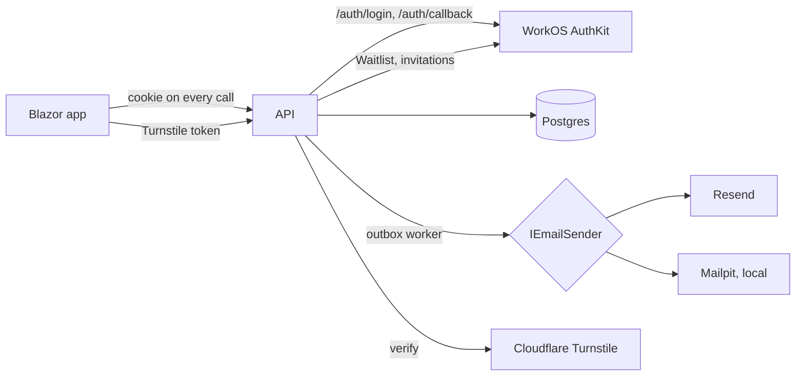

# Sign-in and access plan

Follows the spec in [spec.md](spec.md). [poc/](../../poc/) stays untouched. This slice touches every project: the domain gains organizations with members, invitations, and access requests. The API gains a session, roles, and email. The Blazor app gains sign-in state, new pages, and role-aware frames. Aspire gains Mailpit.

## Order

Each step leaves the build green and every existing test passing.

1. **Domain rules.** Organization status and members, invitations, and access requests, with their tests. Nothing uses them yet.
2. **Organization from the signed-in person.** The database filters by the caller's organization instead of the fixed Test Organization. A test-only sign-in replaces the hard-coded scope in API tests. Add the migration.
3. **Session and roles in the API.** Cookie session, WorkOS sign-in endpoints, `/api/me`, role policies on every endpoint, and acceptance of invitations at sign-in.
4. **Email.** Outbox, templates, senders, and Mailpit in Aspire.
5. **Owners manage their organization.**
6. **Request Access, the Waitlist, and the operator screens**, plus the background sweep.
7. **Deactivate and reactivate.**
8. **Blazor app.** Sign-in state, frames, and pages.
9. **WorkOS dashboard setup and hand checks**, including the phone-width trial.

**Builds on [tournament-lifecycle](../tournament-lifecycle/plan.md), which is in place.** It provides:

- **Tournament states.** `Tournament.Status` (`Unpublished`, `Published`, `Archived`), `LastPublishedAt`, and the publish, unpublish, archive, and restore endpoints.
- **The automatic archive.** `AutoArchiveWorker` in the API runs `TournamentUseCases.ArchiveExpiredAsync` hourly and is switched off by `AutoArchive:Enabled`.
- **Time.** `TimeProvider.System` is registered in the API, and `TestClock` drives time in API tests.
- **Read-only pages.** The tournament editor and Teams pages already have a read-only mode for archived tournaments, keyed on `IsArchived`.

This slice reuses each of these rather than adding its own.

## Files

### 1. Domain

- [src/CourtFlow.Domain/Organization.cs](../../src/CourtFlow.Domain/Organization.cs) — becomes the members aggregate.
  - Adds `Status` (`OrganizationStatus.Active` or `Deactivated`), `Deactivate()`, and `Reactivate()`.
  - Adds a private `_memberships` list exposed as `Memberships`.
  - `AddMember(userId, email, name, role)` refuses a duplicate user.
  - `ChangeRole(membershipId, role)` and `RemoveMember(membershipId)` both refuse to leave zero owners, with the message "An organization needs at least one owner."
  - `UpdateMemberProfile(userId, email, name)` refreshes the copy of the person's details from WorkOS.
  - The existing constructor stays, and a new organization starts active with no members.
- `src/CourtFlow.Domain/Membership.cs` — new. `Id`, `OrganizationId`, `UserId` (the WorkOS user ID), `Email`, `Name`, `Role`.
- `src/CourtFlow.Domain/OrganizationRole.cs` — new. `Owner`, `Editor`, `Viewer`.
- `src/CourtFlow.Domain/OrganizationStatus.cs` — new.
- `src/CourtFlow.Domain/Invitation.cs` — new.
  - Fields: `Id`, `OrganizationId`, `Email` (trimmed and lowercased), `Role`, `SentByUserId` (null when an operator sent it), `SentByOperatorEmail`, `WorkOsInvitationId`, `SentAt`, `ExpiresAt` (`SentAt` plus 7 days), and `State` (`Pending`, `Accepted`, `Cancelled`).
  - `IsExpired(now)` is computed, so nothing has to mark it.
  - Methods: `Accept(now)`, which refuses when not pending or when expired; `Cancel()`; and `Reissue(workOsInvitationId, now)`, which resets `SentAt` and `ExpiresAt` and returns a cancelled or expired invitation to pending.
- `src/CourtFlow.Domain/AccessRequest.cs` — new.
  - Fields: `Id`, `WaitlistEntryId`, `Name`, `Email`, `OrganizationName`, `Message`, `RequestedAt`, `ExpiresAt` (plus 7 days), `ReminderSentAt`, and `State` (`Waiting`, `Approved`, `Declined`, `Expired`).
  - `ReminderDue(now)` is true when the request is waiting, no reminder has been sent, and `now >= ExpiresAt - 24h`.
  - `ExpiryDue(now)` is true when the request is waiting and `now >= ExpiresAt`.
  - Methods: `Approve()`, `Decline()`, `Expire()`, and `MarkReminderSent(now)`. Each refuses when the request is not waiting.
  - The field rules from the spec's form table live here, so the API and the domain agree.
- `src/CourtFlow.Domain/EmailAddress.cs` — new. `Normalize(string)` trims and lowercases. `IsValid(string)` applies the 254-character limit and a simple shape check.

### 2. Organization from the signed-in person

- [src/CourtFlow.Application/IOrganizationScope.cs](../../src/CourtFlow.Application/IOrganizationScope.cs) — unchanged in shape.
- `src/CourtFlow.Application/Access/ICurrentAccess.cs` — new. The caller for this request:
  - `IsSignedIn`, `UserId`, `Email`, `Name`, `IsOperator`,
  - `Membership` (organization ID, organization name and status, role, or null),
  - `HasActiveMembership` and `Role`.
- `src/CourtFlow.Infrastructure/Access/CurrentAccess.cs` — new. A scoped implementation, filled once per request from the cookie's claims plus one database read of the person's membership and organization. Memberships and organizations have no query filter, so that read needs no access of its own.
- `src/CourtFlow.Infrastructure/Access/DataFilter.cs` — new. A scoped holder with `OrganizationId` (default `Guid.Empty`) and `PublishedOnly` (default `false`).
  - `CourtFlowDbContext` reads it at query time. It does not take `ICurrentAccess`, which would loop: loading the access needs the context.
  - `src/CourtFlow.Api/Access/CurrentAccessMiddleware.cs`, new, runs after authentication. It loads `CurrentAccess` and copies the organization and the viewer flag into `DataFilter`.
  - Background scopes, like `AutoArchiveWorker`'s, never set it, so they see no organization data unless they ignore filters.
- `src/CourtFlow.Infrastructure/Access/SignedInOrganizationScope.cs` — new. `IOrganizationScope` over `ICurrentAccess`.
  - Reading `OrganizationId` throws when there is no active membership. The role policies stop such calls before they get this far.
  - It must not throw on construction. `AutoArchiveWorker` resolves `TournamentUseCases`, and therefore this scope, in a background scope with no one signed in, and `ArchiveExpiredAsync` never reads the organization.
- [src/CourtFlow.Infrastructure/CourtFlowDbContext.cs](../../src/CourtFlow.Infrastructure/CourtFlowDbContext.cs)
  - Takes an optional `DataFilter`.
  - Every `HasQueryFilter(... == TestOrganizationSeed.Id)` becomes `== CurrentOrganizationId`. That property reads the filter, or `Guid.Empty` when there is none, so requests with no organization see no organization data.
  - The tournament filter also hides tournaments that aren't Published from viewers: `OrganizationId == CurrentOrganizationId && (!PublishedOnly || Status == TournamentStatus.Published)`.
    - The venue, division, and team list and get use cases all load their tournament first, so this one filter gives viewers the spec's `404` for Unpublished and Archived tournaments and their children.
    - The Teams page's tournament picker gets published tournaments only for free.
  - `TournamentRepository.ListDueForArchiveAsync` already calls `IgnoreQueryFilters()`, so the automatic archive keeps reading every organization with no one signed in. A test guards this.
  - Adds `DbSet`s and mappings for:
    - `Membership`, table `memberships`, indexed on `UserId` and unique on (`OrganizationId`, `UserId`),
    - `Invitation`, table `invitations`, indexed on `Email`,
    - `AccessRequest`, table `access_requests`, indexed on `Email`,
    - `OutboxEmail`, table `outbox_emails`,
    - data protection keys.
  - Maps `organizations.status`. Organizations, memberships, invitations, and access requests have no organization filter, because the use cases that read them check access themselves.
- [src/CourtFlow.Infrastructure/CourtFlowDbContextFactory.cs](../../src/CourtFlow.Infrastructure/CourtFlowDbContextFactory.cs) — passes no scope.
- [src/CourtFlow.Infrastructure/TestOrganizationSeed.cs](../../src/CourtFlow.Infrastructure/TestOrganizationSeed.cs) — `TestOrganizationScope` stays for tests only. `TestOrganizationSeed` is unchanged and still runs in every environment.
- `src/CourtFlow.Infrastructure/Migrations/<timestamp>_AddSignInAndAccess.cs` — new. It adds the status column, defaulting to `Active`, plus the five new tables.

### 3. Session and roles in the API

**Packages.**

- API: `WorkOS.net`, and `Microsoft.AspNetCore.DataProtection.EntityFrameworkCore`, so cookie keys survive restarts and 30-day sessions are not dropped at each deploy.
- Infrastructure: `WorkOS.net`.
- Tests: none. Time comes from the existing `TestClock`, not `FakeTimeProvider`, because the shared fixture rewinds it between tests.

**Ports in the application layer.**

- `src/CourtFlow.Application/Access/IWorkOs.cs` — new.
  - **Sign-in:** `GetSignInUrl(state)`, `AuthenticateWithCode(code)` returning user ID, email, first and last name, session ID, and refresh token, `Refresh(refreshToken)`, and `GetLogoutUrl(sessionId)`.
  - **Waitlist:** `CreateWaitlistEntry(email, fields)`, `ApproveWaitlistEntry(id)` returning the created invitation, `DenyWaitlistEntry(id)`, `DeleteWaitlistEntry(id)`, and `WaitlistEntryExists(id)`.
  - **Invitations:** `SendInvitation(email, expiresInDays: 7)` returning the WorkOS invitation's ID, acceptance URL, and expiry, and `RevokeInvitation(id)`.
- `src/CourtFlow.Infrastructure/WorkOs/WorkOsGateway.cs` — new.
  - Uses the WorkOS .NET SDK for sign-in and invitations.
  - Uses plain `HttpClient` calls with the secret key for the Waitlist API, unless the SDK version in use covers it.
  - After approving a Waitlist entry, it finds the created invitation by listing invitations for that email and taking the newest pending one.
  - **Unknown to resolve while implementing:** whether the approve call returns the invitation directly. If it does, the list call goes away.
- `src/CourtFlow.Application/Access/OperatorOptions.cs` — new. `Emails`, compared after `EmailAddress.Normalize`.

**Sign-in use cases.**

- `src/CourtFlow.Application/Access/SignInUseCases.cs` — new. `OnSignedInAsync(userId, email, name)` runs at every callback:
  1. refreshes the person's email and name on their memberships;
  2. accepts the newest pending, unexpired invitation whose email exactly equals the signed-in email, if the person has no active membership;
  3. in development only, adds the person as owner of the Test Organization if their email is in `Development:TestOrganizationOwners` and they have no membership.
- `LandingFor(access, returnUrl)` applies the spec's "first match wins" order.

**API files.**

- `src/CourtFlow.Api/Access/ReturnUrl.cs` — new. `IsLocal(string?)` accepts a path only: it starts with `/`, does not start with `//` or `/\`, and has no scheme.
- `src/CourtFlow.Api/AuthEndpoints.cs` — new.
  - `GET /auth/login?returnUrl=` stores `returnUrl` and a random `state` in a short-lived protected cookie, then redirects to `GetSignInUrl(state)`.
  - `GET /auth/callback?code=&state=` checks the state, authenticates the code, runs `OnSignedInAsync`, and signs in with the cookie scheme. The claims are the user ID, email, name, and session ID. The refresh token sits in the protected ticket. It then redirects to `Web:BaseUrl` plus the landing path.
  - `GET /auth/logout` signs out of the cookie and redirects to `GetLogoutUrl(sessionId)`. WorkOS then returns to the configured sign-out address, which is the web `/`.
- `src/CourtFlow.Api/MeEndpoints.cs` — new. `GET /api/me` maps `ICurrentAccess` to the spec's shape and allows anonymous callers.
- `src/CourtFlow.Api/Access/AccessPolicies.cs` — new. Four policies:
  - `Member`: an active membership, any role.
  - `Editor`: owner or editor.
  - `Owner`.
  - `Operator`.
  
  `AccessRequirementHandler` reads `ICurrentAccess`.
- `src/CourtFlow.Api/Access/AccessResultHandler.cs` — new. An `IAuthorizationMiddlewareResultHandler` that writes:
  - `401` when not signed in;
  - `403 { reason: "no_access" | "organization_deactivated" | "forbidden" }` otherwise.
- `src/CourtFlow.Api/Access/SameOriginWrites.cs` — new. Middleware that refuses any non-GET or non-HEAD request carrying the session cookie unless `Origin` equals a `Cors:Origins` entry. It answers `403 { reason: "forbidden" }`.
- [src/CourtFlow.Api/Program.cs](../../src/CourtFlow.Api/Program.cs)
  - **Cookie authentication** with:
    - name `courtflow-session`, `HttpOnly`, `SecurePolicy.Always`, `SameSite.Lax`,
    - `ExpireTimeSpan` 30 days with `SlidingExpiration = false`,
    - API-friendly events: `401` instead of a redirect.
    - `OnValidatePrincipal` refreshes the WorkOS session every 5 minutes. If the refresh fails, it rejects the principal, so a session ended in WorkOS ends here too.
  - **Other wiring:**
    - data protection keys persisted to the database,
    - CORS with `AllowCredentials()`,
    - the policies, the result handler, and `SameOriginWrites`,
    - bindings for `Operators`, `WorkOS`, `Web`, `Turnstile`, `Email`, and `Resend`,
    - registrations for the new use cases, gateways, and hosted workers, and `CurrentAccessMiddleware` after `UseAuthentication`.
    - `TimeProvider.System` and the `AutoArchiveWorker` registration are already there and stay as they are.
  - `IOrganizationScope` becomes `SignedInOrganizationScope`.
- **Endpoint guards.** Existing endpoint files add `.RequireAuthorization(...)`:
  - [TournamentEndpoints.cs](../../src/CourtFlow.Api/TournamentEndpoints.cs): GET list and GET by ID use `Member`. Create, update, and delete use `Editor`, as do the lifecycle's `MapTransition` routes for publish, unpublish, archive, and restore.
  - [VenueEndpoints.cs](../../src/CourtFlow.Api/VenueEndpoints.cs) and [DivisionEndpoints.cs](../../src/CourtFlow.Api/DivisionEndpoints.cs): the GET list under a tournament uses `Member`. Every write uses `Editor`.
  - [TeamEndpoints.cs](../../src/CourtFlow.Api/TeamEndpoints.cs): `GET /api/tournaments/{id}/teams` uses `Member`. Everything else uses `Editor`: club search, club teams, imports, and every write.
- **Use cases.** No viewer logic is added. The tournament query filter from step 2 already hides tournaments that aren't Published from viewers, so the existing `null`-means-`404` paths answer for them. The viewer's empty-list case needs no code; the Blazor page shows the note.
- [src/CourtFlow.Api/appsettings.json](../../src/CourtFlow.Api/appsettings.json) — adds:
  - `Operators:Emails: ["mdfelchlin@gmail.com"]`,
  - `Web:BaseUrl`,
  - Cloudflare's always-pass `Turnstile:SecretKey` (`1x0000000000000000000000000000000AA`),
  - empty `WorkOS`, `Email`, and `Resend` sections.

  [appsettings.Development.json](../../src/CourtFlow.Api/appsettings.Development.json) sets `Web:BaseUrl` to `https://localhost:7211/` and adds an empty `Development:TestOrganizationOwners`. WorkOS keys come from user secrets.

### 4. Email

- `src/CourtFlow.Application/Email/EmailMessage.cs` — new. `To` (one or more), `Subject`, `Text`, `Html`.
- `src/CourtFlow.Application/Email/IEmailOutbox.cs` — new. `Enqueue(EmailMessage)` adds the message to the current unit of work and does not send it.
- `src/CourtFlow.Application/Email/EmailTemplates.cs` — new. One method per email, 1 through 9, with the intent's wording.
  - Each builds `Text` and `Html` from the same strings.
  - Dates are formatted as `MMMM d, yyyy` with the US culture.
  - Roles read as "an owner", "an editor", or "a viewer".
- `src/CourtFlow.Application/Email/IEmailSender.cs` — new.
- `src/CourtFlow.Infrastructure/Email/OutboxEmail.cs` — new. Fields: `Id`, recipients, subject, text, HTML, `CreatedAt`, `Attempts`, `NextAttemptAt`, `SentAt`, and `LastError`.
- `src/CourtFlow.Infrastructure/Email/EmailOutbox.cs` — new. Adds `OutboxEmail` rows to `CourtFlowDbContext`, so they save in the same `SaveChangesAsync` as the action.
- `src/CourtFlow.Infrastructure/Email/EmailOutboxSender.cs` — new. `SendDueAsync(now)` sends due rows through `IEmailSender`. Retries happen at 1, 5, 10, 20, and 30 minutes, then stop. Every failure is logged. Tests call it directly.
- `src/CourtFlow.Api/EmailOutboxWorker.cs` — new. It follows [AutoArchiveWorker.cs](../../src/CourtFlow.Api/AutoArchiveWorker.cs):
  - a `PeriodicTimer`, here every 30 seconds,
  - a fresh scope per run,
  - errors logged and swallowed.
  
  It is registered only when `EmailOutbox:Enabled` is true, which is the default.
- `src/CourtFlow.Infrastructure/Email/ResendEmailSender.cs` — new.
  - Posts to Resend's REST API with `Resend:ApiKey`.
  - The sender is `CourtFlow <no-reply@{Email:Domain}>`, and the reply-to is `Email:ReplyTo`.
  - When `Email:Domain` is empty, it uses Resend's test sender `onboarding@resend.dev`.
- `src/CourtFlow.Infrastructure/Email/SmtpEmailSender.cs` — new. Uses `System.Net.Mail` against the Mailpit SMTP endpoint, used when `Email:Smtp` is set.
- [src/CourtFlow.AppHost/Program.cs](../../src/CourtFlow.AppHost/Program.cs)
  - Adds `CommunityToolkit.Aspire.Hosting.MailPit` and `builder.AddMailPit("mailpit")`.
  - The API gets `.WithReference(mailpit)` and the `Email__Smtp` environment from its SMTP endpoint.
  - This is the deliberate exception to the [simple-local-startup](../simple-local-startup/spec.md) rule that Aspire starts only the API, the Blazor app, and Postgres.
- [src/CourtFlow.AppHost/CourtFlow.AppHost.csproj](../../src/CourtFlow.AppHost/CourtFlow.AppHost.csproj) — the package reference.

### 5. Owners manage their organization

- `src/CourtFlow.Application/Organizations/MemberUseCases.cs` — new. Every method requires an owner of an active organization:
  - `GetAsync` returns the members and the pending or expired invitations.
  - `InviteAsync(email, role)` checks the four refusals in the spec's order. It then calls `SendInvitation`, adds an `Invitation`, enqueues email 6, and saves.
  - `ResendAsync(id)` revokes the old WorkOS invitation, sends a new one, calls `Reissue`, and enqueues email 6.
  - `CancelAsync(id)` cancels the invitation and revokes it in WorkOS.
  - `ChangeRoleAsync(membershipId, role)` and `RemoveAsync(membershipId)` go through the `Organization` methods.
- `src/CourtFlow.Application/Access/IAccessRepository.cs` and `src/CourtFlow.Infrastructure/Access/AccessRepository.cs` — new. Loads organizations with members, finds memberships by user ID or email, finds invitations by email or ID, and finds access requests.
- `src/CourtFlow.Api/OrganizationEndpoints.cs` — new. Under `/api/organization`, policy `Owner`:
  - `GET /`,
  - `POST /invitations`,
  - `POST /invitations/{id}/resend`,
  - `DELETE /invitations/{id}`,
  - `PUT /members/{id}/role`,
  - `DELETE /members/{id}`.
  
  Domain refusals become `400 { error }`, as `RejectRules` already does.

### 6. Request Access, the Waitlist, and operators

- `src/CourtFlow.Application/Access/ICaptchaVerifier.cs` and `src/CourtFlow.Infrastructure/Captcha/TurnstileVerifier.cs` — new. Posts the token to Cloudflare's `siteverify` endpoint with `Turnstile:SecretKey`.
- `src/CourtFlow.Application/Access/AccessRequestUseCases.cs` — new.
  - `SubmitAsync(form, captchaToken, signedInEmail?)` runs the spec's five checks in order. On success it creates the Waitlist entry first, then saves the `AccessRequest` and email 1 together. A WorkOS failure returns "couldn't send" and saves nothing.
  - `ListWaitingAsync()` returns waiting requests, oldest first.
  - `ApproveIntoNewAsync(id, organizationName)` and `ApproveIntoExistingAsync(id, organizationId, role)` check the refusals, approve the Waitlist entry, add the organization if needed and the `Invitation`, enqueue email 3 or 4, and save.
  - `DeclineAsync(id)` denies the Waitlist entry and enqueues email 5.
- `src/CourtFlow.Application/Access/AccessRequestSweep.cs` — new. `RunAsync(now)`:
  1. sends email 2 for each `ReminderDue` request and marks it;
  2. expires each `ExpiryDue` request and deletes its Waitlist entry;
  3. marks a waiting request Expired if `WaitlistEntryExists` is false.
- `src/CourtFlow.Api/AccessRequestSweepWorker.cs` — new. Same shape as `AutoArchiveWorker`. It calls `AccessRequestSweep.RunAsync(clock.GetUtcNow())` at startup and then every 15 minutes, and is registered only when `AccessRequestSweep:Enabled` is true, which is the default.
- `src/CourtFlow.Application/Organizations/OperatorOrganizationUseCases.cs` — new.
  - `ListAsync` returns each organization's name, status, member count, and owners' names.
  - `InviteOwnerAsync(organizationId, email)` applies the same refusals as owner invitations and enqueues email 7.
- `src/CourtFlow.Api/AccessRequestEndpoints.cs` — new.
  - `POST /api/access-requests` is anonymous.
  - Under `/api/operator/requests`, policy `Operator`: `GET`, `POST /{id}/approve` (a body with either `newOrganizationName` or `organizationId` plus `role`), and `POST /{id}/decline`.
- `src/CourtFlow.Api/OperatorOrganizationEndpoints.cs` — new. Under `/api/operator/organizations`, policy `Operator`: `GET`, `POST /{id}/owner-invitations`, `POST /{id}/deactivate`, and `POST /{id}/reactivate`.

### 7. Deactivate and reactivate

In `OperatorOrganizationUseCases`:

- **`DeactivateAsync(id)`:**
  - calls `Organization.Deactivate()`,
  - cancels pending invitations and revokes them in WorkOS,
  - enqueues email 8 to every member, in one save.
- **`ReactivateAsync(id)`:** reactivates the organization and enqueues email 9.

`CurrentAccess` already reports the organization's status, so the `Member` policy answers `organization_deactivated` on each member's next call.

The public site has nothing to hide yet. Give `Organization` an `IsVisibleToPublic` property, true only while active, for the public slice to use. It is covered by a domain test.

### 8. Blazor app

**Packages and startup.**

- [src/CourtFlow.Web/CourtFlow.Web.csproj](../../src/CourtFlow.Web/CourtFlow.Web.csproj) — adds `Microsoft.AspNetCore.Components.Authorization`.
- [src/CourtFlow.Web/Program.cs](../../src/CourtFlow.Web/Program.cs)
  - The `HttpClient` gets `IncludeCredentialsHandler` and `AccessStatusHandler`.
  - Registers `AddAuthorizationCore()` with policies `Member`, `Editor`, `Owner`, and `Operator` over claims from `/api/me`, plus `MeAuthenticationStateProvider`.
  - Awaits the first `/api/me` before `RunAsync`, as the theme states already do.
- [src/CourtFlow.Web/wwwroot/appsettings.json](../../src/CourtFlow.Web/wwwroot/appsettings.json) — adds `Turnstile:SiteKey`, Cloudflare's always-pass test key `1x00000000000000000000AA`.

**Services.**

- `src/CourtFlow.Web/Services/IncludeCredentialsHandler.cs` — new. Sets `BrowserRequestCredentials.Include` on every request.
- `src/CourtFlow.Web/Services/AccessStatusHandler.cs` — new.
  - On `401`, it navigates with a forced load to `{ApiBaseUrl}auth/login?returnUrl={current path}`.
  - On `403` with `no_access` or `organization_deactivated`, it refreshes `/api/me` and navigates to `/no-access`.
- `src/CourtFlow.Web/Services/MeAuthenticationStateProvider.cs` — new.
  - Calls `GET /api/me`.
  - Builds claims: name, email, role, `operator`, organization name, and organization status.
  - `RefreshAsync()` exists for after sign-out, removal, or deactivation.
- `src/CourtFlow.Web/Services/SignInLinks.cs` — new. `Login(returnUrl)` and `Logout()` return absolute URLs on the API.
- [src/CourtFlow.Web/Services/ICourtFlowApi.cs](../../src/CourtFlow.Web/Services/ICourtFlowApi.cs), [CourtFlowApi.cs](../../src/CourtFlow.Web/Services/CourtFlowApi.cs), and [ApiContracts.cs](../../src/CourtFlow.Web/Services/ApiContracts.cs) — add calls and contracts for:
  - `/api/me`,
  - access requests,
  - organization members and invitations,
  - operator requests and organizations.

**Routing.**

- [src/CourtFlow.Web/App.razor](../../src/CourtFlow.Web/App.razor) — wraps the router in `CascadingAuthenticationState` and uses `AuthorizeRouteView`.
  - `Authorizing` shows a `MudProgressLinear` and nothing else.
  - `NotAuthorized` renders `AccessRedirect`.
- `src/CourtFlow.Web/Components/AccessRedirect.razor` — new.
  - Signed out: forced navigation to `SignInLinks.Login(current path)`.
  - Signed in without an active membership, on a member page: `/no-access`.
  - Otherwise: the `NotFound` page content.
- **Page attributes.**
  - [TournamentList.razor](../../src/CourtFlow.Web/Pages/TournamentList.razor), [TournamentEditor.razor](../../src/CourtFlow.Web/Pages/TournamentEditor.razor), and [Teams.razor](../../src/CourtFlow.Web/Pages/Teams.razor): `[Authorize(Policy = "Member")]`.
  - The editor serves both `/tournaments/new` and `/tournaments/{id}`, so for a viewer on `/tournaments/new` it renders the `NotFound` content itself.
  - New `Organization.razor`: `Owner`.
  - Operator pages: `Operator`.
  - `Landing`, `RequestAccess`, and `NotFound` stay anonymous.
  - `NoAccess` requires being signed in.
**Read-only for viewers.** This reuses the lifecycle's archived read-only mode. Each page's `IsArchived` checks become `IsReadOnly => IsArchived || IsViewer`, so a viewer sees exactly what an owner sees on an archived tournament, minus the status actions.

- [TournamentList.razor](../../src/CourtFlow.Web/Pages/TournamentList.razor) — for viewers:
  - the Add button and the edit and delete row actions are hidden,
  - the Status column stays; the API sends only Published tournaments,
  - an empty list shows "Nothing has been published yet." in place of `EmptyMessage`.
- [TournamentEditor.razor](../../src/CourtFlow.Web/Pages/TournamentEditor.razor) — `IsArchived` read-only checks become `IsReadOnly`.
- [src/CourtFlow.Web/Components/TournamentStatusBar.razor](../../src/CourtFlow.Web/Components/TournamentStatusBar.razor) — takes a `CanChangeStatus` parameter, false for viewers. When false, it shows the status line ("Published on … It will be archived automatically on …") with no Publish, Unpublish, Archive, or Restore buttons.
- [Teams.razor](../../src/CourtFlow.Web/Pages/Teams.razor) — `IsArchived` read-only checks become `IsReadOnly`, so add, import, edit, and remove disappear for viewers. The archived note shows only for archived tournaments, which viewers never get. The tournament picker needs no change, because [CfTournamentSelect.razor](../../src/CourtFlow.Web/Components/CfTournamentSelect.razor) lists what the API returns.

**Layouts.**

- [src/CourtFlow.Web/Layout/PublicLayout.razor](../../src/CourtFlow.Web/Layout/PublicLayout.razor) — uses `AuthorizeView` for the spec's three top bar states. The existing `data-testid="login"` stays on Login, and new `request-access`, `dashboard`, and `sign-out` test IDs are added. While the authentication state is loading, no buttons show. Login becomes `Href="@SignInLinks.Login("/tournaments")"`.
- [src/CourtFlow.Web/Layout/MainLayout.razor](../../src/CourtFlow.Web/Layout/MainLayout.razor) — adds `CfUserMenu` after `CfThemeToggle`.
- `src/CourtFlow.Web/Components/CfUserMenu.razor` — new. A `MudMenu` whose button shows the person's initials and is labeled with their name.
  - Items: the name and email header (disabled), "View public site" (`/`), "Organization" (owners), "Operator" (`/operator/requests`, operators), and "Sign out" (`SignInLinks.Logout()`, forced load).
- [src/CourtFlow.Web/Layout/NavMenu.razor](../../src/CourtFlow.Web/Layout/NavMenu.razor) — role-aware items.
  - Tournaments and Teams show for every member.
  - An "Operator" `MudNavGroup` holds Requests and Organizations for operators.

**Pages and components.**

- `src/CourtFlow.Web/Pages/RequestAccess.razor` — new. `@page "/request-access"`, `@layout PublicLayout`.
  - The form uses the existing `CfTextField` wrappers plus `CfTurnstile`.
  - It shows the five outcomes from the spec. The email is read-only when signed in.
- `src/CourtFlow.Web/Components/CfTurnstile.razor` and `src/CourtFlow.Web/wwwroot/js/turnstile.js` — new. The script loads Cloudflare's script on first use, renders the widget, and returns the token through interop.
- `src/CourtFlow.Web/Pages/NoAccess.razor` — new. `@page "/no-access"`, `@layout PublicLayout`. It shows the two bodies from the spec, with Request Access and Sign out.
- `src/CourtFlow.Web/Pages/Organization.razor` — new. The members table with a role `CfSelect` and Remove, the pending invitations table with Resend and Cancel, and the Invite button. The last owner's controls are disabled, with a tooltip.
- `src/CourtFlow.Web/Components/InviteDialog.razor` — new. Email plus role, defaulting to Editor. With `FixedRole = Owner`, it also serves the operator's "Invite owner".
- `src/CourtFlow.Web/Pages/OperatorRequests.razor` — new. `@page "/operator/requests"`.
- `src/CourtFlow.Web/Components/ApproveRequestDialog.razor` — new. A "New organization" or "Existing organization" choice, a name field or an organization `CfSelect`, and a role `CfSelect`.
- `src/CourtFlow.Web/Pages/OperatorOrganizations.razor` — new. `@page "/operator/organizations"`. Invite owner, Deactivate, and Reactivate, each through the existing `Confirmations` service.

All new markup follows the look-and-feel rules: typed MudBlazor parameters, spacing utilities only, and no `style` attributes.

### 9. WorkOS setup and hand checks

- **WorkOS test environment configuration.** Record it in `docs/` only if the team wants it. Otherwise it lives in this plan:
  - **Sign-in methods:** email and password plus Google, using the default credentials in the test environment.
  - **Sign-up:** the Waitlist on, the Waitlist confirmation email off, and invitation emails off.
  - **Sessions:** a 30-day maximum length with no inactivity timeout.
  - **Addresses:** the redirect URI is `https://localhost:7011/auth/callback`, and the default sign-out URI is `https://localhost:7211/`.
  - **Branding:** the display name "CourtFlow", the logo, the brand colors, and custom CSS hiding the sign-up link on `sign-in` pages.
- **Try a Request Access link on the WorkOS page.** Test the split layout's content panel with an `<a href=".../request-access">`. If WorkOS strips the link, keep only the hidden sign-up link. This resolves the spec's open item.
- **Phone width trial.** Build these options for "Request Access" at 360 px behind a temporary switch, show them to the product owner in both modes, keep the chosen one, and delete the rest:
  1. Label shortened to "Request" below the small breakpoint.
  2. An icon button with a tooltip below the small breakpoint.
  3. Hidden from the top bar below the small breakpoint, with a "Request Access" button added under "Coming soon" on the landing page.

## Tests

### Existing tests to update

- [src/CourtFlow.Api.Tests/ApiFactory.cs](../../src/CourtFlow.Api.Tests/ApiFactory.cs)
  - Registers the `TestSignIn` authentication scheme in place of the cookie.
  - Replaces `IWorkOs`, `ICaptchaVerifier`, and `IEmailSender` with fakes. It keeps the existing `TestClock` as the `TimeProvider`.
  - Next to the existing `AutoArchive:Enabled=false`, it sets `EmailOutbox:Enabled=false` and `AccessRequestSweep:Enabled=false`.
  - Adds `RunAccessRequestSweepAsync()` and `SendDueEmailsAsync()`, beside `RunAutoArchiveAsync()`.
  - `ResetAsync` also clears memberships, invitations, access requests, and outbox emails.
  - Adds `CreateClientAs(TestUser)` and `CreateMemberClient(OrganizationRole role = Owner)`, which adds a Test Organization membership for a fixed user.
- **Existing API tests.** These switch to `CreateMemberClient()` in place of `CreateClient()`, with no change to behavior assertions:
  - [TournamentApiTests.cs](../../src/CourtFlow.Api.Tests/TournamentApiTests.cs), [VenueApiTests.cs](../../src/CourtFlow.Api.Tests/VenueApiTests.cs), [DivisionApiTests.cs](../../src/CourtFlow.Api.Tests/DivisionApiTests.cs), [TeamApiTests.cs](../../src/CourtFlow.Api.Tests/TeamApiTests.cs), and [TeamImportApiTests.cs](../../src/CourtFlow.Api.Tests/TeamImportApiTests.cs),
  - the lifecycle's [TournamentLifecycleApiTests.cs](../../src/CourtFlow.Api.Tests/TournamentLifecycleApiTests.cs) and [ArchivedTournamentApiTests.cs](../../src/CourtFlow.Api.Tests/ArchivedTournamentApiTests.cs).
- [AutoArchiveApiTests.cs](../../src/CourtFlow.Api.Tests/AutoArchiveApiTests.cs) — its setup creates tournaments through member clients. `RunAutoArchiveAsync()` itself runs with no one signed in, as the worker does.
- [TournamentStatusTests.cs](../../src/CourtFlow.Web.Tests/TournamentStatusTests.cs) — renders `TournamentStatusBar` with `CanChangeStatus = true`. Its assertions do not change.
- [src/CourtFlow.Web.Tests/LayoutTests.cs](../../src/CourtFlow.Web.Tests/LayoutTests.cs)
  - Renders with bUnit's `AddAuthorization()`, signed in as an owner.
  - `No_sign_in_chrome_or_tournament_selector` becomes two tests:
    - the layout has no "Login", "Logout", or "Sign in" text and no tournament selector;
    - the user menu contains "Sign out".
  - The drawer test runs per role.
- [src/CourtFlow.Web.Tests/PublicLayoutTests.cs](../../src/CourtFlow.Web.Tests/PublicLayoutTests.cs) — renders with `AddAuthorization()`.
  - The order test expects brand, toggle, Request Access, then Login when signed out.
  - Login's `href` is the API's `/auth/login?returnUrl=%2Ftournaments`.
- [src/CourtFlow.Web.Tests/FakeApi.cs](../../src/CourtFlow.Web.Tests/FakeApi.cs) — implements the new `ICourtFlowApi` members, with recordable calls.
- [src/CourtFlow.AppHost.Tests/AppHostModelTests.cs](../../src/CourtFlow.AppHost.Tests/AppHostModelTests.cs) — the test name and assertions change to "the API, the Blazor app, Postgres, and Mailpit". It asserts one Mailpit container and that the API references it. Everything else stays.

### New tests

**Domain** (`src/CourtFlow.Domain.Tests/`):

- `OrganizationMemberRulesTests.cs`
  - **Owner rules:**
    - Removing, demoting, or self-removing the last owner is refused with the message.
    - With two owners, each of these is allowed.
  - **Other rules:**
    - A duplicate user is refused.
    - Deactivate and reactivate flip the status.
    - `IsVisibleToPublic` follows the status.
- `InvitationRulesTests.cs`
  - The email is normalized.
  - `IsExpired` is checked at exactly 7 days.
  - `Accept` refuses when expired, cancelled, or already accepted.
  - `Reissue` resets the expiry and revives a cancelled or expired invitation.
- `AccessRequestRulesTests.cs`
  - The field limits from the spec's table.
  - `ReminderDue` at 24 hours before expiry, never twice, and never after approval or decline.
  - `ExpiryDue` at 7 days.
  - Each state change refuses when not waiting.

**Application** (`src/CourtFlow.Application.Tests/`):

- `EmailTemplatesTests.cs`
  - Each of the 9 emails has its subject, and the placeholders are filled.
  - Text and HTML carry the same sentences.
  - Dates read like "October 20, 2026".
  - Roles read "an editor", "a viewer", and "an owner".
  - mdfelchlin@gmail.com appears in emails 2, 5, and 8.

**API** (`src/CourtFlow.Api.Tests/`):

- `TestSignIn.cs` — an authentication handler that reads `X-Test-User`, `X-Test-Email`, and `X-Test-Name`.
- Fakes: `FakeWorkOs.cs`, which records calls and can be set to fail; `FakeCaptcha.cs`; and `CapturingEmailSender.cs`.
- `AccessPolicyApiTests.cs`
  - **Status codes:**
    - Signed-out calls to every organization route get `401`.
    - Signed in with no membership gets `403 no_access`.
    - A deactivated organization gets `403 organization_deactivated`.
    - A viewer's write gets `403 forbidden`.
  - **Row by row from "Who can do what":**
    - **What a viewer sees.** With one Unpublished, one Published, and one Archived tournament in the organization:
      - the list holds only the Published one;
      - GET of each of the other two is `404`, as are their venues, divisions, and teams;
      - the Published one's venues, divisions, and teams come back.
    - **What a viewer is refused.** Every write is `403`, including create, update, and delete, and publish, unpublish, archive, and restore. So are club search, club teams, and imports.
    - **Owners and editors** see all three states and may use every lifecycle action.
    - **Operators** with no membership get `403 no_access` on tournaments.
    - **A tournament leaving Published.** After an editor unpublishes a tournament, a viewer's next GET of it is `404`.
  - **The automatic archive across organizations:** published tournaments due in two different organizations are both archived by `RunAutoArchiveAsync()`, with no one signed in.
  - **Organization isolation:** a tournament created in organization A is `404` for a member of B, and B's list excludes it.
  - **Writes from other origins:** a write with a foreign `Origin` header is refused.
- `MeApiTests.cs` — the signed-out shape, a member's shape, `isOperator` from configuration (case-insensitive), and a deactivated organization's status.
- `SignInTests.cs` — calls `SignInUseCases` through the factory's services.
  - **Invitation matching:**
    - An exact email match accepts and creates the membership with the role.
    - A different address at the same domain does nothing.
    - An expired or cancelled invitation does nothing.
    - An already-a-member person leaves the invitation pending.
  - **Other:**
    - The name and email refresh at sign-in.
    - The development owners list works only in Development.
    - `LandingFor` follows the spec's order.
- `AuthEndpointTests.cs`
  - `/auth/login` redirects to the fake WorkOS address and sets the state cookie.
  - `/auth/callback` with a bad state is refused.
  - `/auth/callback` with a good code sets `courtflow-session` (`HttpOnly`, `Secure`, `SameSite=Lax`, 30-day expiry) and redirects to the landing path.
  - An outside `returnUrl` falls back.
  - `/auth/logout` clears the cookie and redirects to the WorkOS logout address.
- `ReturnUrlTests.cs` — accepts `/tournaments/x`. Refuses `//evil.com`, `/\evil.com`, `https://evil.com`, an empty value, and `tournaments`.
- `AccessRequestApiTests.cs`
  - **The five checks, in order:** a CAPTCHA failure, then already has access, then waiting, then declined, then success. Each check is reached only when the earlier ones pass.
  - **On success:** the Waitlist entry is created with name, organization name, and message as fields, the request is stored, and email 1 goes to every operator.
  - **When WorkOS fails:** nothing is stored and no email is queued.
  - **When signed in:** the signed-in email wins over a different email in the body.
- `OperatorRequestApiTests.cs`
  - Only operators can use it.
  - Approve into a new organization: the organization, the owner invitation, the Waitlist approval, and email 3.
  - Approve into an existing organization with a role: email 4.
  - Refusals: already a member, a pending invitation, a deactivated organization.
  - Decline: the Waitlist entry is denied and email 5 is sent.
- `OperatorOrganizationApiTests.cs`
  - The list shape.
  - Invite owner sends email 7, with the same refusals.
  - Deactivate cancels pending invitations, revokes them in WorkOS, sends email 8 to each member, and members then get `organization_deactivated`.
  - Reactivate sends email 9 and restores access, and cancelled invitations stay cancelled.
- `OrganizationMembersApiTests.cs`
  - Only owners can use it.
  - Invite: each of the four refusal messages; success creates a WorkOS invitation and sends email 6.
  - Resend: revokes the old invitation and sends a new one, a fresh 7 days, works when expired.
  - Cancel: revokes the invitation.
  - Role changes and removal: change role; remove; last-owner refusals over HTTP; a self-removal leaves the next call at `403 no_access`.
- `AccessRequestSweepTests.cs` — moves the existing `TestClock` and calls `RunAccessRequestSweepAsync()`.
  - The reminder is sent once in the last 24 hours.
  - No reminder after approval.
  - Expiry at 7 days deletes the Waitlist entry.
  - The same email can submit again after expiry.
  - A missing Waitlist entry marks the request Expired.
- `EmailOutboxTests.cs`
  - An action and its email save together, and a failing save leaves no email.
  - `SendDueEmailsAsync()` sends due rows.
  - A failing sender retries on schedule and stops after 5 attempts.
  - The action's result does not depend on sending.

**Blazor** (`src/CourtFlow.Web.Tests/`):

- `PublicLayoutTests.cs` (additions)
  - Signed in with a membership: "Dashboard" links to `/tournaments`, and there is no Login or Request Access.
  - Signed in without one: "Sign out", and no Request Access.
  - While authorizing: none of the buttons show.
- `UserMenuTests.cs`
  - The items for an owner, an editor, a viewer, an operator who is a member, and an operator who is not.
  - "View public site" links to `/`.
  - "Sign out" links to the API's `/auth/logout`.
- `NavMenuTests.cs`
  - Tournaments and Teams show for every role.
  - The Operator group shows only for operators.
- `AccessRedirectTests.cs`
  - Signed out, it navigates to the login URL with the current path.
  - Without a membership, it goes to `/no-access`.
  - A forbidden role sees the not-found content.
- `NoAccessPageTests.cs` — the no-membership body, the deactivated body with the organization's name, Request Access to `/request-access`, and Sign out to the logout URL.
- `RequestAccessPageTests.cs`
  - **Validation:** required fields, length limits, and email shape.
  - **Submitting:** the fake Turnstile token is sent.
  - **Outcomes:** each API outcome shows its message, success replaces the form, and the email is read-only when signed in.
- `OrganizationPageTests.cs`
  - Members and invitations render.
  - The last owner's role picker and Remove are disabled, with the tooltip.
  - Invite, Resend, Cancel, and Remove call the API after confirmation.
- `OperatorPagesTests.cs`
  - The requests table is ordered oldest first.
  - The approve dialog's two paths send the right body.
  - Decline confirms.
  - The organizations table's Deactivate and Reactivate confirm and call the API.
- `ViewerReadOnlyTests.cs`
  - **Tournament list:**
    - With no tournaments, a viewer sees "Nothing has been published yet." and no Add button.
    - With a Published tournament, the row has no edit or delete actions.
  - **Tournament page:**
    - Every field is disabled, and there are no add, edit, or delete controls for venues or divisions.
    - The status bar shows the published text with no Publish, Unpublish, Archive, or Restore.
    - A viewer on `/tournaments/new` sees the not-found content.
  - **Teams page:** a viewer has no add, import, edit, or remove controls, and sees no archived note.
  - **Owners and editors:** the same pages show their controls, so the lifecycle's existing behavior holds.
- `AccessStatusHandlerTests.cs`
  - A `401` navigates to the login URL.
  - A `403 organization_deactivated` refreshes `/api/me` and navigates to `/no-access`.

### Unchanged and still required to pass

- [StylingRulesTests.cs](../../src/CourtFlow.Web.Tests/StylingRulesTests.cs) covers the new pages and components.
- [ThemeContrastTests.cs](../../src/CourtFlow.Web.Tests/ThemeContrastTests.cs) is unchanged.
- [LandingPageTests.cs](../../src/CourtFlow.Web.Tests/LandingPageTests.cs) keeps passing. If phone-width option 3 is chosen, it gains an assertion for the landing page's Request Access button.

## No test

These spec items are checked by hand, or by configuration, rather than by automated tests:

- **The WorkOS hosted page.**
  - The CourtFlow branding.
  - The hidden sign-up link.
  - Only invited people can create a sign-in.
  - The email confirmation code on first sign-in.
  - Password reset.
  - Check these in the test environment with a fresh address.
- **Google sign-in.** The test environment uses WorkOS's default credentials. Production needs CourtFlow's own Google Cloud OAuth client, published to production. Check before launch.
- **The 30-day WorkOS session, with no inactivity timeout.** This is a dashboard setting. The API's 30-day cookie is tested; WorkOS's matching setting is not.
- **The cookie across parent domains in production.** Covered only once a production host exists. Locally, check sign-in from `https://localhost:7211` against the API on `7011`.
- **Real email delivery.** Resend's test sender, Mailpit's inbox, and the sending domain's DNS records.
- **The Turnstile widget rendering and solving in a browser.** The tests use the always-pass keys.
- **The phone-width trial.** Its result is the product owner's choice. After it, check by hand at 360 px in both modes.
- **Keyboard order** in the public top bar and the user menu.
- **Forced navigation** on 401 and on Sign out. The tests check the URL, not the full page load.

## Proof of concept left behind

The proof of concept's choices that do not carry forward:

- **Clerk.** It had Clerk's restricted mode, Clerk organizations and webhooks mirrored into `organization_memberships`, and JavaScript interop for `redirectToSignIn`.
- **Its routes.** It had Blazor routes `/login` and `/logout` and a `RedirectToLogin` component. This slice signs in through the API's `/auth/*` instead, and has no Blazor sign-in page.
- **Personal workspaces.** It created them automatically on first login.
- **Its access request states.** It used a "provisioned" state for access requests and an optional contact name.
- **Operators reading any organization's data.**
