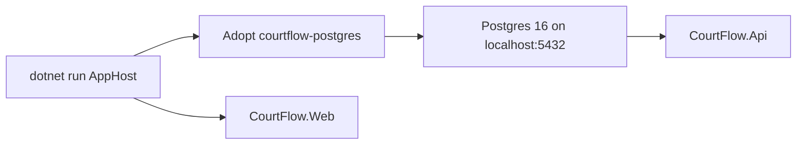

# Simple local startup plan

Follows the spec in [spec.md](spec.md). This slice adds an Aspire app host under [src/](../../src/) and removes root [docker-compose.yml](../../docker-compose.yml) as the way Postgres starts. It does not add WorkOS, OR-Tools, Supabase, a migrator, or a service-defaults project.

The host starts only the API, the Blazor app, and Postgres. The API still applies migrations and seeds Test Organization in [src/CourtFlow.Api/Program.cs](../../src/CourtFlow.Api/Program.cs). Tournament screens do not change.

## Order

1. [src/CourtFlow.AppHost](../../src/CourtFlow.AppHost) and [src/CourtFlow.AppHost.Tests](../../src/CourtFlow.AppHost.Tests), both added to [src/CourtFlow.slnx](../../src/CourtFlow.slnx). The host references only the API and the Blazor app.
2. Volume adoption, then the Postgres, API, and Blazor wiring in the host.
3. Model tests and volume-decision tests.
4. Delete [docker-compose.yml](../../docker-compose.yml). Adoption reads Docker, not that file, so an already created Compose volume can still be copied.
5. One sentence in [README.md](../../README.md) with the start command.

## Files

- [src/CourtFlow.AppHost/CourtFlow.AppHost.csproj](../../src/CourtFlow.AppHost/CourtFlow.AppHost.csproj) — Aspire 13 app host. Use `Aspire.Hosting.AppHost` 13.4.6 and `Aspire.Hosting.PostgreSQL` at that same version. The host references only the API and the Blazor app.
- [src/CourtFlow.AppHost/Program.cs](../../src/CourtFlow.AppHost/Program.cs) — the only startup composition.
- [src/CourtFlow.AppHost/PostgresDataVolume.cs](../../src/CourtFlow.AppHost/PostgresDataVolume.cs) — decides whether to keep the existing Docker volume, and copies it before Postgres starts.
- [src/CourtFlow.AppHost/appsettings.json](../../src/CourtFlow.AppHost/appsettings.json) — local parameter values `courtflow` / `courtflow`. These match the password already in the API settings. No user secrets.
- [src/CourtFlow.AppHost/Properties/launchSettings.json](../../src/CourtFlow.AppHost/Properties/launchSettings.json) — the Aspire template's dashboard profile, with `launchBrowser` true so the command opens the dashboard and prints its URL.
- [src/CourtFlow.AppHost.Tests/CourtFlow.AppHost.Tests.csproj](../../src/CourtFlow.AppHost.Tests/CourtFlow.AppHost.Tests.csproj) — xunit and `Aspire.Hosting.Testing` 13.4.6.
- [README.md](../../README.md) — `dotnet run --project src/CourtFlow.AppHost` from the repo root.
- Delete [docker-compose.yml](../../docker-compose.yml).

Leave these as they are. The host must not override them:

- [src/CourtFlow.Api/Properties/launchSettings.json](../../src/CourtFlow.Api/Properties/launchSettings.json) and [src/CourtFlow.Web/Properties/launchSettings.json](../../src/CourtFlow.Web/Properties/launchSettings.json)
- [src/CourtFlow.Api/appsettings.json](../../src/CourtFlow.Api/appsettings.json) connection string and CORS origins
- [src/CourtFlow.Web/wwwroot/appsettings.json](../../src/CourtFlow.Web/wwwroot/appsettings.json) `ApiBaseUrl` of `http://localhost:5009/`
- [src/CourtFlow.Api/Program.cs](../../src/CourtFlow.Api/Program.cs) migration and Test Organization seed

`Program.cs` adopts the volume first, then builds the application. Postgres uses image `postgres:16` so the existing data directory format still starts. The server resource is `postgres`. Its user and password parameters are `courtflow` and `courtflow`. `WithHostPort(5432)` and `WithDataVolume("courtflow-postgres")` pin the port and the volume. `AddDatabase("CourtFlow", "courtflow")` is that server's database, not another app. The API reference injects `ConnectionStrings__CourtFlow`. The injected value uses host `localhost`, port `5432`, database `courtflow`, username `courtflow`, and password `courtflow`. Key order may differ from the appsettings string.

The API project resource binds `http://localhost:5009` and `https://localhost:7011` with `isProxied: false`, references the database, and `WaitFor` that database so Postgres is accepting connections before the API starts. The Blazor project resource binds `http://localhost:5186` and `https://localhost:7211` with `isProxied: false`. It does not wait for the API, and it is not given an `ApiBaseUrl` override.

No pgAdmin, migrator, service defaults, or test project is added to the host. Child-process logs are what the dashboard shows. Do not add an OpenTelemetry shared project.

## Preexisting data

Compose never named a volume. The `postgres:16` container from the repo root is usually `courtflow-postgres-1`, and its data mount is an anonymous volume at `/var/lib/postgresql/data`.

`PostgresDataVolume` runs before the Aspire Postgres container starts:

- If the named volume `courtflow-postgres` already exists, use it and do not copy. A later start must not overwrite newer data with the old Compose copy.
- Otherwise, if that Compose container, or a container labeled `com.docker.compose.service=postgres` for this repo, has a data mount, stop that container, create `courtflow-postgres`, and copy the data directory into it with `postgres:16` so file ownership stays right. Leave the source volume in place. Stop only that Compose container, so port `5432` is free for Aspire. Any other listener on `5432` is left alone and startup fails visibly.
- If neither volume exists, do nothing. Aspire creates an empty `courtflow-postgres`, and Postgres initializes database `courtflow` with user and password `courtflow`. The API then migrates and seeds Test Organization.

The decision (use existing named volume, copy from a source volume, or start empty) is a pure function. Docker commands sit behind it so the tests do not need a daemon.

## Tests

App host model tests build the distributed application and do not start containers:

- The only project resources are the API and the Blazor app. There is one Postgres server and its `CourtFlow` database. There is no migrator and no test project.
- API endpoints are `5009` and `7011`. Blazor endpoints are `5186` and `7211`. Each is not proxied. Postgres host port is `5432`. The data volume name is `courtflow-postgres`. The image tag is `16`.
- The API waits for the database. The Blazor app does not wait for the API.
- The API's Postgres reference carries username `courtflow`, password `courtflow`, and database `courtflow`. The Blazor app has no `ApiBaseUrl` environment value.

Volume decision tests:

- A named volume that already exists is used, with no copy.
- A missing named volume and a Compose source volume copy from that source into `courtflow-postgres`.
- No named volume and no Compose source starts empty.

Existing domain, API, and web tests stay as they are and still pass. They prove tournament setup did not change. They do not start Aspire.

## No test

- The dashboard opens or prints a URL, and shows starting, running, or failed plus logs and endpoints. That is the AppHost launch profile and Aspire's own dashboard.
- Stopping the command stops all three, and the next start uses the same endpoints. The model test pins the ports; it does not start and stop processes.
- A taken port fails in the command output or dashboard instead of moving. `isProxied: false` is what keeps Aspire from choosing another port.
- The Docker copy itself, and a real restart that still contains the copied tournaments. Only the decision is tested.
- A machine that has never had Postgres shows the empty tournament list through Aspire. Migration, seed, and the empty list already have API and web tests outside Aspire.
- A director never sees Aspire or Postgres. No screen changes.
- Test runs are not part of startup. The host simply does not reference the test projects.

## Not in this slice

SQLite, a database migrator, a Blazor server beside the WebAssembly client, Clerk, Google Maps configuration, a service-defaults project, and `Api__BaseUrl` injection. The Blazor app keeps calling `http://localhost:5009/`.
