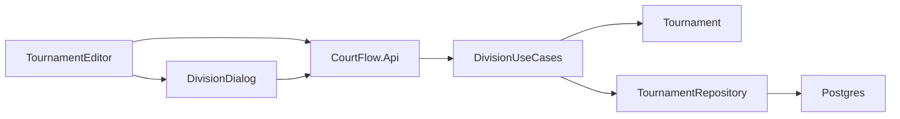

# Tournament divisions plan

Follows the spec in [spec.md](spec.md) and the domain-driven design constraint in [../product/intent.md](../product/intent.md).

Tournament stays the aggregate root. A division changes only through it, the same way a venue does. The Blazor editor keeps calling the same domain rules before the API.

## Order

1. Domain type, gender, and tournament methods, with domain tests.
2. Application use cases, contracts, and the repository port.
3. EF mapping, cascade delete, organization filter, and a migration after [src/CourtFlow.Infrastructure/Migrations/20260925230224_Initial.cs](../../src/CourtFlow.Infrastructure/Migrations/20260925230224_Initial.cs).
4. API endpoints and API tests against Postgres via Testcontainers.
5. Divisions section, dialog, tournament-delete copy, and bUnit tests.

## Files

- [src/CourtFlow.Domain/Division.cs](../../src/CourtFlow.Domain/Division.cs) and a `DivisionGender` of Female, then Male. [src/CourtFlow.Domain/Tournament.cs](../../src/CourtFlow.Domain/Tournament.cs) gains add, update, and remove. Name is trimmed. Blank name throws "Division name is required." Missing gender throws "Gender is required." A matching name and gender in the same tournament throws "A division with this name and gender already exists." Comparison ignores case and surrounding whitespace. Updating a division does not conflict with itself. Another tournament may reuse the same name and gender.
- [src/CourtFlow.Application/Contracts.cs](../../src/CourtFlow.Application/Contracts.cs) and [src/CourtFlow.Application/Divisions/DivisionUseCases.cs](../../src/CourtFlow.Application/Divisions/DivisionUseCases.cs). List returns name then gender, ignoring case, Female before Male. Create and update go through the tournament. Update and delete load the tournament that owns the division and do not move it.
- [src/CourtFlow.Application/ITournamentRepository.cs](../../src/CourtFlow.Application/ITournamentRepository.cs) and [src/CourtFlow.Infrastructure/TournamentRepository.cs](../../src/CourtFlow.Infrastructure/TournamentRepository.cs). Loads include divisions. A get-by-division matches get-by-venue.
- [src/CourtFlow.Infrastructure/CourtFlowDbContext.cs](../../src/CourtFlow.Infrastructure/CourtFlowDbContext.cs). Table `divisions`. Gender stored as the strings `Female` and `Male`. Tournament delete cascades to divisions. Queries stay limited to Test Organization. No unique index: the spec does not detect simultaneous edits, and the rule lives on the aggregate.
- [src/CourtFlow.Api/DivisionEndpoints.cs](../../src/CourtFlow.Api/DivisionEndpoints.cs), mapped from [src/CourtFlow.Api/Program.cs](../../src/CourtFlow.Api/Program.cs). `GET` and `POST /api/tournaments/{tournamentId}/divisions`, `PUT` and `DELETE /api/divisions/{divisionId}`, using the same rule-rejection path as venues.
- [src/CourtFlow.Web/Pages/TournamentEditor.razor](../../src/CourtFlow.Web/Pages/TournamentEditor.razor). Below Venues, a Divisions card. Hidden until the tournament is saved. The existing "Details must be saved first" note stays the only note. Empty text: "No divisions yet. Use Add to create one." Each row shows name and gender, with accessible labels "Edit {name}, {gender}" and "Delete {name}, {gender}."
- [src/CourtFlow.Web/Components/DivisionDialog.razor](../../src/CourtFlow.Web/Components/DivisionDialog.razor). Titles "Add division" and "Edit division." Name uses the text field. Gender uses the existing select, items Female and Male, prompt "Select a gender," nothing selected on add. Edit opens with the current values. Cancel saves nothing. A rejected save leaves the dialog open.
- [src/CourtFlow.Web/Pages/TournamentList.razor](../../src/CourtFlow.Web/Pages/TournamentList.razor). Delete confirmation body becomes "Its venues, courts, and divisions are also deleted."
- Division delete uses the existing confirm dialog. The title is "Delete {name} ({gender})?" and the consequence string is empty, so the dialog has no body.
- Web API client, contracts, and the bUnit fake gain the division calls, beside the venue ones in [src/CourtFlow.Web/Services/](../../src/CourtFlow.Web/Services/).

## Tests

Domain tests in [src/CourtFlow.Domain.Tests/DivisionRulesTests.cs](../../src/CourtFlow.Domain.Tests/DivisionRulesTests.cs):

- Whitespace name is rejected. A non-blank name is stored trimmed.
- Missing gender is rejected. Only Female and Male are accepted.
- "14U Open" Female and "14U Open" Male both save. "14U Open" Female and " 14u open " Female do not.
- Updating a division does not conflict with itself. Changing Female "14U Open" to Male is rejected when Male "14U Open" already exists.
- Removing a division leaves the tournament and its other divisions. Removing the tournament is covered with the API cascade test.

API tests in [src/CourtFlow.Api.Tests/DivisionApiTests.cs](../../src/CourtFlow.Api.Tests/DivisionApiTests.cs), same Postgres reset as venue tests, including a second organization inserted directly:

- List order is name, ignoring case, then Female before Male. "12U" is above "14U Open." "14U Open" Female is above "14U Open" Male.
- Create returns an id. The stored name is trimmed.
- Blank name, missing gender, and any other gender are rejected with the spec messages.
- A repeated name and gender is rejected. The same pair on another tournament is saved.
- Create on a missing tournament is not found. Update or delete of a missing division is not found.
- A division owned by another organization is absent from reads and cannot be changed.
- Deleting a division leaves the tournament and the other division. Deleting a tournament deletes its divisions.

Web tests in [src/CourtFlow.Web.Tests/DivisionPageTests.cs](../../src/CourtFlow.Web.Tests/DivisionPageTests.cs), and the existing tournament-delete assertion in [src/CourtFlow.Web.Tests/TournamentPageTests.cs](../../src/CourtFlow.Web.Tests/TournamentPageTests.cs):

- Before the first save, Divisions is hidden and the only note is "Details must be saved first." An unknown tournament shows not found and no Divisions section.
- An empty section says "No divisions yet. Use Add to create one."
- Add and edit open the modal. Add starts with no gender. Cancel saves nothing. A successful save closes the dialog and reloads the list. A rejected save leaves the dialog open.
- Rows show name and gender, in the spec order, with the accessible edit and delete labels.
- Delete division confirms with "Delete 14U Open (Female)?" and no body. Cancel deletes nothing. Confirm calls delete.
- Tournament delete confirmation includes divisions.

## No test

- The director is not signed in and never sees Test Organization. There is no auth screen to exercise.
- Simultaneous edits are not detected. There is no concurrency-token test and no unique index.
- Teams in different divisions never play each other. This slice has no teams.
- The tournament-teams intent still asks whether a team must belong to a division. This plan does not answer that.

## Not in this slice

A separate Divisions page, format and max-teams columns, a Manage action into stages, and delete blocked once a stage had teams or matches. A create dialog that asks for a name only, and a uniqueness rule on the name alone. Gender is stored here. Wave is not.
