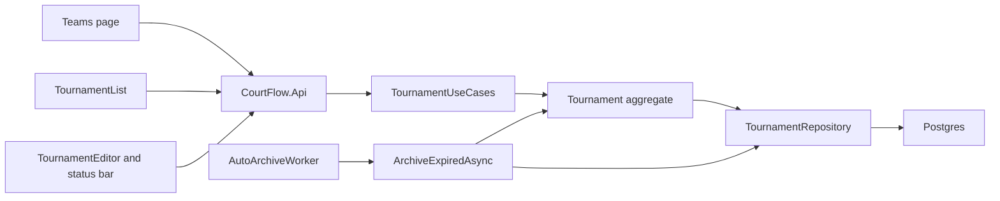

# Tournament lifecycle plan

Follows the spec in [spec.md](spec.md) and the domain-driven design constraint in [../product/intent.md](../product/intent.md).

The **Tournament** aggregate owns the state, the last-published moment, every transition, the delete rule, and the archived lock. Every mutating method on the aggregate checks the lock first, so venue, division, entry, and import use cases need no new branches beyond one up-front check where a second aggregate (the club) is touched. Time comes from `TimeProvider`, so tests control the clock. The automatic archive is one application use case, called by a background worker in the API host.

## Order

1. Domain: status enum, clock, transitions, delete rule, and the archived lock, with table-driven domain tests.
2. Persistence: two columns, a migration after `20261011211756_AddClubsAndTeams`, and a cross-organization query for expired tournaments.
3. Application: contracts, transition use cases, the automatic archive use case, and the up-front lock checks.
4. API: transition endpoints, delete rejection, `TimeProvider` and worker registration, and API tests with a fake clock.
5. Web: contracts and client, status badge, editor status bar and read-only mode, list column and delete rule, Teams lock, dropdown label, and bUnit tests.
6. Wipe the local database.

## Files

### Domain

- **New** [src/CourtFlow.Domain/TournamentStatus.cs](../../src/CourtFlow.Domain/TournamentStatus.cs): `enum TournamentStatus { Unpublished, Published, Archived }`. The web project already references Domain, so both sides share it.
- [src/CourtFlow.Domain/Tournament.cs](../../src/CourtFlow.Domain/Tournament.cs) gains:
  - `Status` (starts `Unpublished`) and `LastPublishedAt` (`DateTimeOffset?`), private setters.
  - `public static readonly TimeSpan AutoArchiveAfter = TimeSpan.FromDays(270);` and `ArchiveDueAt => LastPublishedAt + AutoArchiveAfter`.
  - `Publish(DateTimeOffset now)`, `Unpublish()`, `Archive()`, `Restore()`, `EnsureCanDelete()`, and `bool ArchiveIfDue(DateTimeOffset now)`, which archives only when Published and `now >= ArchiveDueAt`.
  - `public void EnsureEditable()` throws `ArchivedMessage` when Archived. It is called first in `Rename`, `SetDescription`, `SetDates`, `SetTimeZone`, `SetDuration`, `AddVenue`, `UpdateVenue`, `RemoveVenue`, `AddDivision`, `UpdateDivision`, `RemoveDivision`, `EnterTeam`, `MoveEntry`, and `RemoveEntry`.
  - Public message constants with the spec's copy: `ArchivedMessage`, `OnlyPublishedCanBeArchived`, `PublishedCannotBeDeleted`, `OnlyUnpublishedCanBePublished`, `OnlyPublishedCanBeUnpublished`, `OnlyArchivedCanBeRestored`. All throw `DomainRuleException`, so existing `RejectRules` maps them to `400`.

### Persistence

- [src/CourtFlow.Infrastructure/CourtFlowDbContext.cs](../../src/CourtFlow.Infrastructure/CourtFlowDbContext.cs): `Status` stored as a string, required; `LastPublishedAt` as `timestamptz`, nullable.
- **New** migration `AddTournamentLifecycle` and updated snapshot under [src/CourtFlow.Infrastructure/Migrations/](../../src/CourtFlow.Infrastructure/Migrations/). No backfill, because the database is wiped.
- [src/CourtFlow.Application/ITournamentRepository.cs](../../src/CourtFlow.Application/ITournamentRepository.cs) and [src/CourtFlow.Infrastructure/TournamentRepository.cs](../../src/CourtFlow.Infrastructure/TournamentRepository.cs):
  - `ListAsync` projects the two new fields.
  - **New** `ListDueForArchiveAsync(DateTimeOffset now)` uses `IgnoreQueryFilters()` so every organization is checked. It filters `Status == Published && LastPublishedAt <= now - 270 days` and loads tracked tournaments without children.

### Application

- [src/CourtFlow.Application/Contracts.cs](../../src/CourtFlow.Application/Contracts.cs): `TournamentDetails` gains `TournamentStatus Status`, `DateTimeOffset? LastPublishedAt`, `DateOnly? PublishedOn`, and `DateOnly? ArchivesOn`. The two dates are filled only when Published and are converted into the tournament's time zone with `TimeZoneInfo.FindSystemTimeZoneById`.
- [src/CourtFlow.Application/Tournaments/TournamentUseCases.cs](../../src/CourtFlow.Application/Tournaments/TournamentUseCases.cs):
  - Takes `TimeProvider`.
  - **New** `PublishAsync`, `UnpublishAsync`, `ArchiveAsync`, `RestoreAsync(id)`. Each loads, calls one transition, saves, and returns details, or null when not found.
  - `DeleteAsync` calls `EnsureCanDelete()` before removing.
  - **New** `ArchiveExpiredAsync(CancellationToken)` reads `now` from `TimeProvider`, loads `ListDueForArchiveAsync(now)`, calls `ArchiveIfDue(now)` on each, saves once, and returns the count. Because it reloads current values, a republish since the query cutoff is honored by `ArchiveIfDue`.
- [src/CourtFlow.Application/Teams/TeamUseCases.cs](../../src/CourtFlow.Application/Teams/TeamUseCases.cs): `UpdateAsync` calls `tournament.EnsureEditable()` before `club.RenameTeam`, so a rename through an archived tournament never starts.
- [src/CourtFlow.Application/Teams/Import/TeamImportUseCases.cs](../../src/CourtFlow.Application/Teams/Import/TeamImportUseCases.cs): `PreviewAsync` and `ImportAsync` call `tournament.EnsureEditable()` first.

### API

- [src/CourtFlow.Api/TournamentEndpoints.cs](../../src/CourtFlow.Api/TournamentEndpoints.cs): `POST /api/tournaments/{id}/publish`, `/unpublish`, `/archive`, `/restore`, each in `RejectRules`, returning `200` with details, `404`, or `400` with the message. Delete is wrapped in `RejectRules`.
- [src/CourtFlow.Api/VenueEndpoints.cs](../../src/CourtFlow.Api/VenueEndpoints.cs) and [src/CourtFlow.Api/TeamEndpoints.cs](../../src/CourtFlow.Api/TeamEndpoints.cs): venue delete, entry delete, and import preview are wrapped in `RejectRules` so the archived message reaches the client.
- **New** [src/CourtFlow.Api/AutoArchiveWorker.cs](../../src/CourtFlow.Api/AutoArchiveWorker.cs): a `BackgroundService` that runs `ArchiveExpiredAsync` at startup and then hourly on a `PeriodicTimer`, in a fresh scope each time. Exceptions are logged and the loop continues. Hourly keeps the one-day promise with room to spare.
- [src/CourtFlow.Api/Program.cs](../../src/CourtFlow.Api/Program.cs): registers `TimeProvider.System`, and registers the worker unless `AutoArchive:Enabled` is `false`.

### Web

- [src/CourtFlow.Web/Services/ApiContracts.cs](../../src/CourtFlow.Web/Services/ApiContracts.cs): `TournamentResponse` gains `Status`, `LastPublishedAt`, `PublishedOn`, `ArchivesOn`.
- [src/CourtFlow.Web/Services/ICourtFlowApi.cs](../../src/CourtFlow.Web/Services/ICourtFlowApi.cs) and [CourtFlowApi.cs](../../src/CourtFlow.Web/Services/CourtFlowApi.cs): `PublishTournamentAsync`, `UnpublishTournamentAsync`, `ArchiveTournamentAsync`, `RestoreTournamentAsync`. `DeleteTournamentAsync`, `DeleteVenueAsync`, `DeleteTournamentTeamAsync`, and `PreviewTeamImportAsync` switch to `ThrowIfRejected`.
- [src/CourtFlow.Web/Services/Confirmations.cs](../../src/CourtFlow.Web/Services/Confirmations.cs): **new** `ConfirmAsync(title, message, yesText)` with the same dialog options. `ConfirmDeleteAsync` uses it.
- [src/CourtFlow.Web/Services/Feedback.cs](../../src/CourtFlow.Web/Services/Feedback.cs): `Published()`, `Unpublished()`, `Archived()`, `Restored()` with "Published." and so on.
- **New** [src/CourtFlow.Web/Components/CfStatusBadge.razor](../../src/CourtFlow.Web/Components/CfStatusBadge.razor): a `MudChip` reading "Unpublished", "Published", or "Archived".
- **New** [src/CourtFlow.Web/Components/TournamentStatusBar.razor](../../src/CourtFlow.Web/Components/TournamentStatusBar.razor): badge, state text, and actions from the spec. Unpublish and Archive confirm first. Every action runs through `Feedback.RunAsync`, then raises `Changed` whether it succeeded or was rejected, so the editor reloads either way.
- [src/CourtFlow.Web/Pages/TournamentEditor.razor](../../src/CourtFlow.Web/Pages/TournamentEditor.razor):
  - Shows the status bar under the title for existing tournaments.
  - When Archived, detail fields are `Disabled`, Save details is hidden, and venue and division Add, Edit, and Delete are hidden.
  - A rejected save or child action reloads the tournament, so an automatic archive while the editor is open is reflected.
- [src/CourtFlow.Web/Pages/TournamentList.razor](../../src/CourtFlow.Web/Pages/TournamentList.razor): Status column after Name. `DeleteConsequence` becomes "Its venues, courts, divisions, and teams are also deleted. This cannot be undone." For Published rows, Delete is disabled with the tooltip "Unpublish or archive this tournament before deleting it."
- [src/CourtFlow.Web/Components/CfIconButton.razor](../../src/CourtFlow.Web/Components/CfIconButton.razor): gains `Disabled` and an optional `Tooltip` that overrides `Label` as the tooltip text.
- [src/CourtFlow.Web/Pages/Teams.razor](../../src/CourtFlow.Web/Pages/Teams.razor): with an Archived tournament, `CanAddTeams` is false, row Edit and Delete are hidden, and the note "This tournament is archived. Restore it to make changes." sits above the table.
- [src/CourtFlow.Web/Components/CfTournamentSelect.razor](../../src/CourtFlow.Web/Components/CfTournamentSelect.razor): Archived options read "{name} (Archived)". The closed control still shows the name, as the current-tournament spec says.
- [src/CourtFlow.Web.Tests/FakeApi.cs](../../src/CourtFlow.Web.Tests/FakeApi.cs): in-memory state transitions with the domain messages, and a way to script a rejection.

### Tests and setup

- [src/CourtFlow.Api.Tests/CourtFlow.Api.Tests.csproj](../../src/CourtFlow.Api.Tests/CourtFlow.Api.Tests.csproj): add `Microsoft.Extensions.TimeProvider.Testing`.
- [src/CourtFlow.Api.Tests/ApiFactory.cs](../../src/CourtFlow.Api.Tests/ApiFactory.cs): replaces `TimeProvider` with a shared `FakeTimeProvider`, sets `AutoArchive:Enabled=false`, and exposes `Clock` and `RunAutoArchiveAsync()`, which calls the use case in a scope.

### Wiping the database

Stop the AppHost, delete the Docker volume named by `PostgresDataVolume.Name` in [src/CourtFlow.AppHost/PostgresDataVolume.cs](../../src/CourtFlow.AppHost/PostgresDataVolume.cs), and start again. Migrations recreate the schema and `TestOrganizationSeed` re-seeds. API tests use a fresh container and are unaffected.

## Tests

Domain, **new** [src/CourtFlow.Domain.Tests/TournamentLifecycleTests.cs](../../src/CourtFlow.Domain.Tests/TournamentLifecycleTests.cs):

- A new tournament is Unpublished with no last-published moment.
- A table over every state and action: each allowed row in the spec's table succeeds with the right target state; every other pair throws its spec message and leaves the state unchanged.
- Publish sets `LastPublishedAt` to the given `now`. Republishing after Unpublish moves it. Restore and Unpublish do not change it.
- `ArchiveIfDue` archives at exactly 270 × 24 hours and not one second earlier, ignores Unpublished and Archived, and uses the latest publish.
- `EnsureCanDelete` passes for Unpublished and Archived and throws for Published.
- With an Archived tournament, each mutating method listed under Domain throws `ArchivedMessage`. Restored, they work again.

API, **new** [src/CourtFlow.Api.Tests/TournamentLifecycleApiTests.cs](../../src/CourtFlow.Api.Tests/TournamentLifecycleApiTests.cs):

- Create returns Unpublished, and a create body cannot set a state.
- Publish, Unpublish, Archive, and Restore return the new state. Illegal transitions return `400` with the spec message. Unknown ids return `404`.
- List and get return `Status`, and for Published, `LastPublishedAt`, `PublishedOn`, and `ArchivesOn` in the tournament's time zone. A case near midnight UTC in Pacific time proves the local date.
- Saving details never changes the state.
- Delete returns `400` for Published and removes Unpublished and Archived tournaments.

API, **new** [src/CourtFlow.Api.Tests/ArchivedTournamentApiTests.cs](../../src/CourtFlow.Api.Tests/ArchivedTournamentApiTests.cs):

- With an Archived tournament, each write returns `400` with the archived message and changes nothing: details, venue add, edit, and delete, division add, edit, and delete, entry add, update, and delete, import preview, and import.
- A rename attempted through an archived tournament's entry leaves the team's name unchanged.
- Renaming the same team through another tournament still succeeds.

API, **new** [src/CourtFlow.Api.Tests/AutoArchiveApiTests.cs](../../src/CourtFlow.Api.Tests/AutoArchiveApiTests.cs), driving `FakeTimeProvider`:

- At 269 days nothing is archived. At 270 days the Published tournament is archived.
- Unpublished and Archived tournaments are left alone.
- Republished at day 100: day 270 does not archive it, day 370 does.
- Running twice archives once and changes nothing the second time.
- A Published tournament inserted for a second organization is archived too, and a Test Organization tournament beside it is unaffected.

Web, **new** [src/CourtFlow.Web.Tests/TournamentStatusTests.cs](../../src/CourtFlow.Web.Tests/TournamentStatusTests.cs):

- Each state shows its badge, text, and actions. Published shows both dates.
- Unpublish and Archive confirm with the spec copy. Cancel calls nothing. Confirm calls the API and shows the snackbar.
- Publish and Restore act without a dialog.
- A rejected action shows the message and reloads.
- Archived: detail fields are disabled, Save details is hidden, and venue and division buttons are hidden.
- A new tournament shows no status bar.

Web changes to existing tests:

- [TournamentPageTests.cs](../../src/CourtFlow.Web.Tests/TournamentPageTests.cs): Status column badges, Delete disabled for Published with its tooltip, and the new delete body.
- [TeamsPageTests.cs](../../src/CourtFlow.Web.Tests/TeamsPageTests.cs): with an Archived tournament the note shows, Add and Import CSV are disabled, row Edit and Delete are absent, and the dropdown option reads "{name} (Archived)".
- [WrapperTests.cs](../../src/CourtFlow.Web.Tests/WrapperTests.cs): `CfIconButton` disabled state and tooltip override.
- [StylingRulesTests.cs](../../src/CourtFlow.Web.Tests/StylingRulesTests.cs) covers the new `.razor` files without change.

## No test

- **The worker loop.** `AutoArchiveWorker` is a timer around the tested use case. No test waits for an hourly tick or a startup run.
- **"Within one day" after downtime.** Covered only by the worker running at startup.
- **Public visibility.** No public page or API exists yet, so nothing can assert that the public sees nothing.
- **Schedule publishing.** No schedules exist.
- **Time zone data in production.** The `PublishedOn` and `ArchivesOn` conversion runs on the API server, which has IANA data. It is tested in the container, not on Windows hosting.

## Flags

- **Disabled instead of read-only.** The text, date, select, and numeric wrappers have `Disabled` but no `ReadOnly`. This plan uses `Disabled` for archived detail fields. The spec says "read-only." Adding `ReadOnly` to four wrappers is the alternative.
- **Rejection status code.** Illegal transitions and archived writes return `400`, as every other rule does today.
- **Hourly check.** The spec only requires within one day. Hourly is this plan's choice.
- **New test package.** `Microsoft.Extensions.TimeProvider.Testing` is added to the API tests only.
- **Cross-organization query.** `ListDueForArchiveAsync` is the first code to bypass the Test Organization query filter. Sign-in will replace that filter, and this method must keep bypassing it.

## Not in this slice

- The `draft` name, and moving an Archived tournament straight to draft.
- Un-archive restoring to Published.
- Auto-archive a per-organization number of days after the end date.
- Public link preview and copy, archived tournaments as public "past events," and actor captions.
- `LifecycleViolationException` and domain events for transitions.
