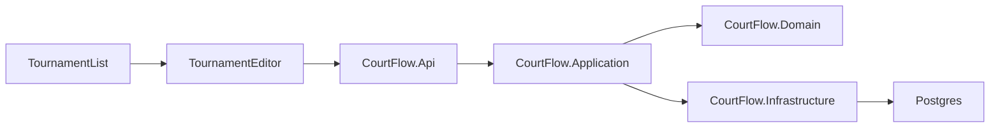

# Tournament setup plan

Follows the spec in [spec.md](spec.md) and the domain-driven design constraint in [../product/intent.md](../product/intent.md).

New code is a greenfield solution under [src/](../../src/). [poc/](../../poc/) stays untouched. The slice uses a .NET API, Blazor WebAssembly with MudBlazor, Entity Framework Core, and local Postgres. It does not add WorkOS, OR-Tools, Supabase, MediatR, or the proof-of-concept project tree. The solution, application projects, and test projects all live under `src/`. The repo root keeps [docker-compose.yml](../../docker-compose.yml) for local Postgres and the existing `intent/` and `poc/` folders.

Dependencies point inward. Domain references nothing else in the solution. Application references Domain and defines the persistence ports. Infrastructure implements those ports with Entity Framework Core. The API is the composition root: it references Application and Infrastructure, and its endpoints call application use cases only. The Blazor app references Domain so the editor can run the same save rules and the editor-only warnings, and it reads and writes only through the API.

## Order

1. [src/CourtFlow.slnx](../../src/CourtFlow.slnx) and the projects below. Domain has no infrastructure dependencies, so the WebAssembly app can reference it.
2. Domain types and [src/CourtFlow.Domain.Tests](../../src/CourtFlow.Domain.Tests).
3. Application use cases and ports in [src/CourtFlow.Application](../../src/CourtFlow.Application).
4. EF Core context, cascade delete, Test Organization seed, and the initial migration.
5. API endpoints and [src/CourtFlow.Api.Tests](../../src/CourtFlow.Api.Tests) against Postgres via Testcontainers.
6. Blazor pages and [src/CourtFlow.Web.Tests](../../src/CourtFlow.Web.Tests) with bUnit.
7. [docker-compose.yml](../../docker-compose.yml) at the repo root for local Postgres only.

## Files

- [src/CourtFlow.Domain/Organization.cs](../../src/CourtFlow.Domain/Organization.cs), [Tournament.cs](../../src/CourtFlow.Domain/Tournament.cs), [Venue.cs](../../src/CourtFlow.Domain/Venue.cs), [Court.cs](../../src/CourtFlow.Domain/Court.cs). Tournament is the aggregate root. Venues and courts change only through it.
- [src/CourtFlow.Domain/UsTimeZones.cs](../../src/CourtFlow.Domain/UsTimeZones.cs) — the seven IANA ids in the spec, including `America/Phoenix`
- [src/CourtFlow.Domain/TournamentWarnings.cs](../../src/CourtFlow.Domain/TournamentWarnings.cs) — inclusive span and name match, used by the editor only
- [src/CourtFlow.Application/Tournaments/TournamentUseCases.cs](../../src/CourtFlow.Application/Tournaments/TournamentUseCases.cs) — list, get, create, update, and delete
- [src/CourtFlow.Application/Venues/VenueUseCases.cs](../../src/CourtFlow.Application/Venues/VenueUseCases.cs) — list, create, update, and delete for one tournament
- [src/CourtFlow.Application/ITournamentRepository.cs](../../src/CourtFlow.Application/ITournamentRepository.cs) — the persistence port, including venues and courts
- [src/CourtFlow.Infrastructure/CourtFlowDbContext.cs](../../src/CourtFlow.Infrastructure/CourtFlowDbContext.cs) — tournament delete cascades to venues and courts; queries are limited to the seeded Test Organization
- [src/CourtFlow.Infrastructure/TournamentRepository.cs](../../src/CourtFlow.Infrastructure/TournamentRepository.cs) — Entity Framework implementation of the port
- [src/CourtFlow.Infrastructure/TestOrganizationSeed.cs](../../src/CourtFlow.Infrastructure/TestOrganizationSeed.cs) — idempotent seed of the organization named Test Organization
- [src/CourtFlow.Api/Program.cs](../../src/CourtFlow.Api/Program.cs) and tournament and venue endpoints that call the use cases
- [src/CourtFlow.Web/Pages/TournamentList.razor](../../src/CourtFlow.Web/Pages/TournamentList.razor) at `/`
- [src/CourtFlow.Web/Pages/TournamentEditor.razor](../../src/CourtFlow.Web/Pages/TournamentEditor.razor) at `/tournaments/new` and `/tournaments/{id}`
- [src/CourtFlow.Web/Components/VenueDialog.razor](../../src/CourtFlow.Web/Components/VenueDialog.razor)
- [docker-compose.yml](../../docker-compose.yml) — Postgres for local runs

Courts are not their own screen or resource. A venue save sets the count, and the set of courts becomes numbers `1` through `N`. Raising the count adds the missing higher numbers. Lowering it deletes courts numbered above the new count. Rows that remain keep their ids. A count of `0` leaves no courts.

Stored names and the optional description and address drop surrounding whitespace. A whitespace-only description or address is stored empty. The duration field starts empty; save is rejected until the director enters a whole number from 15 through 240. The spec does not name a default duration.

## Tests

Domain tests:

- Whitespace tournament or venue name is rejected; a non-blank name is stored trimmed.
- Empty description and address are saved.
- End date on or before the start date is rejected, including a same-day tournament.
- A span of more than five calendar days is accepted by the domain. September 1 through September 5 does not warn. September 1 through September 6 does.
- A name that matches another tournament, ignoring case and surrounding whitespace, warns. The tournament's own name does not warn. The domain still accepts the name.
- Duration 15 and 240 are accepted; 14 and 241 are rejected.
- Each listed US time zone is accepted, including Arizona. Any other id, including `UTC`, is rejected.
- Court counts 0 and 99 are accepted; a count outside that range is rejected.
- Raising a count adds higher numbers. Lowering it deletes numbers above the new count and keeps the same court ids for the numbers that remain.

API tests, one Postgres database per run, with a second organization inserted directly so the filter can be seen:

- List returns only Test Organization tournaments, with name, start date, end date, time zone, and default match duration.
- Create, get, and update a tournament. Create returns an id the editor can open.
- A missing tournament is not found. Venue create, update, and delete for a missing tournament are rejected.
- Duplicate names and a span longer than five days are saved.
- Invalid name, dates, time zone, and duration are rejected.
- Venue name and court-count rules match the domain tests, including rewrite and preserved court ids.
- Deleting a tournament deletes its venues and courts. Deleting a venue deletes its courts and leaves the tournament.
- A tournament, venue, or court owned by another organization is absent from reads and cannot be changed.

Web tests:

- The list shows those five fields, and an empty list tells the director to add a tournament.
- The same editor is create and edit. Before the first save, venues are unavailable and the note says details must be saved first.
- Saving a create moves to the new tournament's editor. Saving an edit stays there.
- An unknown id shows that the tournament was not found.
- The time zone picker offers only the seven US zones.
- The long-span and duplicate-name warnings appear, and save still runs. Editing does not warn about the tournament's own name.
- Delete tournament and delete venue ask for confirmation. Cancel leaves the data in place. Confirm calls delete.

## No test

- The director is not signed in and never sees the name Test Organization. There is no auth screen to exercise.
- Address text is not looked up.
- Simultaneous edits are not detected. A normal update test already shows the latest save is what remains; there is no concurrency-token test.

## Proof of concept left behind

The editor in [poc/docs/features/tournaments.md](../../poc/docs/features/tournaments.md) also did sign-in and organization choice, publish, unpublish, archive, a public link, clone, shared venues, waves and start times, divisions, clubs, teams, rankings, CSV import, and Google Places. This slice does not.

Where the proof of concept disagrees with the spec, the spec wins: a same-day tournament is rejected, duration is 15 through 240, the time zone list has no `UTC`, and lowering a court count is not blocked by matches. Court numbers stay `1` through `N`, and the numbers that remain are the same courts.
