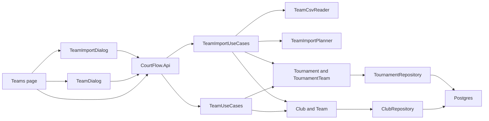

# Tournament teams plan

Follows the spec in [spec.md](spec.md) and the domain-driven design constraint in [../product/intent.md](../product/intent.md).

Two aggregates own the new rules. **Club** is an organization-level root that owns its **Teams**, so team-name uniqueness within a club and renames live in one place. **Tournament** stays the root for everything inside one tournament and gains its **TournamentTeam** entries, so "one entry per team," "division belongs to this tournament," and "a division with entries cannot be deleted" stay beside the division rules. Use cases load both roots and save once, so an add or an import is one transaction. CSV reading and import matching are pure application code with their own tests. The Blazor app calls the same domain checks before the API.

## Order

1. Domain: club, team, entry, tournament entry methods, and the division-delete guard, with domain tests.
2. Persistence: EF mapping, unique indexes, organization filters, a migration after [src/CourtFlow.Infrastructure/Migrations/20261010234810_AddDivisions.cs](../../src/CourtFlow.Infrastructure/Migrations/20261010234810_AddDivisions.cs), the club repository, and the test reset.
3. Application: contracts and team use cases. Then the CSV reader, the import planner, and the import use cases, with a new application test project.
4. API: team, club, and import endpoints, plus the division-delete rejection, with API tests against Postgres via Testcontainers.
5. Web: client, contracts, and fake; new wrappers; the remembered-tournament service; the drawer link; the Teams page and both dialogs; editor and list changes; the template file; and bUnit tests.

## Files

### Domain

- **New** [src/CourtFlow.Domain/Club.cs](../../src/CourtFlow.Domain/Club.cs). `Club` has `Id`, `OrganizationId`, `Name`, `NormalizedName`, and a private team list.
  - `Club.Create(organizationId, name)` trims the name. A blank name throws "Club is required."
  - `AddTeam(name)` and `RenameTeam(teamId, name)` enforce unique team names within the club.
  - `FindTeam(name)` matches a team by normalized name.
  - A static `Normalize(name)` trims and upper-cases with the invariant culture. Clubs and teams both use it, so the database indexes and the in-memory checks agree.
  - No rename or delete method exists for the club itself.
- **New** [src/CourtFlow.Domain/Team.cs](../../src/CourtFlow.Domain/Team.cs). `Team` has `Id`, `OrganizationId`, `ClubId`, `Name`, and `NormalizedName`. Its constructor and rename are internal to the club.
  - A blank name throws "Team name is required."
  - A rename that collides with another team in the club throws "Another team in this club already has this name."
  - Renaming a team to its own name with different case succeeds.
  - A public static `Validate(name)` lets the dialog run the same check.
- **New** [src/CourtFlow.Domain/TournamentTeam.cs](../../src/CourtFlow.Domain/TournamentTeam.cs). `TournamentTeam` has `Id`, `OrganizationId`, `TournamentId`, `TeamId`, and `DivisionId`, with an internal `MoveTo(divisionId)`.
- [src/CourtFlow.Domain/Tournament.cs](../../src/CourtFlow.Domain/Tournament.cs) gains a private entry list and these methods:
  - `EnterTeam(teamId, divisionId)` rejects a division that is not in this tournament ("Division is required.") and a team already entered ("This team is already entered in this tournament.").
  - `MoveEntry(entryId, divisionId)` applies the same division check.
  - `RemoveEntry(entryId)` removes the entry. A missing entry throws "Team entry was not found."
  - `EntryFor(teamId)` returns the team's entry, if any.
  - `RemoveDivision` now throws "This division has 3 teams. Move or remove them on the Teams page first." when entries point at it, and uses "1 team" for one.
- [src/CourtFlow.Domain/Division.cs](../../src/CourtFlow.Domain/Division.cs) gains a static `Label(name, gender)` that returns "14U Open (Female)." It also gains `ParseImportGender(value)`, which accepts M, F, Male, and Female in any case and returns null otherwise. The list, the dialogs, and the import messages all use it.

### Persistence

- [src/CourtFlow.Infrastructure/CourtFlowDbContext.cs](../../src/CourtFlow.Infrastructure/CourtFlowDbContext.cs). Tables `clubs`, `teams`, and `tournament_teams`, each filtered to Test Organization.
  - Unique indexes on `(OrganizationId, NormalizedName)` for clubs, `(ClubId, NormalizedName)` for teams, and `(TournamentId, TeamId)` for entries.
  - Clubs cascade to teams in the model only. Nothing deletes a club in this slice.
  - The tournament cascades to its entries.
  - The entry-to-team key restricts, so a team with entries cannot be removed underneath them.
  - The entry-to-division key uses no action. The domain guard blocks a division delete. On a tournament delete, Postgres checks at the end of the statement, after both the divisions and the entries are gone.
  - Navigations use backing fields, as venues and divisions do.
- **New** migration `AddClubsAndTeams` and an updated model snapshot under [src/CourtFlow.Infrastructure/Migrations/](../../src/CourtFlow.Infrastructure/Migrations/).
- **New** [src/CourtFlow.Application/IClubRepository.cs](../../src/CourtFlow.Application/IClubRepository.cs) and [src/CourtFlow.Infrastructure/ClubRepository.cs](../../src/CourtFlow.Infrastructure/ClubRepository.cs). It provides:
  - Search by any part of the name, ignoring case, ordered by name.
  - Get by id with teams.
  - Get many by normalized name with teams, so the import loads every named club in one query.
  - Add.
  - Teams for an id, for the Team dropdown.

  Save goes through the same `CourtFlowDbContext` as the tournament repository, so one `SaveChangesAsync` writes both roots together.
- [src/CourtFlow.Application/ITournamentRepository.cs](../../src/CourtFlow.Application/ITournamentRepository.cs) and [src/CourtFlow.Infrastructure/TournamentRepository.cs](../../src/CourtFlow.Infrastructure/TournamentRepository.cs). The children loaded with a tournament now include entries. A new `GetByEntryAsync(entryId)` follows the existing get-by-division pattern.
- [src/CourtFlow.Api.Tests/ApiFactory.cs](../../src/CourtFlow.Api.Tests/ApiFactory.cs). Reset deletes `tournament_teams`, `teams`, and `clubs` before tournaments.

### Application

- [src/CourtFlow.Application/Contracts.cs](../../src/CourtFlow.Application/Contracts.cs) gains:
  - `TournamentTeamDetails(Id, TournamentId, TeamId, TeamName, ClubId, ClubName, DivisionId, DivisionName, DivisionGender)`
  - `AddTournamentTeam(ClubName, TeamName, DivisionId)`
  - `UpdateTournamentTeam(TeamName, DivisionId)`
  - `ClubDetails(Id, Name)`
  - `ClubTeamOption(Id, Name, AlreadyEntered)`
  - The import records `TeamImportPreview(FileError, Rows, Summary, Stale)`, `TeamImportRow(Line, Club, Team, Division, Gender, Outcome, FromDivision, Message)`, `TeamImportSummary(Rows, NewClubs, NewTeams, ToAdd, ToMove, Unchanged, Rejected)`, and `TeamImportResult(Imported)`.
  - `TeamImportOutcome` is `AddNewClubAndTeam`, `AddNewTeam`, `AddExistingTeam`, `Move`, `NoChange`, or `Rejected`.
- **New** [src/CourtFlow.Application/Teams/TeamUseCases.cs](../../src/CourtFlow.Application/Teams/TeamUseCases.cs).
  - **List.** Orders entries by division (in `Division.OrderForList` order), then by team name ignoring case, then by club name ignoring case. Returns null for a missing tournament.
  - **Add.** Checks the club name first, then the team name. It finds or creates the club by normalized name, keeping the existing spelling. It finds or creates the team in that club. It enters the team through the tournament, then saves once.
  - **Update.** Loads the tournament that owns the entry and the club that owns its team, renames through the club, moves through the tournament, and saves once.
  - **Delete.** Removes the entry through the tournament.
  - **Search clubs** and **list a club's teams.** The team list marks the teams already entered in the given tournament.
  - **Races.** A unique-index violation on save becomes a rule rejection with the message "This club or team was just saved by someone else. Try again." The spec does not give this text; see Flags below.
- **New** [src/CourtFlow.Application/Teams/Import/TeamCsvReader.cs](../../src/CourtFlow.Application/Teams/Import/TeamCsvReader.cs). A pure reader with no package dependency. It takes bytes and returns either a file error or rows of `(Line, Club, Team, Division, Gender)` or a per-row "more values" rejection.
  - It decodes with a strict UTF-8 decoder that throws on invalid bytes and strips a leading byte order mark.
  - It parses RFC 4180 quoting: commas, doubled quotes, and line breaks inside quotes. Line numbers count physical lines, with the header as line 1, and a row's line is where it starts.
  - Headers match ignoring case and surrounding whitespace. It reports every missing column and the first duplicate required column.
  - It trims values, skips lines that are entirely empty, treats missing trailing values as blank, and rejects rows with extra values.
  - It enforces the 2 MB limit and the spec's file messages.
- **New** [src/CourtFlow.Application/Teams/Import/TeamImportPlanner.cs](../../src/CourtFlow.Application/Teams/Import/TeamImportPlanner.cs). A pure function that takes the reader's rows, the tournament's divisions and entries, and the named clubs with their teams, and returns the preview.
  - It applies row checks 1 through 6 in spec order, using `Division.ParseImportGender` and `Division.Label` for the missing-division message.
  - For duplicates it groups by normalized club and team, so every duplicate row lists every line.
  - Rows that pass get an outcome. New clubs with any case collapse to one club, spelled as in the first row. The summary counts each new club once.
- **New** [src/CourtFlow.Application/Teams/Import/TeamImportUseCases.cs](../../src/CourtFlow.Application/Teams/Import/TeamImportUseCases.cs).
  - **Preview** reads and plans, and writes nothing.
  - **Import** reads and plans again. If the file fails or any row is rejected, it returns the preview with `Stale = true` and writes nothing. Otherwise it creates the clubs and teams, enters or moves each team, and saves once. It returns the total row count, including rows with no change.
  - Missing tournament returns null.

### API

- **New** [src/CourtFlow.Api/TeamEndpoints.cs](../../src/CourtFlow.Api/TeamEndpoints.cs), mapped from [src/CourtFlow.Api/Program.cs](../../src/CourtFlow.Api/Program.cs), which also registers `TeamUseCases`, `TeamImportUseCases`, and `ClubRepository`. Every write uses `TournamentEndpoints.RejectRules`.

  | Method and path | Purpose |
  | --- | --- |
  | `GET /api/tournaments/{tournamentId}/teams` | List entries |
  | `POST /api/tournaments/{tournamentId}/teams` | Add |
  | `PUT /api/tournament-teams/{entryId}` | Rename and move |
  | `DELETE /api/tournament-teams/{entryId}` | Remove from tournament |
  | `GET /api/clubs?search=` | Club search |
  | `GET /api/clubs/{clubId}/teams?tournamentId=` | Team options with already-entered flags |
  | `POST /api/tournaments/{tournamentId}/team-imports/preview` | Multipart file in, preview out |
  | `POST /api/tournaments/{tournamentId}/team-imports` | Multipart file in. `200` with the count, or `409` with a stale preview. |

  The two import endpoints disable antiforgery, since the app has no cookies to protect, and set a request size limit just above 2 MB, so the reader reports an oversized file with the spec message.
- [src/CourtFlow.Api/DivisionEndpoints.cs](../../src/CourtFlow.Api/DivisionEndpoints.cs). Delete is wrapped in `RejectRules`, so the guard returns `400` with its message.

### Web

- [src/CourtFlow.Web/Services/ApiContracts.cs](../../src/CourtFlow.Web/Services/ApiContracts.cs), [ICourtFlowApi.cs](../../src/CourtFlow.Web/Services/ICourtFlowApi.cs), and [CourtFlowApi.cs](../../src/CourtFlow.Web/Services/CourtFlowApi.cs) get the matching records and calls. Import posts `MultipartFormDataContent` and returns a preview or a result. `DeleteDivisionAsync` switches from `EnsureSuccessStatusCode` to `ThrowIfRejected`, so the blocked-delete message reaches the snackbar.
- **New** [src/CourtFlow.Web/Services/ITournamentMemory.cs](../../src/CourtFlow.Web/Services/ITournamentMemory.cs) and `JsTournamentMemory.cs`. They read, write, and clear one tournament id in browser local storage through **new** `wwwroot/js/tournament-memory.js`, which [wwwroot/index.html](../../src/CourtFlow.Web/wwwroot/index.html) loads. The comment in [wwwroot/js/theme.js](../../src/CourtFlow.Web/wwwroot/js/theme.js) that calls it the only JavaScript is updated. The service is registered in [Program.cs](../../src/CourtFlow.Web/Program.cs).
- **New** wrappers in [src/CourtFlow.Web/Components/](../../src/CourtFlow.Web/Components/), each with the label above the control through `CfField`:
  - `CfAutocomplete.razor` wraps `MudAutocomplete`, with search callback, `CoerceValue` for typed text, and a disabled-item function.
  - `CfFileDropZone.razor` wraps `MudFileUpload` with drag and drop, an outlined `MudPaper` target, and a keyboard-reachable browse button. It uses only typed MudBlazor parameters and spacing utilities, to satisfy [StylingRulesTests](../../src/CourtFlow.Web.Tests/StylingRulesTests.cs).
  - `CfSwitch.razor`.
- [src/CourtFlow.Web/Layout/NavMenu.razor](../../src/CourtFlow.Web/Layout/NavMenu.razor) gets a Teams link with the `Groups` icon to `/teams`, after Tournaments.
- **New** [src/CourtFlow.Web/Pages/Teams.razor](../../src/CourtFlow.Web/Pages/Teams.razor) at `/teams`.
  - **Picker.** The tournament picker uses `CfSelect`, in the API's list order, with the prompt "Select a tournament." It loads the remembered tournament, clears it when that tournament no longer exists, and remembers each pick.
  - **States.** No tournaments, nothing selected, loading bar, no divisions (with a link to `/tournaments/{id}`), no teams, and no matches, each with the spec copy as public constants.
  - **Table.** A `MudTable` with the same breakpoint stacking as [TournamentList.razor](../../src/CourtFlow.Web/Pages/TournamentList.razor). It has the Club, Team, and Division columns, plus Edit and Delete icon buttons labeled "Edit {team}, {club}" and "Delete {team}, {club}."
  - **Filter, search, and count.** These run client-side over the loaded list. The count reads "157 teams," "1 team," or "50 of 157 teams." Changing the tournament resets them.
  - **Delete.** Uses `Confirmations.ConfirmDeleteAsync("{team} ({club})", "The team stays available for other tournaments.")`, then shows "Deleted" and reloads.
- **New** [src/CourtFlow.Web/Components/TeamDialog.razor](../../src/CourtFlow.Web/Components/TeamDialog.razor), with the titles "Add team" and "Edit team."
  - **Add mode.** Club and Team are autocompletes. Club offers "Add new club: …" for unmatched text. Team stays disabled until a club is chosen, offers "Add new team: …", auto-picks a matching name, shows "(already entered)" items as disabled, and clears when the club changes. Division is a `CfSelect` with `Division.Label` and the prompt "Select a division," with nothing selected at first.
  - **Buttons.** Cancel, "Save and add another," and Save, using the save button's double-click guard. "Save and add another" keeps the club and division, clears the team, shows "Saved," and focuses Team. Closing after one or more saves returns a non-cancel result, so the page reloads.
  - **Edit mode.** The club is shown as read-only text, the team name is a `CfTextField`, and Division is the same select.
  - **Checks.** Both modes run `Club`, `Team`, and division checks before calling the API. A rejection keeps the dialog open with every field intact.
- **New** [src/CourtFlow.Web/Components/TeamImportDialog.razor](../../src/CourtFlow.Web/Components/TeamImportDialog.razor), titled "Import teams."
  - **Choosing a file.** The drop zone has a "Download template" link to **new** static file `wwwroot/teams-template.csv`, which holds `Club,Team,Division,Gender`. Files over 2 MB are refused before upload with the spec message.
  - **File errors.** A file error shows instead of the table.
  - **Summary and table.** The summary sits in an `aria-live="polite"` region. The table lists rows in file order. Outcome text comes from the spec, and rejected rows get the error color and an error icon. The "Rejected only" switch appears only when a row is rejected.
  - **Import.** The button is disabled with no preview, a file error, or any rejected row. A stale response replaces the preview and adds "The teams changed since the preview. Review it and import again." Success closes the dialog with the count, and the page shows "Imported 157 rows." and reloads.
- [src/CourtFlow.Web/Pages/TournamentEditor.razor](../../src/CourtFlow.Web/Pages/TournamentEditor.razor) remembers the tournament once an existing one loads. The division-delete rejection already reaches `Feedback.RunAsync`, which shows it as a warning.
- [src/CourtFlow.Web/Pages/TournamentList.razor](../../src/CourtFlow.Web/Pages/TournamentList.razor). `DeleteConsequence` becomes "Its venues, courts, divisions, and teams are also deleted."
- [src/CourtFlow.Web.Tests/FakeApi.cs](../../src/CourtFlow.Web.Tests/FakeApi.cs) gains in-memory clubs, teams, entries, and a scripted import preview and result. It can also reject division deletes with a given message. **New** `FakeTournamentMemory.cs` sits beside `FakeThemePreferenceStore.cs`.

### Solution

- **New** `src/CourtFlow.Application.Tests/` (xUnit, referencing Application), added to [src/CourtFlow.slnx](../../src/CourtFlow.slnx). Reader and planner cases need neither Postgres nor HTTP.

## Tests

Domain tests in **new** [src/CourtFlow.Domain.Tests/ClubTeamRulesTests.cs](../../src/CourtFlow.Domain.Tests/ClubTeamRulesTests.cs):

- A blank club name is rejected with "Club is required." A non-blank name is stored trimmed.
- A blank team name is rejected with "Team name is required." A non-blank name is stored trimmed.
- " ohio st u " matches "Ohio St U" in the same club. Adding it again is rejected.
- Two clubs may each have "Ohio St U."
- A rename to another team's name in the club is rejected with the spec message. A rename that changes only case succeeds.
- A team's club cannot be changed. There is no API for it, and the test asserts the club id is unchanged after a rename.

Domain tests in **new** [src/CourtFlow.Domain.Tests/TournamentTeamRulesTests.cs](../../src/CourtFlow.Domain.Tests/TournamentTeamRulesTests.cs):

- Entering a team twice is rejected with "This team is already entered in this tournament."
- Entering into a division from another tournament, or no division, is rejected with "Division is required." Moving has the same check.
- A move changes the division and keeps the entry id.
- Removing an entry leaves the tournament's other entries and divisions.
- Removing a division with three entries is rejected with "This division has 3 teams…", and with one entry the message says "1 team." A division with no entries removes as before. This replaces the divisions-slice case that assumed no teams.
- `Division.Label` and `ParseImportGender` accept M, F, Male, and Female in any case, and reject anything else.

Application tests in **new** `src/CourtFlow.Application.Tests/TeamCsvReaderTests.cs`:

- Each file-level problem gives the spec message: over 2 MB, invalid UTF-8, empty, each missing column listed, a duplicate required header, and a header with no data rows.
- A byte order mark is ignored. Header case and surrounding spaces are ignored, column order can vary, and extra columns are ignored.
- Quoted commas, doubled quotes, and a quoted line break are read correctly. The line number for each row is its starting physical line.
- Values are trimmed. Empty lines and all-blank lines are skipped and do not count.
- Short rows read missing trailing values as blank. Long rows are rejected with "This row has more values than the header."
- The two-row sample in the spec reads as expected. A copy of [MDI AES Import File.csv](../../MDI%20AES%20Import%20File.csv) with headers renamed to `Club,Team,Division,Gender` reads 157 rows, including the club name with a trailing space.

Application tests in **new** `src/CourtFlow.Application.Tests/TeamImportPlannerTests.cs`:

- Row checks run in spec order, with the first failure's message for blank club, team, and division, and for a bad gender.
- A missing division gives the "Add the division \"Men's Division II (Male)\"…" message, using the row's spelling.
- Duplicate club and team rows, ignoring case, reject every such row, and each message lists all their lines.
- Outcomes cover each case: "Add, new club and team," "Add, new team," "Add, existing team," "Move from 14U Open (Female)," and "No change."
- Two rows naming the same new club with different case produce one new club, spelled as in the first row.
- Summary counts match the rows. An entry absent from the file is not touched.

API tests in **new** [src/CourtFlow.Api.Tests/TeamApiTests.cs](../../src/CourtFlow.Api.Tests/TeamApiTests.cs):

- **List.** Order is division list order, then team name, then club name.
- **Add.** A new club and team create both. A club name in different case reuses the club and keeps its first spelling. An existing team is entered rather than duplicated.
- **Add rejections.** A blank club, a blank team name, a missing or foreign division, and an already-entered team are rejected with the spec messages.
- **Update.** Renaming applies in a second tournament where the team is entered. A rename collision is rejected. A move changes the division.
- **Delete.** Removes the entry and leaves the team and club, which can be entered again.
- **Not found.** A missing tournament or entry returns not found. An entry addressed through another tournament's route is rejected.
- **Lookups.** Club search matches any part of the name, ignoring case. A club's team options flag teams already entered in the given tournament.
- **Organization isolation.** Clubs, teams, and entries inserted for a second organization are absent from reads and cannot be changed.
- **Database guards.** Inserting a duplicate normalized club, a duplicate team in a club, or a second entry for a team directly through the `DbContext` fails at the database.

API tests in **new** [src/CourtFlow.Api.Tests/TeamImportApiTests.cs](../../src/CourtFlow.Api.Tests/TeamImportApiTests.cs):

- **Preview.** Writes nothing, which is checked by counting rows before and after.
- **Import.** A clean file writes every club, team, entry, and move in one save, and returns the total row count.
- **Rejected rows.** A file with a rejected row returns `409` with the preview and writes nothing.
- **Stale preview.** Preview a file, delete one of its divisions through the API (so its team rows become rejected), then import. The response is the stale preview, and nothing is written.
- **Oversized file.** A file over 2 MB is reported with the spec message, not a server error.
- **Re-import.** Importing the same file twice gives "No change" for every row on the second preview and no duplicates.

API changes to existing tests:

- [src/CourtFlow.Api.Tests/DivisionApiTests.cs](../../src/CourtFlow.Api.Tests/DivisionApiTests.cs): deleting a division with entries returns `400` with the count message, and the division stays.
- [src/CourtFlow.Api.Tests/TournamentApiTests.cs](../../src/CourtFlow.Api.Tests/TournamentApiTests.cs): deleting a tournament removes its entries and keeps its clubs and teams.

Web tests in **new** [src/CourtFlow.Web.Tests/TeamsPageTests.cs](../../src/CourtFlow.Web.Tests/TeamsPageTests.cs):

- **Picker.** Uses the tournament list order and prompt. A remembered tournament is selected on load. A remembered id that no longer exists leaves nothing selected and clears the memory. Picking a tournament remembers it.
- **States.** No tournaments shows the message and a link to `/`. Nothing selected shows the prompt with Add and Import CSV disabled. While loading, the bar shows and the table does not. With no divisions, the message links to the editor and Add and Import are disabled. With no teams, "No teams yet. Use Add or Import CSV." With no matches, "No teams match."
- **Table.** Rows follow the API order and show "Name (Gender)" with the accessible Edit and Delete labels.
- **Filtering.** The division filter and the search for team or club, ignoring case, narrow the rows. The count reads "157 teams," "1 team," and "50 of 157 teams." Changing the tournament resets the filter and search.
- **Delete.** Confirms with "Ohio St U (Ohio State University)" and the body copy. Cancel deletes nothing. Confirm deletes, shows "Deleted," and reloads.

Web tests in **new** [src/CourtFlow.Web.Tests/TeamDialogTests.cs](../../src/CourtFlow.Web.Tests/TeamDialogTests.cs):

- **Add basics.** The dialog opens titled "Add team" with no division selected. Team is disabled until a club is chosen, and clears when the club changes.
- **Options.** Unmatched text offers "Add new club: …" and "Add new team: …". Typing an existing team's name in different case picks that team. Already-entered teams show "(already entered)" and cannot be picked.
- **Saving.** Save saves, closes, reloads, and shows "Saved." "Save and add another" saves, shows "Saved," keeps the club and division, clears the team, and focuses Team. Closing after that reloads the page.
- **Cancel and failures.** Cancel saves nothing, and teams saved earlier in the dialog stay. A rejected save or a failed call leaves the dialog open with every field intact.
- **Edit.** Shows the club as read-only, the team name, and the current division. Save sends the rename and the move. Cancel saves nothing.

Web tests in **new** [src/CourtFlow.Web.Tests/TeamImportDialogTests.cs](../../src/CourtFlow.Web.Tests/TeamImportDialogTests.cs):

- **Opening.** The dialog is titled "Import teams," the template link points at `teams-template.csv`, and Import is disabled.
- **Choosing a file.** An oversized file is refused before any API call. A file error from the API shows its message and no table.
- **Preview.** It shows the summary in a live region and the rows in file order with the spec outcome text. A rejected row has the error icon. The "Rejected only" switch appears only with rejections and narrows the rows. Import stays disabled while any row is rejected.
- **Importing.** A stale response shows the new preview with the "teams changed" message. Success closes the dialog, and the page shows "Imported 157 rows." and reloads. Cancel calls no import.

Web changes to existing tests:

- [LayoutTests.cs](../../src/CourtFlow.Web.Tests/LayoutTests.cs): the drawer lists Tournaments then Teams, and Teams is active on `/teams`.
- [WrapperTests.cs](../../src/CourtFlow.Web.Tests/WrapperTests.cs): the autocomplete, drop zone, and switch render their label above the control and mark required fields.
- [TournamentPageTests.cs](../../src/CourtFlow.Web.Tests/TournamentPageTests.cs): the tournament delete body names teams, and opening an existing tournament in the editor remembers it.
- [DivisionPageTests.cs](../../src/CourtFlow.Web.Tests/DivisionPageTests.cs): a rejected division delete shows the count message as a warning and keeps the division in the list.
- [StylingRulesTests.cs](../../src/CourtFlow.Web.Tests/StylingRulesTests.cs) needs no change. It already covers the new `.razor` files.

## No test

- **Phone-width stacking.** The teams table uses the same breakpoint setting as the tournament list. No visual test runs at 360 px.
- **Screen reader announcements.** The autocomplete's match count and new-record announcement come from MudBlazor. Only the preview summary's live region is asserted.
- **Drag and drop.** bUnit cannot drag a file or press Enter on the native file browser. Tests drive the file input's change event. Keyboard access is the browse button, which is asserted to exist.
- **Remembering across browser restarts.** `tournament-memory.js` is a few lines over local storage. bUnit uses the fake.
- **The race itself.** Two saves racing to create one club or team is not simulated. The database guard tests prove the indexes, and the message mapping is a single catch.
- **Simultaneous edits to one entry.** The last save wins. There is no concurrency token.
- **Excel's "CSV UTF-8."** It is covered by the byte order mark case, not by an Excel-produced file.
- **No sign-in and no visible Test Organization.** There is no auth screen to exercise.

## Flags

- **Race message.** The spec says a racing save "shows its message" but gives no text. This plan uses "This club or team was just saved by someone else. Try again." Add it to the spec, or change it, before building.
- **Missing-entry message.** "Team entry was not found." is a domain message for an entry id that does not exist. The API returns not found before the message would show, and the spec does not word it.
- **Import status code.** The spec does not say how a stale import is signaled. This plan uses `409` with the preview body.
- **New test project.** `CourtFlow.Application.Tests` is a new project. The alternative is putting the pure reader and planner tests in `CourtFlow.Api.Tests`, which would make them wait on the Postgres container fixture.

## Not in this slice

- A header tournament selector, and a Refresh button.
- Withdraw as a repair, and the seeded-stage routing in the team dialog.
- A separate `/imports` page with format detection between the predefined-pools and ranked-teams layouts, and a format help dialog.
- Waves and pool names on import, and writing rankings from `Rank` or `SeedHint`.
- Client-side preview with a separate confirmation box before import.
- Renaming a master team on import. There is no team code.
- A maximum length on club names. Club names have no maximum length, as the spec says.
