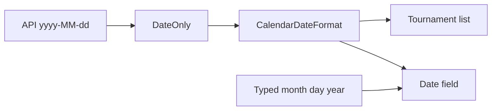

# US date format plan

Follows the spec in [spec.md](spec.md). This slice changes only how the Blazor app shows and accepts calendar dates. The API, the domain, and Postgres stay as they are.

One shared pattern formats and parses every director-facing calendar date: `MM'/'dd'/'yyyy` with `CultureInfo.InvariantCulture`. The quotes keep the slashes literal. An unquoted `/` in a .NET format string is the current culture's date separator, so a locale that uses `.` would show `09.01.2026`. Invariant culture plus the quoted pattern keeps `09/01/2026` as September 1, 2026, and `02/03/2026` as February 3, even when the current culture is day-first.

## Order

1. Add the shared pattern, then point the date field and the tournament list at it.
2. Update the date-field tests, including a day-first culture.
3. Update the tournament list and editor tests that still type or expect `yyyy-MM-dd`.
4. Leave API tests and every project outside the Blazor app unchanged.

## Files

- [src/CourtFlow.Web/CalendarDateFormat.cs](../../src/CourtFlow.Web/CalendarDateFormat.cs) — new. Holds the pattern `MM'/'dd'/'yyyy`, the placeholder `mm/dd/yyyy`, invariant culture, and `Display(DateOnly)`.
- [src/CourtFlow.Web/Components/CfDateField.razor](../../src/CourtFlow.Web/Components/CfDateField.razor) — `DateFormat`, `Culture`, and `Placeholder` come from `CalendarDateFormat`. The placeholder is the constant `mm/dd/yyyy`, not the format string lowercased, because the format quotes its slashes. The field stays editable and does not gain a date mask. Parsing stays in MudBlazor's date picker: .NET accepts one or two digits for `MM` and `dd`, requires four digits for `yyyy`, and rejects impossible dates.
- [src/CourtFlow.Web/Pages/TournamentList.razor](../../src/CourtFlow.Web/Pages/TournamentList.razor) — start and end cells call `CalendarDateFormat.Display`. The `DataLabel` values stay "Start date" and "End date".
- [src/CourtFlow.Web.Tests/WrapperTests.cs](../../src/CourtFlow.Web.Tests/WrapperTests.cs) — date-field expectations below.
- [src/CourtFlow.Web.Tests/TournamentPageTests.cs](../../src/CourtFlow.Web.Tests/TournamentPageTests.cs) — list text and the dates passed to `Fill`.

Do not change [src/CourtFlow.Api](../../src/CourtFlow.Api), [src/CourtFlow.Domain](../../src/CourtFlow.Domain), [src/CourtFlow.Infrastructure](../../src/CourtFlow.Infrastructure), or [src/CourtFlow.Api.Tests](../../src/CourtFlow.Api.Tests). `TournamentRequest` still carries `DateOnly`, and the API still serializes it as `yyyy-MM-dd`.

## Tests

Date field, in [src/CourtFlow.Web.Tests/WrapperTests.cs](../../src/CourtFlow.Web.Tests/WrapperTests.cs):

- September 3, 2026 shows `09/03/2026`. The empty field's placeholder is `mm/dd/yyyy`.
- Typing `09/01/2026` or `9/1/2026` yields September 1, 2026, and the field then shows `09/01/2026`.
- Typing `02/03/2026` yields February 3, 2026.
- Typing `13/01/2026`, `02/31/2026`, `09/01/26`, or `2026-09-01` does not yield a date.
- Clearing the input yields an empty date.
- With the current culture set to `de-DE`, September 1 still shows `09/01/2026`, and `02/03/2026` is still February 3.
- Setting the picker's date to September 1, 2026 shows `09/01/2026` and yields that calendar date. This stands in for choosing the day on the calendar.

Tournament list and editor, in [src/CourtFlow.Web.Tests/TournamentPageTests.cs](../../src/CourtFlow.Web.Tests/TournamentPageTests.cs):

- `List_shows_name_dates_time_zone_and_duration` expects `09/01/2026` and `09/03/2026`.
- `Fill` uses US dates: `09/01/2026`, `09/03/2026`, `09/05/2026`, and `09/06/2026` in the five-day warning tests.
- `Saving_a_create_opens_the_new_tournament_and_says_saved` asserts `LastSaved` is September 1 through September 3, 2026. The five-day warning tests still compare those calendar dates, not the display text.

Existing API tests that send `yyyy-MM-dd` are not edited and must still pass.

## No test

- Clicking a day inside the calendar popup. The picker binding is tested by setting its date.
- The phone layout's "Start date" and "End date" labels. Those `DataLabel` attributes do not change.
- A blank date cell. A saved tournament always has both dates, and the list has no such row.
- A new API or database test. Storage and the wire format do not change; current API tests remain the check.
- Any later director screen. None shows a calendar date today. The shared `CalendarDateFormat` is what keeps the next one on this pattern.

## Not in this slice

A `DateMask` of `MM/dd/yyyy`. The spec accepts a single-digit month or day while typing. Dates use the pattern in the spec, including on the tournament list. Schedule times, public event dates, the clone dialog, and print headers are not in this slice.
